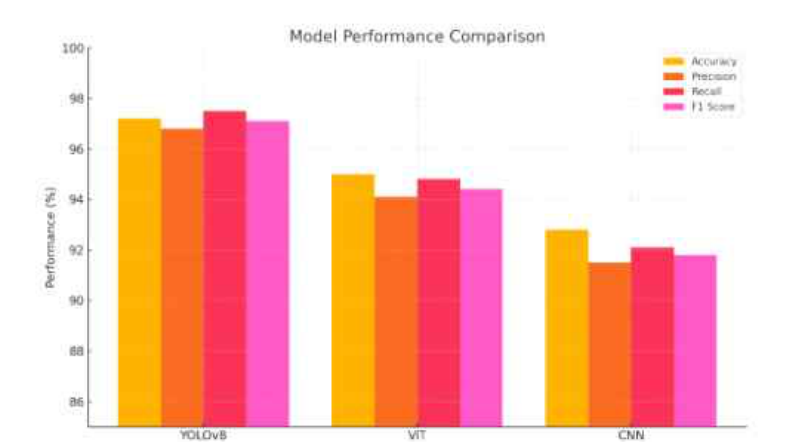
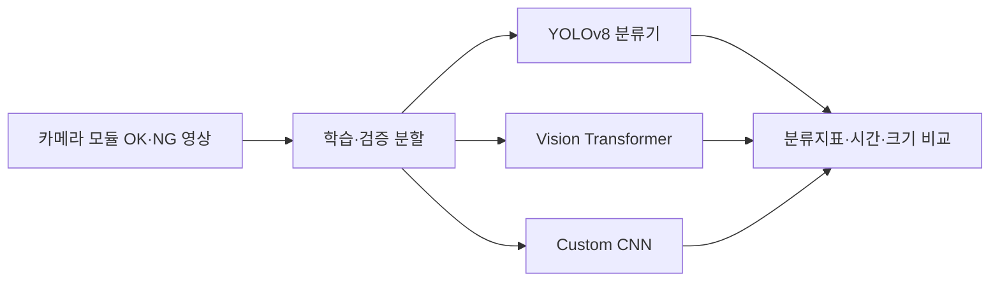

<div align="center">

<a name="카메라-모듈-정상불량-영상-분류"></a>

# 🔬 카메라 모듈 정상·불량 영상 분류

**Camera-Module-Anomaly-Project**

**기술 분류:** 컴퓨터 비전 › 딥러닝 영상 분류 › CNN·Vision Transformer 비교

<a name="카메라-모듈-정상불량-영상-분류-비교"></a>

### 🔎 카메라 모듈 정상·불량 영상 분류 비교
<a name="performance-comparison-of-image-based-deep-learning-models-for-anomaly-detection-in-camera-modules-of-smart-device"></a>

### 🔎 Performance Comparison of Image-Based Deep Learning Models for Anomaly Detection in Camera Modules of Smart Device

**YOLOv8 분류 · Vision Transformer · Custom CNN**

스마트 장치 카메라 모듈의 정상(OK)·불량(NG) 이미지를 대상으로 세 가지 분류 모델을 비교한 개인 연구 원고입니다. 분류 성능과 처리 시간, 모델 크기를 함께 검토합니다.<br>

 

[원고 읽기](#quick-start) · [저장소 구성](#structure) · [자료·설정](#data)

[예시 이미지](#preview)

</div>

<a name="preview"></a>

## 🖼️ 예시로 보기

<p align="center"></p>

**논문 그림** — 공개 원고 5쪽의 모델 성능 비교 그림입니다. 원고에 보고된 분류 지표이며 새로 실행한 결과가 아닙니다. 그래프의 막대와 본문·표의 수치가 모두 일치하지 않으므로, 정확한 값을 인용할 때는 아래의 불일치 설명도 함께 확인해 주세요.

[근거 파일 보기](%EB%85%BC%EB%AC%B8/%EC%B5%9C%EC%A2%85_%EB%85%BC%EB%AC%B8.pdf)


<a name="input-processing-output"></a>

## 🔄 입력·처리·출력

| 단계 | 이 프로젝트에서 다루는 내용 |
| :--- | :--- |
| 입력 | 정상·불량 카메라 모듈 영상 |
| 처리 | 원고에서 YOLO·ViT·CNN 분류 성능과 처리시간 비교 |
| 출력 | F1·처리시간 비교표와 그래프 |


---

## ✨ 프로젝트 소개

저자: **곽윤석**

원고에 「곽윤석 개인논문」으로 표시되어 있습니다. 특정 학회 게재나 출판 완료는 확인되지 않았습니다.

| 항목 | 원고에서 다루는 내용 |
|---|---|
| 이진 분류 비교 | YOLOv8 분류기, 사전학습 ViT, 자체 CNN을 비교합니다. |
| 데이터 구성 | 약 2,000장의 OK/NG 영상과 80:20 학습·검증 분할을 서술합니다. |
| 정량 지표 | 정확도·정밀도·재현율·F1과 처리시간·모델크기를 비교합니다. |
| 오류 사례 | 금속 표면의 흠집과 오염 영상에 대한 예측 사례를 설명합니다. |



<a name="structure"></a>
## 📁 저장소 구성

```text
.
├── README.md
├── CHANGELOG.md
└── 논문/
    └── 최종_논문.pdf
```

- [전체 최종 원고](논문/최종_논문.pdf)

## 🧩 원고의 모델 구성

YOLOv8은 입력 크기 64, 배치 32, 최대 3,000에폭을 설명합니다. ViT에는 `google/vit-base-patch16-224-in21k`를, 커스텀 CNN에는 세 개의 합성곱·풀링 블록과 완전연결층을 사용했다고 기술합니다. ViT/CNN 입력 전처리 설명은 224×224입니다. 같은 입력 크기의 모델 비교라고 단정하지 않습니다.

<a name="quick-start"></a>
## 🚀 원고 읽기

1. 위의 최종 원고 링크를 엽니다.
2. 서론의 연구 질문과 방법을 먼저 읽습니다.
3. 결과표와 함께 한계·후속 연구를 확인합니다.

이 저장소에는 실행 코드가 없어 원고를 내려받아 읽으면 됩니다. 기존 원본 폴더 조사에서도 지정한 코드 확장자의 일반 파일은 찾지 못했습니다. 다만 압축 파일 내부까지 조사한 것은 아닙니다.

<a name="data"></a>
## 📊 자료 구성과 결과 해석

원고 안의 부품 예시와 연구 도표를 보존합니다. 제조 영상 원데이터 전체, 모델 가중치와 학습 로그는 제공하지 않습니다. 데이터 폴더 삭제·재생성을 설명하는 문장이 있으므로 원고의 코드 조각을 원본 자료가 있는 경로에서 바로 실행하지 마세요.

<a name="원고가-보고한-결과와-한계"></a>

### 🔎 원고가 보고한 결과와 한계

원고 5쪽 표와 6쪽 결론은 YOLOv8 F1 0.972·12ms, ViT 0.958·28ms, CNN 0.943·22ms를 보고합니다. 6쪽의 모델 크기는 각각 약 15MB·380MB·4MB입니다. 이는 원고의 보고값이며 이 저장소에서 재실행해 확인한 성능이 아닙니다.

5쪽 문단의 YOLOv8 F1 0.977은 같은 쪽 표의 0.972와 다릅니다. ViT 조기종료도 적용했다는 문장과 제거했다는 구현 설명이 함께 있으며, 시간 그래프와 표의 수치도 일부 다릅니다. 결과를 인용할 때 해당 위치와 불일치를 함께 확인해야 합니다.

자료는 단일 공정 장비의 OK/NG 영상으로 한정됩니다. 다중 결함 분류, 다른 조명·배경, 실제 생산라인 연동과 경량화·양자화는 후속 연구 방향이며 완료된 검증으로 보지 않습니다.

## 🛠 문제 해결

| 상황 | 확인할 내용 |
|---|---|
| 표와 본문 수치가 다릅니다. | F1·시간 값의 불일치는 원고에 존재합니다. 이 저장소에서 임의로 원고 수치를 고치지 않습니다. |
| 분류 코드를 실행하고 싶습니다. | 원고의 구현 설명과 실행 가능한 코드 패키지는 구분합니다. 설치·실행 명령을 보장하지 않습니다. |
| 독립 테스트 결과인가요? | 원고는 80:20 학습·검증 분할을 설명합니다. 별도 외부 테스트나 생산라인 검증 완료로 확대하지 않습니다. |

<div align="center">

연구 방법과 결과, 다음에 확인할 과제를 함께 살펴볼 수 있습니다.

</div>
