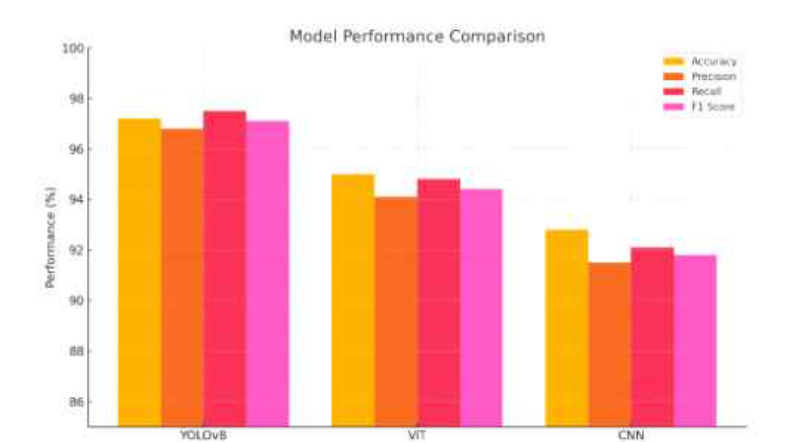

# 문서 읽기 레벨 구성 전체 비교

기준 커밋: `b4aa191ccae7980e625e78bacbd9c6dfe88e8a4c`

기존 Markdown의 모든 수정 줄과 새 수준별 안내 전문을 비교합니다. 줄바꿈·공백 차이는 원문 Git 비교로도 확인할 수 있습니다. 새 변경 기록과 이 비교 문서 자체는 비교 대상에서 제외했습니다. 코드·데이터·논문·이미지와 나머지 파일은 기준 커밋과 같습니다.

````````````diff
--- a/README.md
+++ b/README.md
@@ -6,7 +6,17 @@
 
 # Camera Module Anomaly Project
 
-YOLO·ViT·CNN으로 카메라 모듈의 정상·불량 분류 성능과 처리시간을 비교한 연구입니다.
+**YOLO·ViT·CNN으로 카메라 모듈의 정상·불량 분류 성능과 처리시간을 비교한 연구입니다.**
+
+<!-- reading-levels17:start -->
+| 읽기 수준 | 안내 내용 |
+| --- | --- |
+| [LEVEL 1 - Beginner](docs/%EC%9D%BD%EA%B8%B0%EC%95%88%EB%82%B4/%EB%A0%88%EB%B2%A81.md) | 낯선 용어를 풀고 입력부터 결과까지 구체적인 예로 읽기 |
+| [LEVEL 2 - Explorer](docs/%EC%9D%BD%EA%B8%B0%EC%95%88%EB%82%B4/%EB%A0%88%EB%B2%A82.md) | 핵심 개념과 처리 흐름의 관계 이해 |
+| [LEVEL 3 - Practitioner](docs/%EC%9D%BD%EA%B8%B0%EC%95%88%EB%82%B4/%EB%A0%88%EB%B2%A83.md) | 실험·사용 절차와 결과 해석 따라가기 |
+| [LEVEL 4 - Advanced](docs/%EC%9D%BD%EA%B8%B0%EC%95%88%EB%82%B4/%EB%A0%88%EB%B2%A84.md) | 코드 구조·설정·설계 선택과 제약 검토 |
+| [LEVEL 5 - Expert](docs/%EC%9D%BD%EA%B8%B0%EC%95%88%EB%82%B4/%EB%A0%88%EB%B2%A85.md) | 논문·프로토콜·분모·누수·미검증 범위 대조 |
+<!-- reading-levels17:end -->
 
 분야: 컴퓨터 비전 › 딥러닝 영상 분류 › CNN·Vision Transformer 비교
 

--- a/docs/PAPERS.md
+++ b/docs/PAPERS.md
@@ -2,7 +2,11 @@
 
 # 논문과 최신 자료
 
-논문은 각 연구의 최종 전체본을 수록했습니다. 발표·대본·연구노트는 문서 목적을 구분해 연결합니다. 원문의 저자·소속·이메일·사진과 본문을 그대로 보존했습니다.
+<!-- reading-levels17:start -->
+**읽기 수준 선택** · [LEVEL 1 - Beginner](%EC%9D%BD%EA%B8%B0%EC%95%88%EB%82%B4/%EB%A0%88%EB%B2%A81.md) · [LEVEL 2 - Explorer](%EC%9D%BD%EA%B8%B0%EC%95%88%EB%82%B4/%EB%A0%88%EB%B2%A82.md) · [LEVEL 3 - Practitioner](%EC%9D%BD%EA%B8%B0%EC%95%88%EB%82%B4/%EB%A0%88%EB%B2%A83.md) · [LEVEL 4 - Advanced](%EC%9D%BD%EA%B8%B0%EC%95%88%EB%82%B4/%EB%A0%88%EB%B2%A84.md) · [LEVEL 5 - Expert](%EC%9D%BD%EA%B8%B0%EC%95%88%EB%82%B4/%EB%A0%88%EB%B2%A85.md)
+<!-- reading-levels17:end -->
+
+**논문은 각 연구의 최종 전체본을 수록했습니다.** 발표·대본·연구노트는 문서 목적을 구분해 연결합니다. 원문의 저자·소속·이메일·사진과 본문을 그대로 보존했습니다.
 
 | 자료 | 원문 파일 |
 |---|---|

--- a/docs/REVISION_INDEX.md
+++ b/docs/REVISION_INDEX.md
@@ -2,7 +2,11 @@
 
 # 전체 차수
 
-연구 원고·실험 코드·발표 자료의 목적과 사용 순서를 단계별로 살펴봅니다.
+<!-- reading-levels17:start -->
+**읽기 수준 선택** · [LEVEL 1 - Beginner](%EC%9D%BD%EA%B8%B0%EC%95%88%EB%82%B4/%EB%A0%88%EB%B2%A81.md) · [LEVEL 2 - Explorer](%EC%9D%BD%EA%B8%B0%EC%95%88%EB%82%B4/%EB%A0%88%EB%B2%A82.md) · [LEVEL 3 - Practitioner](%EC%9D%BD%EA%B8%B0%EC%95%88%EB%82%B4/%EB%A0%88%EB%B2%A83.md) · [LEVEL 4 - Advanced](%EC%9D%BD%EA%B8%B0%EC%95%88%EB%82%B4/%EB%A0%88%EB%B2%A84.md) · [LEVEL 5 - Expert](%EC%9D%BD%EA%B8%B0%EC%95%88%EB%82%B4/%EB%A0%88%EB%B2%A85.md)
+<!-- reading-levels17:end -->
+
+**연구 원고·실험 코드·발표 자료의 목적과 사용 순서를 단계별로 살펴봅니다.**
 
 [프로젝트 전체 소개](../README.md)
 

--- a/docs/VERSIONS.md
+++ b/docs/VERSIONS.md
@@ -1,6 +1,10 @@
 <a id="-연구-자료"></a>
 
 # 연구 자료
+
+<!-- reading-levels17:start -->
+**읽기 수준 선택** · [LEVEL 1 - Beginner](%EC%9D%BD%EA%B8%B0%EC%95%88%EB%82%B4/%EB%A0%88%EB%B2%A81.md) · [LEVEL 2 - Explorer](%EC%9D%BD%EA%B8%B0%EC%95%88%EB%82%B4/%EB%A0%88%EB%B2%A82.md) · [LEVEL 3 - Practitioner](%EC%9D%BD%EA%B8%B0%EC%95%88%EB%82%B4/%EB%A0%88%EB%B2%A83.md) · [LEVEL 4 - Advanced](%EC%9D%BD%EA%B8%B0%EC%95%88%EB%82%B4/%EB%A0%88%EB%B2%A84.md) · [LEVEL 5 - Expert](%EC%9D%BD%EA%B8%B0%EC%95%88%EB%82%B4/%EB%A0%88%EB%B2%A85.md)
+<!-- reading-levels17:end -->
 
 | 자료 | 목적과 내용 | 근거 |
 |---|---|---|
@@ -16,4 +20,4 @@
 |---|---|---|
 | [최종 원고](versions/final-paper.md) | 원고만 공개 | 이 저장소는 최종 원고 한 편을 공개합니다. 연구 방법과 처리 흐름을 원고에 정리했습니다. |
 
-연구 내용별로 원고의 해당 본문을 연결했습니다.
+**연구 내용별로 원고의 해당 본문을 연결했습니다.**

--- a/docs/latest/camera-module-binary-classification.md
+++ b/docs/latest/camera-module-binary-classification.md
@@ -2,7 +2,11 @@
 
 # 스마트 장치의 카메라 모듈에 대한 이미지 기반 딥러닝 모델의 이미지 이상 탐지 성능 비교 분석
 
-스마트 장치의 카메라 모듈 영상을 정상·불량으로 분류할 때 YOLOv8·Vision Transformer·자체 CNN의 성능과 처리 비용을 비교한 7쪽 연구 원고입니다.
+<!-- reading-levels17:start -->
+**읽기 수준 선택** · [LEVEL 1 - Beginner](../%EC%9D%BD%EA%B8%B0%EC%95%88%EB%82%B4/%EB%A0%88%EB%B2%A81.md) · [LEVEL 2 - Explorer](../%EC%9D%BD%EA%B8%B0%EC%95%88%EB%82%B4/%EB%A0%88%EB%B2%A82.md) · [LEVEL 3 - Practitioner](../%EC%9D%BD%EA%B8%B0%EC%95%88%EB%82%B4/%EB%A0%88%EB%B2%A83.md) · [LEVEL 4 - Advanced](../%EC%9D%BD%EA%B8%B0%EC%95%88%EB%82%B4/%EB%A0%88%EB%B2%A84.md) · [LEVEL 5 - Expert](../%EC%9D%BD%EA%B8%B0%EC%95%88%EB%82%B4/%EB%A0%88%EB%B2%A85.md)
+<!-- reading-levels17:end -->
+
+**스마트 장치의 카메라 모듈 영상을 정상·불량으로 분류할 때 YOLOv8·Vision Transformer·자체 CNN의 성능과 처리 비용을 비교한 7쪽 연구 원고입니다.**
 
 [목적·구성·사용법·결과의 상세 안내](../versions/final-paper.md) · [프로젝트](../../README.md) · [전체 차수](../REVISION_INDEX.md)
 

--- a/docs/versions/final-paper.md
+++ b/docs/versions/final-paper.md
@@ -2,25 +2,75 @@
 
 # 최종 원고 · 카메라 모듈 정상·불량 분류
 
+<!-- reading-levels17:start -->
+**읽기 수준 선택** · [LEVEL 1 - Beginner](#reading-level-1) · [LEVEL 2 - Explorer](#reading-level-2) · [LEVEL 3 - Practitioner](#reading-level-3) · [LEVEL 4 - Advanced](#reading-level-4) · [LEVEL 5 - Expert](#reading-level-5)
+
+<a id="reading-level-1"></a>
+
+## LEVEL 1 - Beginner
+
+<!-- semantic-revision17:level-1:start -->
+
+<a id="semantic-classification-level-1"></a>
+
+### LEVEL 1 · 자료 분할과 세 분류기의 비교
+
+**학습 사진과 확인 사진은 역할이 다릅니다.** 모델이 본 사진에서만 잘 맞추는 것과 새 사진에서도 잘 맞추는 것은 다릅니다. 먼저 정상·불량 예시를 보고 80:20의 두 묶음을 구분한 다음, 불량을 놓치는 경우와 정상 사진을 잘못 지목하는 경우를 나누어 표를 읽으세요.
+
+| 조건·자료 | 의미와 확인 방법 |
+| --- | --- |
+| 약 2,000장 OK/NG·80:20 | OK는 정상, NG는 불량입니다. 사진의 약 80%는 모델이 규칙을 배우는 데, 나머지 약 20%는 그 규칙을 확인하는 데 씁니다. 별도 외부 공장 시험을 뜻하지 않습니다. |
+| YOLOv8·ViT·자체 CNN | 세 모델 모두 사진 전체를 정상/불량으로 분류합니다. 볼 위치를 찾는 탐지 결과와 구분합니다. 금속 표면 흠집·오염의 예시가 모든 결함 종류를 포괄하지는 않습니다. |
+| 정확도·정밀도·재현율·F1 | 정확도는 전체 판정, 정밀도는 불량으로 지목한 것의 적중, 재현율은 실제 불량을 찾은 정도를 봅니다. F1은 정밀도와 재현율을 함께 요약하지만 오류 종류를 없애지는 않습니다. |
+
+<a id="semantic-models-level-1"></a>
+
+### LEVEL 1 · 입력 크기와 학습 설정의 의미
+
+사진을 크게 보는 모델과 작게 보는 모델은 받는 정보량부터 다를 수 있습니다. **64와 224×224를 같은 입력이라고 읽지 마세요.** 한 번에 보는 묶음과 전체 반복 한도, 중간에 멈추는 규칙을 따로 확인하면 학습 설정의 뜻을 이해할 수 있습니다.
+
+| 조건·자료 | 의미와 확인 방법 |
+| --- | --- |
+| YOLOv8 입력 64·batch32 | 입력 크기는 모델에 넣을 사진의 크기 설정, batch32는 한 번의 갱신에 묶는 사진 수입니다. 원고 호출의 설정이지 모든 모델의 공통 설정은 아닙니다. |
+| 최대 3,000epoch·patience100 | epoch는 학습 자료를 반복해 보는 단위입니다. 3,000은 최대 반복 한도이고 patience100은 개선을 기다린 뒤 일찍 멈추는 설정입니다. 실제 3,000회를 모두 완료했다는 뜻은 아닙니다. |
+| ViT 224×224·google/vit-base-patch16-224-in21k | 사전학습된 Vision Transformer를 분류에 이용합니다. YOLO 입력64와 같게 줄인 사진의 비교가 아닙니다. |
+| 자체 CNN 224×224·합성곱/풀링 3블록·완전연결층 | 합성곱이 무늬를 찾고 풀링이 공간 정보를 줄인 뒤 완전연결층이 분류합니다. 원고의 구성 설명이며 실행 패키지가 제공됐다는 뜻은 아닙니다. |
+
+<a id="semantic-cost-level-1"></a>
+
+### LEVEL 1 · F1·속도·용량을 함께 읽기
+
+정답을 잘 맞추는 정도, 한 번 처리하는 데 걸리는 시간, 저장에 필요한 크기는 다른 질문입니다. **F1 0.972를 처리시간이나 생산라인 정확도로 바꾸지 않습니다.** 먼저 세 모델의 같은 열을 비교하고 원고 표의 보고값이라는 점을 확인하세요.
+
+| 조건·자료 | 의미와 확인 방법 |
+| --- | --- |
+| 5쪽 표·6쪽 결론의 YOLOv8 | F1 0.972·12ms·약 15MB입니다. F1은 분류 지표, ms는 처리시간, MB는 모델 크기라 서로 다른 성질을 뜻합니다. |
+| 같은 보고의 ViT | F1 0.958·28ms·약 380MB입니다. 더 큰 모델이 이 표에서 더 높은 F1을 얻은 것은 아닙니다. |
+| 같은 보고의 CNN | F1 0.943·22ms·약 4MB입니다. 작은 저장 크기와 분류 지표를 함께 비교하되 다른 장비에서도 이 시간이 유지된다고 보장하지 않습니다. |
+| 자료 범위 | 원고 PDF·같은 판 편집 원본·부품 예시·연구 도표를 제공합니다. 제조 원영상 전체·가중치·학습 로그·완성된 검사 실행 패키지는 제공하지 않습니다. |
+
+<a id="semantic-conflicts-level-1"></a>
+
+### LEVEL 1 · 원고 내부 차이와 재실행의 경계
+
+**같은 원고 안에서도 숫자나 학습 설명이 다를 수 있습니다.** 표를 인용했다면 표의 값과 위치를 적고 옆 문단의 차이도 함께 알리세요. 코드가 적혀 있다는 이유로 설치 가능한 검사 앱이라고 생각하거나 원본 폴더에서 바로 실행하지 않습니다.
+
+| 조건·자료 | 의미와 확인 방법 |
+| --- | --- |
+| F1 위치별 차이 | 5쪽 문단은 YOLOv8 F1 0.977, 같은 쪽 표는 0.972입니다. 둘 중 하나를 새 정답으로 골라 원문을 고치지 않습니다. |
+| ViT 조기종료·시간 | 조기종료를 적용했다는 문장과 제거했다는 구현 설명이 함께 있습니다. 시간 그래프와 표에도 차이가 있어 인용 위치를 함께 확인합니다. |
+| 원고 코드 조각 | 데이터 폴더 삭제·재생성을 설명하는 부분이 있습니다. 원본 자료가 있는 경로에서 그대로 실행하지 말고 코드의 경로와 실제 제공 범위를 먼저 확인해야 합니다. |
+| 후속 과제 | 다른 공정·조명·배경, 다중 결함 분류, 생산라인 연동, 경량화·양자화는 추가 검증 대상입니다. 원고의 80:20 내부 검증으로 완료 처리하지 않습니다. |
+
+<!-- semantic-revision17:level-1:end -->
+
+[이 수준의 프로젝트 전체 안내](../%EC%9D%BD%EA%B8%B0%EC%95%88%EB%82%B4/%EB%A0%88%EB%B2%A81.md) · [같은 수준 프로필](https://github.com/PUVKID/PUVKID/blob/main/docs/읽기안내/레벨1.md)
+
+### LEVEL 1 · 목적과 대상
+
+**이 차수의 목적과 실제 구성**
+
 스마트 장치의 카메라 모듈 영상을 정상·불량으로 분류할 때 YOLOv8·Vision Transformer·자체 CNN의 성능과 처리 비용을 비교한 7쪽 연구 원고입니다.
-
-분야: 컴퓨터 비전 › 제조 영상 이진 분류 › YOLOv8·ViT·CNN 비교
-
-[목적](#purpose) · [기능](#features) · [입출력](#flow) · [구성](#files) · [준비](#setup) · [사용법](#usage) · [결과](#results) · [제약](#limits) · [변경](#changes)
-
-<a name="purpose"></a>
-
-<a id="-이-단계에서-하는-일"></a>
-
-## 연구 목적
-
-각 모델의 입력 전처리, 학습 설정과 분류 지표를 함께 읽는 것이 핵심입니다. 이진 영상 분류 연구이므로 볼의 위치와 개수를 검출하는 다른 연구의 경계상자 평가와 구분합니다.
-
-<a name="features"></a>
-
-<a id="-주요-기능과-처리-방식"></a>
-
-## 방법과 구현
 
 | 구성 | 실제 역할 |
 | --- | --- |
@@ -29,11 +79,17 @@
 | ViT와 CNN 비교 | 사전학습 ViT와 합성곱·풀링·완전연결층 CNN을 분류 지표로 비교합니다. |
 | 성능과 비용 해석 | 정확도·정밀도·재현율·F1과 처리시간·모델 크기를 함께 제시합니다. |
 
-<a name="flow"></a>
-
-<a id="-입력--처리--출력"></a>
-
-## 입력·처리·출력
+카메라 모듈 사진 한 장을 보고 정상(OK)과 불량(NG)을 구분하는 연구입니다. 사진에서 볼의 위치를 찾는 다른 연구와 달리, 여기서는 사진 전체에 어느 분류 이름을 붙이는지 비교합니다. **제공 자료는 모델 비교 원고**이며 완성된 공장 검사 앱은 아닙니다.
+
+### LEVEL 1 · 달라진 내용과 차수 관계
+
+일반 제조 결함에서 카메라 모듈 정상·불량 비교로 정리한 최종 원고입니다. 현재 첨부는 최종 PDF와 같은 판의 편집 원문으로 연결합니다.
+
+[직전 단계 전체 비교·구성](../VERSIONS.md)
+
+OK는 정상, NG는 불량을 뜻합니다. 사람이 사진을 하나씩 확인하는 일을 분류기로 보조하려는 문제입니다. 정밀도·재현율은 서로 다른 오류를 보는 수치이므로 어느 한 점수만 높다고 모든 불량을 잘 찾았다고 읽지 않습니다.
+
+### LEVEL 1 · 입력과 실행 조건
 
 | 입력 | 처리 | 출력 |
 | --- | --- | --- |
@@ -41,23 +97,6 @@
 | YOLOv8·ViT·CNN | 각 모델 학습과 검증 | 정상·불량 예측 및 분류 지표 |
 | 모델별 예측·비용 | 표·그래프 비교 | 모델 선택의 장단점과 후속 연구 방향 |
 
-<a name="files"></a>
-
-<a id="-파일과-핵심-처리"></a>
-
-## 파일별 역할
-
-| 파일 | 이용 방법 |
-| --- | --- |
-| [논문/최종_논문.pdf](../../%EB%85%BC%EB%AC%B8/%EC%B5%9C%EC%A2%85_%EB%85%BC%EB%AC%B8.pdf) | 전체 원문·도표 읽기 |
-| [논문/최종_논문.hwp](../../%EB%85%BC%EB%AC%B8/%EC%B5%9C%EC%A2%85_%EB%85%BC%EB%AC%B8.hwp) | 같은 판의 편집 원본 |
-
-<a name="setup"></a>
-
-<a id="️-환경과-설정"></a>
-
-## 실행 환경과 설정
-
 | 항목 | 조건·기본값 |
 | --- | --- |
 | 분할 | 학습 80%·검증 20% |
@@ -66,22 +105,18 @@
 | 최대 학습 | 3000epoch로 서술 |
 | 자료 | 원고 PDF와 같은 판의 HWP |
 
-<a name="usage"></a>
-
-<a id="-읽고-활용하는-순서"></a>
-
-## 원고 읽기
+입력은 카메라 모듈 영상입니다. 모델이 사용할 크기와 형태로 준비한 뒤 정상·불량을 예측하고, 정답과 맞춰 결과표를 만듭니다. 같은 사진 문제라도 모델마다 사진을 줄이는 크기가 같지는 않습니다.
+
+### LEVEL 1 · 처리 절차
 
 1. 초록과 데이터 구성에서 정상·불량 분류 문제와 분할을 확인합니다.
 2. 모델별 구현 설명을 읽으며 입력 크기와 학습 조건을 나란히 기록합니다.
 3. 5쪽 결과표와 그래프, 6쪽 결론의 수치를 대조합니다.
 4. 같은 조건의 외부 시험인지, 원고 내부 검증인지 구분한 뒤 결과를 인용합니다.
 
-<a name="results"></a>
-
-<a id="-결과를-읽는-방법"></a>
-
-## 결과와 해석
+먼저 원고의 정상·불량 예시와 세 모델 그림을 봅니다. 다음에 결과표의 모델 이름을 따라 F1, 시간, 크기를 읽습니다. 원고 속 코드 조각을 원본 자료가 있는 폴더에서 곧바로 실행하지 마세요. 데이터 폴더 삭제·재생성 설명이 포함되어 있습니다.
+
+### LEVEL 1 · 결과를 확인하는 방법
 
 원고 5쪽 표와 6쪽 결론의 보고값입니다.
 
@@ -93,11 +128,9 @@
 
 5쪽 문단의 YOLOv8 F1 0.977은 표의 0.972와 다릅니다. ViT 조기종료를 적용했다는 설명과 제거했다는 구현 설명도 함께 있어 해당 위치를 확인해야 합니다. 이 안내에서는 원고의 숫자나 문장을 임의로 고치지 않았습니다.
 
-<a name="limits"></a>
-
-<a id="️-알려진-제약과-확인-지점"></a>
-
-## 제약과 확인 사항
+F1은 잘 맞춘 정도를 한 숫자로 살피는 지표이며 1에 가까울수록 이 표에서는 좋게 읽습니다. 원고 표는 YOLOv8 0.972, ViT 0.958, CNN 0.943을 보고합니다. 이것은 원고의 보고값이며 이 안내를 작성하며 새로 측정한 결과가 아닙니다.
+
+### LEVEL 1 · 주의할 범위
 
 | 상황 | 확인할 내용 |
 | --- | --- |
@@ -106,6 +139,592 @@
 | 현장 일반화 | 다른 공정·조명·배경의 외부 테스트와 생산라인 연동은 후속 평가입니다. |
 | 재실행 | 공개 자료는 원고이며 학습 가중치·제조 원영상·실행 패키지는 별도로 필요합니다. |
 
+학습에 쓰인 공장과 다른 조명·배경에서도 같은 결과가 나오는지는 따로 확인해야 합니다. 원고 안에서도 숫자와 설명이 일부 다릅니다. **모든 제조 환경에 적용됐다는 결과는 아닙니다.**
+
+[표·코드·실행 설정·파일 전체 비교를 포함한 공통 상세](#reading-level-5)
+
+<a id="reading-level-2"></a>
+
+## LEVEL 2 - Explorer
+
+<!-- semantic-revision17:level-2:start -->
+
+<a id="semantic-classification-level-2"></a>
+
+### LEVEL 2 · 자료 분할과 세 분류기의 비교
+
+세 분류기에 같은 정상·불량 문제를 맡기고 지표·시간·크기를 함께 읽는 구성입니다. **분할은 모델을 배우게 하는 단계와 성능을 살피는 단계를 연결**합니다. 같은 데이터 비율을 썼다는 사실만으로 입력 전처리까지 같다고 결론낼 수는 없습니다.
+
+| 조건·자료 | 의미와 확인 방법 |
+| --- | --- |
+| 약 2,000장 OK/NG·80:20 | OK는 정상, NG는 불량입니다. 사진의 약 80%는 모델이 규칙을 배우는 데, 나머지 약 20%는 그 규칙을 확인하는 데 씁니다. 별도 외부 공장 시험을 뜻하지 않습니다. |
+| YOLOv8·ViT·자체 CNN | 세 모델 모두 사진 전체를 정상/불량으로 분류합니다. 볼 위치를 찾는 탐지 결과와 구분합니다. 금속 표면 흠집·오염의 예시가 모든 결함 종류를 포괄하지는 않습니다. |
+| 정확도·정밀도·재현율·F1 | 정확도는 전체 판정, 정밀도는 불량으로 지목한 것의 적중, 재현율은 실제 불량을 찾은 정도를 봅니다. F1은 정밀도와 재현율을 함께 요약하지만 오류 종류를 없애지는 않습니다. |
+
+<a id="semantic-models-level-2"></a>
+
+### LEVEL 2 · 입력 크기와 학습 설정의 의미
+
+YOLO 분류기, 사전학습 ViT, 자체 CNN은 정상·불량이라는 같은 출력을 서로 다른 처리 구조로 만듭니다. **전처리→모델→학습 정책**의 순서로 비교하면 입력 해상도와 최대 epoch가 결과 해석에 왜 필요한지 알 수 있습니다.
+
+| 조건·자료 | 의미와 확인 방법 |
+| --- | --- |
+| YOLOv8 입력 64·batch32 | 입력 크기는 모델에 넣을 사진의 크기 설정, batch32는 한 번의 갱신에 묶는 사진 수입니다. 원고 호출의 설정이지 모든 모델의 공통 설정은 아닙니다. |
+| 최대 3,000epoch·patience100 | epoch는 학습 자료를 반복해 보는 단위입니다. 3,000은 최대 반복 한도이고 patience100은 개선을 기다린 뒤 일찍 멈추는 설정입니다. 실제 3,000회를 모두 완료했다는 뜻은 아닙니다. |
+| ViT 224×224·google/vit-base-patch16-224-in21k | 사전학습된 Vision Transformer를 분류에 이용합니다. YOLO 입력64와 같게 줄인 사진의 비교가 아닙니다. |
+| 자체 CNN 224×224·합성곱/풀링 3블록·완전연결층 | 합성곱이 무늬를 찾고 풀링이 공간 정보를 줄인 뒤 완전연결층이 분류합니다. 원고의 구성 설명이며 실행 패키지가 제공됐다는 뜻은 아닙니다. |
+
+<a id="semantic-cost-level-2"></a>
+
+### LEVEL 2 · F1·속도·용량을 함께 읽기
+
+원고는 분류 품질과 처리 비용의 절충을 보여 줍니다. CNN은 작고 YOLOv8은 표에서 높은 F1과 짧은 시간을 보고하지만, 이 관계를 모든 장비로 넓힐 수 없습니다. 표의 각 열을 연결해 모델 선택의 관점을 읽습니다.
+
+| 조건·자료 | 의미와 확인 방법 |
+| --- | --- |
+| 5쪽 표·6쪽 결론의 YOLOv8 | F1 0.972·12ms·약 15MB입니다. F1은 분류 지표, ms는 처리시간, MB는 모델 크기라 서로 다른 성질을 뜻합니다. |
+| 같은 보고의 ViT | F1 0.958·28ms·약 380MB입니다. 더 큰 모델이 이 표에서 더 높은 F1을 얻은 것은 아닙니다. |
+| 같은 보고의 CNN | F1 0.943·22ms·약 4MB입니다. 작은 저장 크기와 분류 지표를 함께 비교하되 다른 장비에서도 이 시간이 유지된다고 보장하지 않습니다. |
+| 자료 범위 | 원고 PDF·같은 판 편집 원본·부품 예시·연구 도표를 제공합니다. 제조 원영상 전체·가중치·학습 로그·완성된 검사 실행 패키지는 제공하지 않습니다. |
+
+<a id="semantic-conflicts-level-2"></a>
+
+### LEVEL 2 · 원고 내부 차이와 재실행의 경계
+
+서술·표·그래프는 같은 실험을 설명해도 내용이 일치하는지 따로 확인해야 합니다. 조기종료의 상충은 학습이 언제 끝났는지 해석하는 데 영향을 줍니다. 재현 자료 부재와 현장 일반화 미검증은 서로 다른 한계입니다.
+
+| 조건·자료 | 의미와 확인 방법 |
+| --- | --- |
+| F1 위치별 차이 | 5쪽 문단은 YOLOv8 F1 0.977, 같은 쪽 표는 0.972입니다. 둘 중 하나를 새 정답으로 골라 원문을 고치지 않습니다. |
+| ViT 조기종료·시간 | 조기종료를 적용했다는 문장과 제거했다는 구현 설명이 함께 있습니다. 시간 그래프와 표에도 차이가 있어 인용 위치를 함께 확인합니다. |
+| 원고 코드 조각 | 데이터 폴더 삭제·재생성을 설명하는 부분이 있습니다. 원본 자료가 있는 경로에서 그대로 실행하지 말고 코드의 경로와 실제 제공 범위를 먼저 확인해야 합니다. |
+| 후속 과제 | 다른 공정·조명·배경, 다중 결함 분류, 생산라인 연동, 경량화·양자화는 추가 검증 대상입니다. 원고의 80:20 내부 검증으로 완료 처리하지 않습니다. |
+
+<!-- semantic-revision17:level-2:end -->
+
+[이 수준의 프로젝트 전체 안내](../%EC%9D%BD%EA%B8%B0%EC%95%88%EB%82%B4/%EB%A0%88%EB%B2%A82.md) · [같은 수준 프로필](https://github.com/PUVKID/PUVKID/blob/main/docs/읽기안내/레벨2.md)
+
+### LEVEL 2 · 목적과 대상
+
+**이 차수의 목적과 실제 구성**
+
+스마트 장치의 카메라 모듈 영상을 정상·불량으로 분류할 때 YOLOv8·Vision Transformer·자체 CNN의 성능과 처리 비용을 비교한 7쪽 연구 원고입니다.
+
+| 구성 | 실제 역할 |
+| --- | --- |
+| 정상·불량 데이터 구성 | OK/NG 영상을 학습 80%·검증 20%로 분할하는 실험을 설명합니다. |
+| YOLOv8 분류 | 원고의 학습 호출은 imgsz64·batch32·최대 3000epoch·patience100을 사용합니다. |
+| ViT와 CNN 비교 | 사전학습 ViT와 합성곱·풀링·완전연결층 CNN을 분류 지표로 비교합니다. |
+| 성능과 비용 해석 | 정확도·정밀도·재현율·F1과 처리시간·모델 크기를 함께 제시합니다. |
+
+YOLOv8 분류 모델, 사전학습 ViT, 직접 구성한 CNN을 같은 정상·불량 문제에서 비교합니다. 탐지 상자의 위치를 평가하는 연구가 아니라 이진 영상 분류입니다. 정확도만 보지 않고 처리시간과 모델 크기도 함께 읽는 구성이 핵심입니다.
+
+### LEVEL 2 · 달라진 내용과 차수 관계
+
+일반 제조 결함에서 카메라 모듈 정상·불량 비교로 정리한 최종 원고입니다. 현재 첨부는 최종 PDF와 같은 판의 편집 원문으로 연결합니다.
+
+[직전 단계 전체 비교·구성](../VERSIONS.md)
+
+정상·불량 영상을 학습용과 검증용으로 나누고 각 모델이 예측한 분류를 정답과 비교합니다. 정확도, 정밀도, 재현율, F1은 예측의 서로 다른 면을 설명합니다. 시간과 용량은 현장에 적용할 때 추가로 고려할 항목입니다.
+
+### LEVEL 2 · 입력과 실행 조건
+
+| 입력 | 처리 | 출력 |
+| --- | --- | --- |
+| 정상·불량 카메라 모듈 영상 | 학습·검증 분리와 모델별 전처리 | 각 분류기에 넣을 영상 |
+| YOLOv8·ViT·CNN | 각 모델 학습과 검증 | 정상·불량 예측 및 분류 지표 |
+| 모델별 예측·비용 | 표·그래프 비교 | 모델 선택의 장단점과 후속 연구 방향 |
+
+| 항목 | 조건·기본값 |
+| --- | --- |
+| 분할 | 학습 80%·검증 20% |
+| YOLOv8 입력 | 64·batch32 |
+| ViT/CNN 전처리 | 224×224 설명 |
+| 최대 학습 | 3000epoch로 서술 |
+| 자료 | 원고 PDF와 같은 판의 HWP |
+
+영상 준비 → 학습·검증 분리 → 모델별 전처리 → 학습·예측 → 분류 지표와 비용 비교 순서입니다. YOLO의 입력 크기는 64, ViT/CNN 전처리 설명은 224×224입니다. 이 차이를 처리 흐름의 일부로 읽습니다.
+
+### LEVEL 2 · 처리 절차
+
+1. 초록과 데이터 구성에서 정상·불량 분류 문제와 분할을 확인합니다.
+2. 모델별 구현 설명을 읽으며 입력 크기와 학습 조건을 나란히 기록합니다.
+3. 5쪽 결과표와 그래프, 6쪽 결론의 수치를 대조합니다.
+4. 같은 조건의 외부 시험인지, 원고 내부 검증인지 구분한 뒤 결과를 인용합니다.
+
+전체 PDF에서 데이터 구성, 모델 설정, 결과와 결론을 순서대로 읽습니다. 그래프와 표의 수치가 같은지 대조하고 서로 다르면 위치를 남깁니다. 학습용 자료와 가중치가 별도로 필요한 점도 확인합니다.
+
+### LEVEL 2 · 결과를 확인하는 방법
+
+원고 5쪽 표와 6쪽 결론의 보고값입니다.
+
+| 모델 | F1 | 처리시간 | 모델 크기 |
+| --- | ---: | ---: | ---: |
+| YOLOv8 | 0.972 | 12ms | 약 15MB |
+| ViT | 0.958 | 28ms | 약 380MB |
+| CNN | 0.943 | 22ms | 약 4MB |
+
+5쪽 문단의 YOLOv8 F1 0.977은 표의 0.972와 다릅니다. ViT 조기종료를 적용했다는 설명과 제거했다는 구현 설명도 함께 있어 해당 위치를 확인해야 합니다. 이 안내에서는 원고의 숫자나 문장을 임의로 고치지 않았습니다.
+
+표·결론의 YOLOv8 F1은 0.972·12ms, ViT는 0.958·28ms, CNN은 0.943·22ms입니다. 모델 크기는 약 15MB·380MB·4MB입니다. 모델 선택을 한 점수만으로 하지 않고 처리 비용도 함께 비교합니다.
+
+### LEVEL 2 · 주의할 범위
+
+| 상황 | 확인할 내용 |
+| --- | --- |
+| 지표 불일치 | 본문·표·시간 그래프에 차이가 있습니다. 인용 위치를 함께 적습니다. |
+| 모델 비교 조건 | YOLO64와 ViT/CNN224 전처리를 같은 입력 크기로 설명하지 않습니다. |
+| 현장 일반화 | 다른 공정·조명·배경의 외부 테스트와 생산라인 연동은 후속 평가입니다. |
+| 재실행 | 공개 자료는 원고이며 학습 가중치·제조 원영상·실행 패키지는 별도로 필요합니다. |
+
+데이터 분할의 결과를 다른 공정 일반화로 옮길 수는 없습니다. 표와 본문이 다른 부분, 입력 크기가 다른 부분, ViT 조기 종료의 상충 설명을 확인해야 합니다. 원고를 읽는 단계에서 이를 해결된 문제로 바꾸지 않습니다.
+
+[표·코드·실행 설정·파일 전체 비교를 포함한 공통 상세](#reading-level-5)
+
+<a id="reading-level-3"></a>
+
+## LEVEL 3 - Practitioner
+
+<!-- semantic-revision17:level-3:start -->
+
+<a id="semantic-classification-level-3"></a>
+
+### LEVEL 3 · 자료 분할과 세 분류기의 비교
+
+원고의 데이터 구성에서 약 2,000장과 80:20을 확인하고 모델별 전처리·학습 호출을 결과표에 대응시키세요. 정확도와 F1만 옮기지 말고 정밀도·재현율도 확인합니다. **원영상 전체가 없으므로 이 분할을 새로 재현한 결과로 보고하지 않습니다.**
+
+| 조건·자료 | 의미와 확인 방법 |
+| --- | --- |
+| 약 2,000장 OK/NG·80:20 | OK는 정상, NG는 불량입니다. 사진의 약 80%는 모델이 규칙을 배우는 데, 나머지 약 20%는 그 규칙을 확인하는 데 씁니다. 별도 외부 공장 시험을 뜻하지 않습니다. |
+| YOLOv8·ViT·자체 CNN | 세 모델 모두 사진 전체를 정상/불량으로 분류합니다. 볼 위치를 찾는 탐지 결과와 구분합니다. 금속 표면 흠집·오염의 예시가 모든 결함 종류를 포괄하지는 않습니다. |
+| 정확도·정밀도·재현율·F1 | 정확도는 전체 판정, 정밀도는 불량으로 지목한 것의 적중, 재현율은 실제 불량을 찾은 정도를 봅니다. F1은 정밀도와 재현율을 함께 요약하지만 오류 종류를 없애지는 않습니다. |
+
+<a id="semantic-models-level-3"></a>
+
+### LEVEL 3 · 입력 크기와 학습 설정의 의미
+
+원고 학습 호출의 imgsz64·batch32·3000epoch·patience100을 기록하고 ViT/CNN의 224×224 설명과 구분하세요. ViT 사전학습 식별자와 CNN 3블록도 함께 남깁니다. 최대 한도를 실제 종료 epoch로 바꾸어 기록하지 않습니다.
+
+| 조건·자료 | 의미와 확인 방법 |
+| --- | --- |
+| YOLOv8 입력 64·batch32 | 입력 크기는 모델에 넣을 사진의 크기 설정, batch32는 한 번의 갱신에 묶는 사진 수입니다. 원고 호출의 설정이지 모든 모델의 공통 설정은 아닙니다. |
+| 최대 3,000epoch·patience100 | epoch는 학습 자료를 반복해 보는 단위입니다. 3,000은 최대 반복 한도이고 patience100은 개선을 기다린 뒤 일찍 멈추는 설정입니다. 실제 3,000회를 모두 완료했다는 뜻은 아닙니다. |
+| ViT 224×224·google/vit-base-patch16-224-in21k | 사전학습된 Vision Transformer를 분류에 이용합니다. YOLO 입력64와 같게 줄인 사진의 비교가 아닙니다. |
+| 자체 CNN 224×224·합성곱/풀링 3블록·완전연결층 | 합성곱이 무늬를 찾고 풀링이 공간 정보를 줄인 뒤 완전연결층이 분류합니다. 원고의 구성 설명이며 실행 패키지가 제공됐다는 뜻은 아닙니다. |
+
+<a id="semantic-cost-level-3"></a>
+
+### LEVEL 3 · F1·속도·용량을 함께 읽기
+
+인용할 때 모델·F1·ms·MB·원고 위치를 함께 기록하세요. 다운로드한 원고를 읽은 일과 모델을 실행한 일을 구분합니다. 원영상·가중치·로그가 없어 독립 재측정은 이 저장소만으로 완료할 수 없습니다.
+
+| 조건·자료 | 의미와 확인 방법 |
+| --- | --- |
+| 5쪽 표·6쪽 결론의 YOLOv8 | F1 0.972·12ms·약 15MB입니다. F1은 분류 지표, ms는 처리시간, MB는 모델 크기라 서로 다른 성질을 뜻합니다. |
+| 같은 보고의 ViT | F1 0.958·28ms·약 380MB입니다. 더 큰 모델이 이 표에서 더 높은 F1을 얻은 것은 아닙니다. |
+| 같은 보고의 CNN | F1 0.943·22ms·약 4MB입니다. 작은 저장 크기와 분류 지표를 함께 비교하되 다른 장비에서도 이 시간이 유지된다고 보장하지 않습니다. |
+| 자료 범위 | 원고 PDF·같은 판 편집 원본·부품 예시·연구 도표를 제공합니다. 제조 원영상 전체·가중치·학습 로그·완성된 검사 실행 패키지는 제공하지 않습니다. |
+
+<a id="semantic-conflicts-level-3"></a>
+
+### LEVEL 3 · 원고 내부 차이와 재실행의 경계
+
+문제별로 확인점을 나눕니다. 수치 차이는 5쪽 문단/표와 시간 그림, 실행 요청은 코드의 삭제·재생성 경로와 원자료 부재, 독립 테스트 여부는 80:20 설명을 확인하세요. **실행 불가를 임의 설치 명령으로 채우지 않습니다.**
+
+| 조건·자료 | 의미와 확인 방법 |
+| --- | --- |
+| F1 위치별 차이 | 5쪽 문단은 YOLOv8 F1 0.977, 같은 쪽 표는 0.972입니다. 둘 중 하나를 새 정답으로 골라 원문을 고치지 않습니다. |
+| ViT 조기종료·시간 | 조기종료를 적용했다는 문장과 제거했다는 구현 설명이 함께 있습니다. 시간 그래프와 표에도 차이가 있어 인용 위치를 함께 확인합니다. |
+| 원고 코드 조각 | 데이터 폴더 삭제·재생성을 설명하는 부분이 있습니다. 원본 자료가 있는 경로에서 그대로 실행하지 말고 코드의 경로와 실제 제공 범위를 먼저 확인해야 합니다. |
+| 후속 과제 | 다른 공정·조명·배경, 다중 결함 분류, 생산라인 연동, 경량화·양자화는 추가 검증 대상입니다. 원고의 80:20 내부 검증으로 완료 처리하지 않습니다. |
+
+<!-- semantic-revision17:level-3:end -->
+
+[이 수준의 프로젝트 전체 안내](../%EC%9D%BD%EA%B8%B0%EC%95%88%EB%82%B4/%EB%A0%88%EB%B2%A83.md) · [같은 수준 프로필](https://github.com/PUVKID/PUVKID/blob/main/docs/읽기안내/레벨3.md)
+
+### LEVEL 3 · 목적과 대상
+
+**이 차수의 목적과 실제 구성**
+
+스마트 장치의 카메라 모듈 영상을 정상·불량으로 분류할 때 YOLOv8·Vision Transformer·자체 CNN의 성능과 처리 비용을 비교한 7쪽 연구 원고입니다.
+
+| 구성 | 실제 역할 |
+| --- | --- |
+| 정상·불량 데이터 구성 | OK/NG 영상을 학습 80%·검증 20%로 분할하는 실험을 설명합니다. |
+| YOLOv8 분류 | 원고의 학습 호출은 imgsz64·batch32·최대 3000epoch·patience100을 사용합니다. |
+| ViT와 CNN 비교 | 사전학습 ViT와 합성곱·풀링·완전연결층 CNN을 분류 지표로 비교합니다. |
+| 성능과 비용 해석 | 정확도·정밀도·재현율·F1과 처리시간·모델 크기를 함께 제시합니다. |
+
+원고의 설정과 결과표를 대조해 세 분류기의 차이를 검토하는 자료입니다. 제조 원영상과 학습 가중치가 제공되는 실행 패키지는 아닙니다. 재실행보다 먼저 입력 크기·분할·학습 조건이 모델별로 어떻게 다른지 확인해야 합니다.
+
+### LEVEL 3 · 달라진 내용과 차수 관계
+
+일반 제조 결함에서 카메라 모듈 정상·불량 비교로 정리한 최종 원고입니다. 현재 첨부는 최종 PDF와 같은 판의 편집 원문으로 연결합니다.
+
+[직전 단계 전체 비교·구성](../VERSIONS.md)
+
+분류 지표를 비교할 때 OK/NG의 분모와 오류 방향을 먼저 확인합니다. 원고의 지표 표와 혼동행렬을 대응해 읽고 F1과 처리시간을 같은 지표처럼 합치지 않습니다. 다른 공정에서의 검증은 원고 내부 비교와 구분합니다.
+
+### LEVEL 3 · 입력과 실행 조건
+
+| 입력 | 처리 | 출력 |
+| --- | --- | --- |
+| 정상·불량 카메라 모듈 영상 | 학습·검증 분리와 모델별 전처리 | 각 분류기에 넣을 영상 |
+| YOLOv8·ViT·CNN | 각 모델 학습과 검증 | 정상·불량 예측 및 분류 지표 |
+| 모델별 예측·비용 | 표·그래프 비교 | 모델 선택의 장단점과 후속 연구 방향 |
+
+| 항목 | 조건·기본값 |
+| --- | --- |
+| 분할 | 학습 80%·검증 20% |
+| YOLOv8 입력 | 64·batch32 |
+| ViT/CNN 전처리 | 224×224 설명 |
+| 최대 학습 | 3000epoch로 서술 |
+| 자료 | 원고 PDF와 같은 판의 HWP |
+
+원고의 데이터 준비 부분에서 분할 비율을 확인하고 모델별 설정표를 따로 만듭니다. YOLO의 imgsz64·batch32·최대 3000epoch·patience100과 ViT/CNN 입력을 비교합니다. 같은 설정으로 실험했다고 새로 가정하지 않습니다.
+
+### LEVEL 3 · 처리 절차
+
+1. 초록과 데이터 구성에서 정상·불량 분류 문제와 분할을 확인합니다.
+2. 모델별 구현 설명을 읽으며 입력 크기와 학습 조건을 나란히 기록합니다.
+3. 5쪽 결과표와 그래프, 6쪽 결론의 수치를 대조합니다.
+4. 같은 조건의 외부 시험인지, 원고 내부 검증인지 구분한 뒤 결과를 인용합니다.
+
+실행 재현에는 제조 영상·라벨·가중치·환경이 추가로 필요합니다. 공개 자료만 열람하는 것과 학습 호출을 실행하는 것은 다릅니다. 특히 원고의 파일 처리 예시는 별도 복사본에서 설정을 검토해야 하며, 이 안내 자체가 재학습 실행을 뜻하지 않습니다.
+
+### LEVEL 3 · 결과를 확인하는 방법
+
+원고 5쪽 표와 6쪽 결론의 보고값입니다.
+
+| 모델 | F1 | 처리시간 | 모델 크기 |
+| --- | ---: | ---: | ---: |
+| YOLOv8 | 0.972 | 12ms | 약 15MB |
+| ViT | 0.958 | 28ms | 약 380MB |
+| CNN | 0.943 | 22ms | 약 4MB |
+
+5쪽 문단의 YOLOv8 F1 0.977은 표의 0.972와 다릅니다. ViT 조기종료를 적용했다는 설명과 제거했다는 구현 설명도 함께 있어 해당 위치를 확인해야 합니다. 이 안내에서는 원고의 숫자나 문장을 임의로 고치지 않았습니다.
+
+결과표의 F1과 처리시간·크기를 모델별로 묶어 읽으세요. 5쪽 문단의 YOLOv8 F1 0.977과 표의 0.972가 다르므로 인용한 위치를 함께 적습니다. 정확한 하나의 값으로 임의 정정하거나 새로운 평균을 만들지 않습니다.
+
+### LEVEL 3 · 주의할 범위
+
+| 상황 | 확인할 내용 |
+| --- | --- |
+| 지표 불일치 | 본문·표·시간 그래프에 차이가 있습니다. 인용 위치를 함께 적습니다. |
+| 모델 비교 조건 | YOLO64와 ViT/CNN224 전처리를 같은 입력 크기로 설명하지 않습니다. |
+| 현장 일반화 | 다른 공정·조명·배경의 외부 테스트와 생산라인 연동은 후속 평가입니다. |
+| 재실행 | 공개 자료는 원고이며 학습 가중치·제조 원영상·실행 패키지는 별도로 필요합니다. |
+
+재실행 필수 자료가 없으므로 문헌의 보고값을 재측정값처럼 적지 않습니다. 모델 비교 시 각 전처리와 학습 조건을 옆에 두고, 외부 평가 부재와 시간 측정 범위의 한계를 함께 기록합니다.
+
+[표·코드·실행 설정·파일 전체 비교를 포함한 공통 상세](#reading-level-5)
+
+<a id="reading-level-4"></a>
+
+## LEVEL 4 - Advanced
+
+<!-- semantic-revision17:level-4:start -->
+
+<a id="semantic-classification-level-4"></a>
+
+### LEVEL 4 · 자료 분할과 세 분류기의 비교
+
+비교 단위는 영상 이진 분류기입니다. 입력 해상도와 학습 정책이 모델별로 달라 구조 자체의 효과와 전처리 효과가 섞일 수 있습니다. **흠집·오염 예시는 오류 해석의 근거**이며 다중 결함 위치 추정이나 현장 전체 결함 검증으로 확장하지 않습니다.
+
+| 조건·자료 | 의미와 확인 방법 |
+| --- | --- |
+| 약 2,000장 OK/NG·80:20 | OK는 정상, NG는 불량입니다. 사진의 약 80%는 모델이 규칙을 배우는 데, 나머지 약 20%는 그 규칙을 확인하는 데 씁니다. 별도 외부 공장 시험을 뜻하지 않습니다. |
+| YOLOv8·ViT·자체 CNN | 세 모델 모두 사진 전체를 정상/불량으로 분류합니다. 볼 위치를 찾는 탐지 결과와 구분합니다. 금속 표면 흠집·오염의 예시가 모든 결함 종류를 포괄하지는 않습니다. |
+| 정확도·정밀도·재현율·F1 | 정확도는 전체 판정, 정밀도는 불량으로 지목한 것의 적중, 재현율은 실제 불량을 찾은 정도를 봅니다. F1은 정밀도와 재현율을 함께 요약하지만 오류 종류를 없애지는 않습니다. |
+
+<a id="semantic-models-level-4"></a>
+
+### LEVEL 4 · 입력 크기와 학습 설정의 의미
+
+CNN의 지역적 무늬 처리, ViT 사전학습 표현, YOLO 분류 경로의 차이를 해상도·학습 정책과 분리해 봅니다. **입력 크기 통제 없이 관측 차이를 아키텍처 하나의 인과 효과로 해석할 수 없습니다.**
+
+| 조건·자료 | 의미와 확인 방법 |
+| --- | --- |
+| YOLOv8 입력 64·batch32 | 입력 크기는 모델에 넣을 사진의 크기 설정, batch32는 한 번의 갱신에 묶는 사진 수입니다. 원고 호출의 설정이지 모든 모델의 공통 설정은 아닙니다. |
+| 최대 3,000epoch·patience100 | epoch는 학습 자료를 반복해 보는 단위입니다. 3,000은 최대 반복 한도이고 patience100은 개선을 기다린 뒤 일찍 멈추는 설정입니다. 실제 3,000회를 모두 완료했다는 뜻은 아닙니다. |
+| ViT 224×224·google/vit-base-patch16-224-in21k | 사전학습된 Vision Transformer를 분류에 이용합니다. YOLO 입력64와 같게 줄인 사진의 비교가 아닙니다. |
+| 자체 CNN 224×224·합성곱/풀링 3블록·완전연결층 | 합성곱이 무늬를 찾고 풀링이 공간 정보를 줄인 뒤 완전연결층이 분류합니다. 원고의 구성 설명이며 실행 패키지가 제공됐다는 뜻은 아닙니다. |
+
+<a id="semantic-cost-level-4"></a>
+
+### LEVEL 4 · F1·속도·용량을 함께 읽기
+
+품질과 메모리·지연을 각각 검토해야 합니다. **약 4MB CNN의 저장 비용과 22ms 처리시간은 같은 축이 아닙니다.** 해당 장비·측정 범위를 넘는 처리량이나 라인 지연은 별도 계측이 필요합니다.
+
+| 조건·자료 | 의미와 확인 방법 |
+| --- | --- |
+| 5쪽 표·6쪽 결론의 YOLOv8 | F1 0.972·12ms·약 15MB입니다. F1은 분류 지표, ms는 처리시간, MB는 모델 크기라 서로 다른 성질을 뜻합니다. |
+| 같은 보고의 ViT | F1 0.958·28ms·약 380MB입니다. 더 큰 모델이 이 표에서 더 높은 F1을 얻은 것은 아닙니다. |
+| 같은 보고의 CNN | F1 0.943·22ms·약 4MB입니다. 작은 저장 크기와 분류 지표를 함께 비교하되 다른 장비에서도 이 시간이 유지된다고 보장하지 않습니다. |
+| 자료 범위 | 원고 PDF·같은 판 편집 원본·부품 예시·연구 도표를 제공합니다. 제조 원영상 전체·가중치·학습 로그·완성된 검사 실행 패키지는 제공하지 않습니다. |
+
+<a id="semantic-conflicts-level-4"></a>
+
+### LEVEL 4 · 원고 내부 차이와 재실행의 경계
+
+최대 epoch만으로 종료 상태를 결정할 수 없으며 ViT 정책의 불일치는 비교 조건의 불확실성입니다. 현장 확장 시 전처리·학습·시간 측정·외부 평가를 각각 설계해야 하나 현재 자료가 그 구현을 제공하는 것은 아닙니다.
+
+| 조건·자료 | 의미와 확인 방법 |
+| --- | --- |
+| F1 위치별 차이 | 5쪽 문단은 YOLOv8 F1 0.977, 같은 쪽 표는 0.972입니다. 둘 중 하나를 새 정답으로 골라 원문을 고치지 않습니다. |
+| ViT 조기종료·시간 | 조기종료를 적용했다는 문장과 제거했다는 구현 설명이 함께 있습니다. 시간 그래프와 표에도 차이가 있어 인용 위치를 함께 확인합니다. |
+| 원고 코드 조각 | 데이터 폴더 삭제·재생성을 설명하는 부분이 있습니다. 원본 자료가 있는 경로에서 그대로 실행하지 말고 코드의 경로와 실제 제공 범위를 먼저 확인해야 합니다. |
+| 후속 과제 | 다른 공정·조명·배경, 다중 결함 분류, 생산라인 연동, 경량화·양자화는 추가 검증 대상입니다. 원고의 80:20 내부 검증으로 완료 처리하지 않습니다. |
+
+<!-- semantic-revision17:level-4:end -->
+
+[이 수준의 프로젝트 전체 안내](../%EC%9D%BD%EA%B8%B0%EC%95%88%EB%82%B4/%EB%A0%88%EB%B2%A84.md) · [같은 수준 프로필](https://github.com/PUVKID/PUVKID/blob/main/docs/읽기안내/레벨4.md)
+
+### LEVEL 4 · 목적과 대상
+
+**이 차수의 목적과 실제 구성**
+
+스마트 장치의 카메라 모듈 영상을 정상·불량으로 분류할 때 YOLOv8·Vision Transformer·자체 CNN의 성능과 처리 비용을 비교한 7쪽 연구 원고입니다.
+
+| 구성 | 실제 역할 |
+| --- | --- |
+| 정상·불량 데이터 구성 | OK/NG 영상을 학습 80%·검증 20%로 분할하는 실험을 설명합니다. |
+| YOLOv8 분류 | 원고의 학습 호출은 imgsz64·batch32·최대 3000epoch·patience100을 사용합니다. |
+| ViT와 CNN 비교 | 사전학습 ViT와 합성곱·풀링·완전연결층 CNN을 분류 지표로 비교합니다. |
+| 성능과 비용 해석 | 정확도·정밀도·재현율·F1과 처리시간·모델 크기를 함께 제시합니다. |
+
+모델 아키텍처의 표현력뿐 아니라 입력 전처리와 학습 정책이 결과에 영향을 줄 수 있습니다. YOLO와 ViT/CNN의 입력 크기가 다르므로, 이 비교를 동일 계산 조건의 구조 비교로 단순화하지 않습니다. 분류 성능과 배포 비용의 비교를 분리해 읽습니다.
+
+### LEVEL 4 · 달라진 내용과 차수 관계
+
+일반 제조 결함에서 카메라 모듈 정상·불량 비교로 정리한 최종 원고입니다. 현재 첨부는 최종 PDF와 같은 판의 편집 원문으로 연결합니다.
+
+[직전 단계 전체 비교·구성](../VERSIONS.md)
+
+모델 선택은 F1을 높이는 문제와 지연·메모리를 낮추는 문제를 함께 가집니다. 하지만 서로 다른 전처리 해상도와 조기 종료 설명이 섞여 있어 아키텍처만의 효과를 분리하기 어렵습니다. 지표별 장단점과 비교 조건을 함께 제시해야 합니다.
+
+### LEVEL 4 · 입력과 실행 조건
+
+| 입력 | 처리 | 출력 |
+| --- | --- | --- |
+| 정상·불량 카메라 모듈 영상 | 학습·검증 분리와 모델별 전처리 | 각 분류기에 넣을 영상 |
+| YOLOv8·ViT·CNN | 각 모델 학습과 검증 | 정상·불량 예측 및 분류 지표 |
+| 모델별 예측·비용 | 표·그래프 비교 | 모델 선택의 장단점과 후속 연구 방향 |
+
+| 항목 | 조건·기본값 |
+| --- | --- |
+| 분할 | 학습 80%·검증 20% |
+| YOLOv8 입력 | 64·batch32 |
+| ViT/CNN 전처리 | 224×224 설명 |
+| 최대 학습 | 3000epoch로 서술 |
+| 자료 | 원고 PDF와 같은 판의 HWP |
+
+YOLO 설정에는 최대 학습 횟수와 조기 종료 대기 조건이 함께 있습니다. ViT는 사전학습 특징을 활용하고 CNN은 합성곱·풀링 블록과 완전연결층으로 구성됩니다. 입력 해상도와 초기화가 다르므로 처리 경로와 모델 구조를 함께 검토합니다.
+
+### LEVEL 4 · 처리 절차
+
+1. 초록과 데이터 구성에서 정상·불량 분류 문제와 분할을 확인합니다.
+2. 모델별 구현 설명을 읽으며 입력 크기와 학습 조건을 나란히 기록합니다.
+3. 5쪽 결과표와 그래프, 6쪽 결론의 수치를 대조합니다.
+4. 같은 조건의 외부 시험인지, 원고 내부 검증인지 구분한 뒤 결과를 인용합니다.
+
+실험 설계를 재구성한다면 분할과 전처리를 먼저 고정하고 모델별 정책을 비교해야 합니다. 현재 원고의 ViT 조기 종료 서술에는 서로 다른 설명이 있어 하나의 정책으로 확정할 수 없습니다. 불일치를 지운 뒤 재현됐다고 선언하지 않습니다.
+
+### LEVEL 4 · 결과를 확인하는 방법
+
+원고 5쪽 표와 6쪽 결론의 보고값입니다.
+
+| 모델 | F1 | 처리시간 | 모델 크기 |
+| --- | ---: | ---: | ---: |
+| YOLOv8 | 0.972 | 12ms | 약 15MB |
+| ViT | 0.958 | 28ms | 약 380MB |
+| CNN | 0.943 | 22ms | 약 4MB |
+
+5쪽 문단의 YOLOv8 F1 0.977은 표의 0.972와 다릅니다. ViT 조기종료를 적용했다는 설명과 제거했다는 구현 설명도 함께 있어 해당 위치를 확인해야 합니다. 이 안내에서는 원고의 숫자나 문장을 임의로 고치지 않았습니다.
+
+보고 표에서는 YOLO의 F1·시간 조합이 유리하지만, CNN의 크기는 더 작고 ViT의 입력·초기화 조건은 다릅니다. 하드웨어와 측정 구간이 완전히 같다는 확인 없이 생산라인의 전체 지연 순위로 확대하지 않습니다. 수치 불일치도 해석의 일부입니다.
+
+### LEVEL 4 · 주의할 범위
+
+| 상황 | 확인할 내용 |
+| --- | --- |
+| 지표 불일치 | 본문·표·시간 그래프에 차이가 있습니다. 인용 위치를 함께 적습니다. |
+| 모델 비교 조건 | YOLO64와 ViT/CNN224 전처리를 같은 입력 크기로 설명하지 않습니다. |
+| 현장 일반화 | 다른 공정·조명·배경의 외부 테스트와 생산라인 연동은 후속 평가입니다. |
+| 재실행 | 공개 자료는 원고이며 학습 가중치·제조 원영상·실행 패키지는 별도로 필요합니다. |
+
+입력·종료 정책의 차이 때문에 모델 구조만의 기여를 식별하기 어렵습니다. 현장 지연에는 장비 입출력과 전후처리도 포함될 수 있습니다. 원고의 처리시간을 통합 생산라인 지연으로 재명명하지 않습니다.
+
+[표·코드·실행 설정·파일 전체 비교를 포함한 공통 상세](#reading-level-5)
+
+<a id="reading-level-5"></a>
+
+## LEVEL 5 - Expert
+
+<!-- semantic-revision17:level-5:start -->
+
+<a id="semantic-classification-level-5"></a>
+
+### LEVEL 5 · 자료 분할과 세 분류기의 비교
+
+약 2,000장·80:20은 원고 서술의 데이터 규모·분할입니다. 외부 테스트셋·다공정 검증이 확인되지 않은 상태에서 F1을 일반화 성능으로 취급하지 않습니다. 정밀도·재현율의 오류 유형과 데이터 범위를 유지해 비교해야 합니다.
+
+| 조건·자료 | 의미와 확인 방법 |
+| --- | --- |
+| 약 2,000장 OK/NG·80:20 | OK는 정상, NG는 불량입니다. 사진의 약 80%는 모델이 규칙을 배우는 데, 나머지 약 20%는 그 규칙을 확인하는 데 씁니다. 별도 외부 공장 시험을 뜻하지 않습니다. |
+| YOLOv8·ViT·자체 CNN | 세 모델 모두 사진 전체를 정상/불량으로 분류합니다. 볼 위치를 찾는 탐지 결과와 구분합니다. 금속 표면 흠집·오염의 예시가 모든 결함 종류를 포괄하지는 않습니다. |
+| 정확도·정밀도·재현율·F1 | 정확도는 전체 판정, 정밀도는 불량으로 지목한 것의 적중, 재현율은 실제 불량을 찾은 정도를 봅니다. F1은 정밀도와 재현율을 함께 요약하지만 오류 종류를 없애지는 않습니다. |
+
+<a id="semantic-models-level-5"></a>
+
+### LEVEL 5 · 입력 크기와 학습 설정의 의미
+
+재현 명세에는 원고의 모델 식별자·전처리 크기·batch·최대 epoch·patience를 각각 보존해야 합니다. ViT 조기종료 서술의 상충은 아래 결과 절의 불확실성과 함께 남기며, 공개되지 않은 가중치나 학습 로그를 추정해 채우지 않습니다.
+
+| 조건·자료 | 의미와 확인 방법 |
+| --- | --- |
+| YOLOv8 입력 64·batch32 | 입력 크기는 모델에 넣을 사진의 크기 설정, batch32는 한 번의 갱신에 묶는 사진 수입니다. 원고 호출의 설정이지 모든 모델의 공통 설정은 아닙니다. |
+| 최대 3,000epoch·patience100 | epoch는 학습 자료를 반복해 보는 단위입니다. 3,000은 최대 반복 한도이고 patience100은 개선을 기다린 뒤 일찍 멈추는 설정입니다. 실제 3,000회를 모두 완료했다는 뜻은 아닙니다. |
+| ViT 224×224·google/vit-base-patch16-224-in21k | 사전학습된 Vision Transformer를 분류에 이용합니다. YOLO 입력64와 같게 줄인 사진의 비교가 아닙니다. |
+| 자체 CNN 224×224·합성곱/풀링 3블록·완전연결층 | 합성곱이 무늬를 찾고 풀링이 공간 정보를 줄인 뒤 완전연결층이 분류합니다. 원고의 구성 설명이며 실행 패키지가 제공됐다는 뜻은 아닙니다. |
+
+<a id="semantic-cost-level-5"></a>
+
+### LEVEL 5 · F1·속도·용량을 함께 읽기
+
+비교표의 측정 단위와 원고 위치를 고정하고 수치 간 우열을 조건부로 서술합니다. 원자료·로그 부재로 분산·장비별 재현성이 독립 확인되지 않았으며, F1을 백분율 정확도로 다시 명명하지 않습니다.
+
+| 조건·자료 | 의미와 확인 방법 |
+| --- | --- |
+| 5쪽 표·6쪽 결론의 YOLOv8 | F1 0.972·12ms·약 15MB입니다. F1은 분류 지표, ms는 처리시간, MB는 모델 크기라 서로 다른 성질을 뜻합니다. |
+| 같은 보고의 ViT | F1 0.958·28ms·약 380MB입니다. 더 큰 모델이 이 표에서 더 높은 F1을 얻은 것은 아닙니다. |
+| 같은 보고의 CNN | F1 0.943·22ms·약 4MB입니다. 작은 저장 크기와 분류 지표를 함께 비교하되 다른 장비에서도 이 시간이 유지된다고 보장하지 않습니다. |
+| 자료 범위 | 원고 PDF·같은 판 편집 원본·부품 예시·연구 도표를 제공합니다. 제조 원영상 전체·가중치·학습 로그·완성된 검사 실행 패키지는 제공하지 않습니다. |
+
+<a id="semantic-conflicts-level-5"></a>
+
+### LEVEL 5 · 원고 내부 차이와 재실행의 경계
+
+표 F1 0.972와 문단 0.977, ViT early stopping 적용/제거, 시간 도표/표의 차이를 원문 위치 단위로 보존합니다. 독립 외부 평가·양자화·생산라인 지연에 대한 미측정 주장을 만들지 않고, 단일 최종 원고의 검토 범위를 유지합니다.
+
+| 조건·자료 | 의미와 확인 방법 |
+| --- | --- |
+| F1 위치별 차이 | 5쪽 문단은 YOLOv8 F1 0.977, 같은 쪽 표는 0.972입니다. 둘 중 하나를 새 정답으로 골라 원문을 고치지 않습니다. |
+| ViT 조기종료·시간 | 조기종료를 적용했다는 문장과 제거했다는 구현 설명이 함께 있습니다. 시간 그래프와 표에도 차이가 있어 인용 위치를 함께 확인합니다. |
+| 원고 코드 조각 | 데이터 폴더 삭제·재생성을 설명하는 부분이 있습니다. 원본 자료가 있는 경로에서 그대로 실행하지 말고 코드의 경로와 실제 제공 범위를 먼저 확인해야 합니다. |
+| 후속 과제 | 다른 공정·조명·배경, 다중 결함 분류, 생산라인 연동, 경량화·양자화는 추가 검증 대상입니다. 원고의 80:20 내부 검증으로 완료 처리하지 않습니다. |
+
+<!-- semantic-revision17:level-5:end -->
+
+[전문가 수준 프로젝트 안내](../%EC%9D%BD%EA%B8%B0%EC%95%88%EB%82%B4/%EB%A0%88%EB%B2%A85.md) · [같은 수준 프로필](https://github.com/PUVKID/PUVKID/blob/main/docs/읽기안내/레벨5.md)
+
+**기존 전체 상세** — 다음 본문은 이 차수의 원래 방법·조건·결과·실패·한계와 전체 비교입니다. 위 수준의 설명에 필요한 공통 근거도 모두 여기서 확인할 수 있습니다.
+<!-- reading-levels17:end -->
+
+**스마트 장치의 카메라 모듈 영상을 정상·불량으로 분류할 때 YOLOv8·Vision Transformer·자체 CNN의 성능과 처리 비용을 비교한 7쪽 연구 원고입니다.**
+
+분야: 컴퓨터 비전 › 제조 영상 이진 분류 › YOLOv8·ViT·CNN 비교
+
+[목적](#purpose) · [기능](#features) · [입출력](#flow) · [구성](#files) · [준비](#setup) · [사용법](#usage) · [결과](#results) · [제약](#limits) · [변경](#changes)
+
+<a name="purpose"></a>
+
+<a id="-이-단계에서-하는-일"></a>
+
+## 연구 목적
+
+각 모델의 입력 전처리, 학습 설정과 분류 지표를 함께 읽는 것이 핵심입니다. 이진 영상 분류 연구이므로 볼의 위치와 개수를 검출하는 다른 연구의 경계상자 평가와 구분합니다.
+
+<a name="features"></a>
+
+<a id="-주요-기능과-처리-방식"></a>
+
+## 방법과 구현
+
+| 구성 | 실제 역할 |
+| --- | --- |
+| 정상·불량 데이터 구성 | OK/NG 영상을 학습 80%·검증 20%로 분할하는 실험을 설명합니다. |
+| YOLOv8 분류 | 원고의 학습 호출은 imgsz64·batch32·최대 3000epoch·patience100을 사용합니다. |
+| ViT와 CNN 비교 | 사전학습 ViT와 합성곱·풀링·완전연결층 CNN을 분류 지표로 비교합니다. |
+| 성능과 비용 해석 | 정확도·정밀도·재현율·F1과 처리시간·모델 크기를 함께 제시합니다. |
+
+<a name="flow"></a>
+
+<a id="-입력--처리--출력"></a>
+
+## 입력·처리·출력
+
+| 입력 | 처리 | 출력 |
+| --- | --- | --- |
+| 정상·불량 카메라 모듈 영상 | 학습·검증 분리와 모델별 전처리 | 각 분류기에 넣을 영상 |
+| YOLOv8·ViT·CNN | 각 모델 학습과 검증 | 정상·불량 예측 및 분류 지표 |
+| 모델별 예측·비용 | 표·그래프 비교 | 모델 선택의 장단점과 후속 연구 방향 |
+
+<a name="files"></a>
+
+<a id="-파일과-핵심-처리"></a>
+
+## 파일별 역할
+
+| 파일 | 이용 방법 |
+| --- | --- |
+| [논문/최종_논문.pdf](../../%EB%85%BC%EB%AC%B8/%EC%B5%9C%EC%A2%85_%EB%85%BC%EB%AC%B8.pdf) | 전체 원문·도표 읽기 |
+| [논문/최종_논문.hwp](../../%EB%85%BC%EB%AC%B8/%EC%B5%9C%EC%A2%85_%EB%85%BC%EB%AC%B8.hwp) | 같은 판의 편집 원본 |
+
+<a name="setup"></a>
+
+<a id="️-환경과-설정"></a>
+
+## 실행 환경과 설정
+
+| 항목 | 조건·기본값 |
+| --- | --- |
+| 분할 | 학습 80%·검증 20% |
+| YOLOv8 입력 | 64·batch32 |
+| ViT/CNN 전처리 | 224×224 설명 |
+| 최대 학습 | 3000epoch로 서술 |
+| 자료 | 원고 PDF와 같은 판의 HWP |
+
+<a name="usage"></a>
+
+<a id="-읽고-활용하는-순서"></a>
+
+## 원고 읽기
+
+1. 초록과 데이터 구성에서 정상·불량 분류 문제와 분할을 확인합니다.
+2. 모델별 구현 설명을 읽으며 입력 크기와 학습 조건을 나란히 기록합니다.
+3. 5쪽 결과표와 그래프, 6쪽 결론의 수치를 대조합니다.
+4. 같은 조건의 외부 시험인지, 원고 내부 검증인지 구분한 뒤 결과를 인용합니다.
+
+<a name="results"></a>
+
+<a id="-결과를-읽는-방법"></a>
+
+## 결과와 해석
+
+원고 5쪽 표와 6쪽 결론의 보고값입니다.
+
+| 모델 | F1 | 처리시간 | 모델 크기 |
+| --- | ---: | ---: | ---: |
+| YOLOv8 | 0.972 | 12ms | 약 15MB |
+| ViT | 0.958 | 28ms | 약 380MB |
+| CNN | 0.943 | 22ms | 약 4MB |
+
+5쪽 문단의 YOLOv8 F1 0.977은 표의 0.972와 다릅니다. ViT 조기종료를 적용했다는 설명과 제거했다는 구현 설명도 함께 있어 해당 위치를 확인해야 합니다. 이 안내에서는 원고의 숫자나 문장을 임의로 고치지 않았습니다.
+
+<a name="limits"></a>
+
+<a id="️-알려진-제약과-확인-지점"></a>
+
+## 제약과 확인 사항
+
+| 상황 | 확인할 내용 |
+| --- | --- |
+| 지표 불일치 | 본문·표·시간 그래프에 차이가 있습니다. 인용 위치를 함께 적습니다. |
+| 모델 비교 조건 | YOLO64와 ViT/CNN224 전처리를 같은 입력 크기로 설명하지 않습니다. |
+| 현장 일반화 | 다른 공정·조명·배경의 외부 테스트와 생산라인 연동은 후속 평가입니다. |
+| 재실행 | 공개 자료는 원고이며 학습 가중치·제조 원영상·실행 패키지는 별도로 필요합니다. |
+
 <a name="changes"></a>
 
 <a id="-이전-단계와의-변화"></a>

--- a/논문/README.md
+++ b/논문/README.md
@@ -2,7 +2,11 @@
 
 # 논문
 
-스마트 장치의 카메라 모듈 영상을 정상·불량으로 분류할 때 YOLOv8·Vision Transformer·자체 CNN의 성능과 처리 비용을 비교한 7쪽 연구 원고입니다.
+<!-- reading-levels17:start -->
+**읽기 수준 선택** · [LEVEL 1 - Beginner](../docs/%EC%9D%BD%EA%B8%B0%EC%95%88%EB%82%B4/%EB%A0%88%EB%B2%A81.md) · [LEVEL 2 - Explorer](../docs/%EC%9D%BD%EA%B8%B0%EC%95%88%EB%82%B4/%EB%A0%88%EB%B2%A82.md) · [LEVEL 3 - Practitioner](../docs/%EC%9D%BD%EA%B8%B0%EC%95%88%EB%82%B4/%EB%A0%88%EB%B2%A83.md) · [LEVEL 4 - Advanced](../docs/%EC%9D%BD%EA%B8%B0%EC%95%88%EB%82%B4/%EB%A0%88%EB%B2%A84.md) · [LEVEL 5 - Expert](../docs/%EC%9D%BD%EA%B8%B0%EC%95%88%EB%82%B4/%EB%A0%88%EB%B2%A85.md)
+<!-- reading-levels17:end -->
+
+**스마트 장치의 카메라 모듈 영상을 정상·불량으로 분류할 때 YOLOv8·Vision Transformer·자체 CNN의 성능과 처리 비용을 비교한 7쪽 연구 원고입니다.**
 
 | 주요 구성 | 내용 |
 | --- | --- |

--- /dev/null
+++ b/docs/읽기안내/레벨1.md
@@ -0,0 +1,461 @@
+# Camera-Module-Anomaly-Project — LEVEL 1 - Beginner
+
+**읽기 수준 선택** · **LEVEL 1 - Beginner** · [LEVEL 2 - Explorer](%EB%A0%88%EB%B2%A82.md) · [LEVEL 3 - Practitioner](%EB%A0%88%EB%B2%A83.md) · [LEVEL 4 - Advanced](%EB%A0%88%EB%B2%A84.md) · [LEVEL 5 - Expert](%EB%A0%88%EB%B2%A85.md)
+
+[같은 수준 프로필](https://github.com/PUVKID/PUVKID/blob/main/docs/읽기안내/레벨1.md) · [저장소 첫 화면](../../README.md)
+
+<a id="guide-intro"></a>
+
+## 프로젝트 소개
+
+**카메라 모듈 사진 한 장을 보고 정상(OK)과 불량(NG)을 구분하는 연구입니다.** 사진에서 볼의 위치를 찾는 다른 연구와 달리, 여기서는 사진 전체에 어느 분류 이름을 붙이는지 비교합니다. **제공 자료는 모델 비교 원고**이며 완성된 공장 검사 앱은 아닙니다.
+
+<a id="guide-problem"></a>
+
+## 문제와 주요 기능
+
+OK는 정상, NG는 불량을 뜻합니다. 사람이 사진을 하나씩 확인하는 일을 분류기로 보조하려는 문제입니다. 정밀도·재현율은 서로 다른 오류를 보는 수치이므로 어느 한 점수만 높다고 모든 불량을 잘 찾았다고 읽지 않습니다.
+
+<a id="guide-flow"></a>
+
+## 입력·처리·출력
+
+입력은 카메라 모듈 영상입니다. 모델이 사용할 크기와 형태로 준비한 뒤 정상·불량을 예측하고, 정답과 맞춰 결과표를 만듭니다. 같은 사진 문제라도 모델마다 사진을 줄이는 크기가 같지는 않습니다.
+
+<a id="guide-practice"></a>
+
+## 실험과 사용 흐름
+
+먼저 원고의 정상·불량 예시와 세 모델 그림을 봅니다. 다음에 결과표의 모델 이름을 따라 F1, 시간, 크기를 읽습니다. 원고 속 코드 조각을 원본 자료가 있는 폴더에서 곧바로 실행하지 마세요. 데이터 폴더 삭제·재생성 설명이 포함되어 있습니다.
+
+<a id="guide-results"></a>
+
+## 관측 결과와 해석
+
+F1은 잘 맞춘 정도를 한 숫자로 살피는 지표이며 1에 가까울수록 이 표에서는 좋게 읽습니다. 원고 표는 YOLOv8 0.972, ViT 0.958, CNN 0.943을 보고합니다. 이것은 원고의 보고값이며 이 안내를 작성하며 새로 측정한 결과가 아닙니다.
+
+<a id="guide-architecture"></a>
+
+## 구현과 핵심 파일
+
+YOLOv8, ViT, CNN은 영상을 처리하는 서로 다른 모델 이름입니다. 원고는 이 모델들의 구성과 비교 결과를 담습니다. 저장소에서 바로 실행할 검사 프로그램이나 공장 원영상 전체를 찾을 수 있는 것은 아닙니다.
+
+<a id="guide-paper"></a>
+
+## 실제 논문과 원고
+
+전체 PDF와 같은 판의 편집 원본이 논문 자료입니다. 보고값을 확인할 때는 표와 바로 옆 설명을 같이 읽습니다. 저장소에 있는 연구 예시 그림과 제조 원영상 전체는 다른 자료입니다.
+
+<a id="guide-limits"></a>
+
+## 조건·실패·미검증 한계
+
+학습에 쓰인 공장과 다른 조명·배경에서도 같은 결과가 나오는지는 따로 확인해야 합니다. 원고 안에서도 숫자와 설명이 일부 다릅니다. **모든 제조 환경에 적용됐다는 결과는 아닙니다.**
+
+## 전체 차수
+
+차수는 아래의 실제 자료 구분을 따릅니다. 설명은 현재 선택한 수준으로 열리며, 자료 폴더와 당시 전체 비교도 함께 확인할 수 있습니다.
+
+| 차수·단계 | 같은 수준 설명 | 자료 폴더 | 직전 비교·구성 |
+| --- | --- | --- | --- |
+| 최종 원고 | [LEVEL 1 - Beginner](../versions/final-paper.md#reading-level-1) | [자료](../../%EB%85%BC%EB%AC%B8) | [전체 비교](../VERSIONS.md) |
+
+## 첫 화면의 모든 설명과 공통 근거
+
+아래는 기존 첫 화면의 실질 구성 전체입니다. 각 항목의 개념은 이 페이지의 풀이와 연결하고, 실제 표·코드·그림·상세 조건은 원문 공통 근거에서 확인합니다. 기존 전체 비교는 문장·주석·파일 단위의 작은 변화까지 보존하는 자료입니다.
+
+| 첫 화면 구성 | 이 수준의 풀이 | 원문 공통 근거 |
+| --- | --- | --- |
+| 연구 요약 | [프로젝트 소개](#guide-intro) | [전체 설명·표·그림](../../README.md#-%EC%97%B0%EA%B5%AC-%ED%95%B5%EC%8B%AC) |
+| 입력·처리·출력 | [입력·처리·출력](#guide-flow) | [전체 설명·표·그림](../../README.md#-%EC%9E%85%EB%A0%A5%EC%B2%98%EB%A6%AC%EC%B6%9C%EB%A0%A5) |
+| 논문과 최신 자료 | [실제 논문과 원고](#guide-paper) | [전체 설명·표·그림](../../README.md#-%EB%85%BC%EB%AC%B8%EA%B3%BC-%EC%B5%9C%EC%8B%A0-%EC%9E%90%EB%A3%8C) |
+| 전체 차수 | [문제와 주요 기능](#guide-problem) | [전체 설명·표·그림](../../README.md#%EF%B8%8F-%EC%B0%A8%EC%88%98%EB%B3%84-%ED%94%84%EB%A1%9C%EC%A0%9D%ED%8A%B8-%EC%95%88%EB%82%B4) |
+| 연구 방법 | [자료 분할과 세 분류기의 비교](#semantic-classification-level-1) | [전체 설명·표·그림](../../README.md#-%ED%94%84%EB%A1%9C%EC%A0%9D%ED%8A%B8-%EC%86%8C%EA%B0%9C) |
+| 저장소 구성 | [구현과 핵심 파일](#guide-architecture) | [전체 설명·표·그림](../../README.md#-%EC%A0%80%EC%9E%A5%EC%86%8C-%EA%B5%AC%EC%84%B1) |
+| 원고의 모델 구성 | [입력 크기와 학습 설정의 의미](#semantic-models-level-1) | [전체 설명·표·그림](../../README.md#-%EC%9B%90%EA%B3%A0%EC%9D%98-%EB%AA%A8%EB%8D%B8-%EA%B5%AC%EC%84%B1) |
+| 원고 읽기 | [실제 논문과 원고](#guide-paper) | [전체 설명·표·그림](../../README.md#-%EC%9B%90%EA%B3%A0-%EC%9D%BD%EA%B8%B0) |
+| 자료 구성과 결과 해석 | [F1·속도·용량을 함께 읽기](#semantic-cost-level-1) | [전체 설명·표·그림](../../README.md#-%EC%9E%90%EB%A3%8C-%EA%B5%AC%EC%84%B1%EA%B3%BC-%EA%B2%B0%EA%B3%BC-%ED%95%B4%EC%84%9D) |
+| 문제 해결 | [원고 내부 차이와 재실행의 경계](#semantic-conflicts-level-1) | [전체 설명·표·그림](../../README.md#-%EB%AC%B8%EC%A0%9C-%ED%95%B4%EA%B2%B0) |
+| 자료 폴더와 차수별 변화 | [문제와 주요 기능](#guide-problem) | [전체 설명·표·그림](../../README.md#%EF%B8%8F-%EC%9E%90%EB%A3%8C-%ED%8F%B4%EB%8D%94%EC%99%80-%EC%B0%A8%EC%88%98%EB%B3%84-%EB%B3%80%ED%99%94) |
+| 최신 문서와 변경 이력 | [실제 논문과 원고](#guide-paper) | [전체 설명·표·그림](../../README.md#-%ED%98%84%EC%9E%AC-%EC%B2%A8%EB%B6%80-%EB%AC%B8%EC%84%9C) |
+| 차수별 방법과 조건 | [입력 크기와 학습 설정의 의미](#semantic-models-level-1) | [전체 설명·표·그림](../../README.md#-%EC%97%B0%EA%B5%AC%EA%B5%AC%ED%98%84%EC%9D%98-%EC%84%B8%EB%B6%80-%ED%9D%90%EB%A6%84) |
+
+## 이어 읽기
+
+같은 난이도로 다른 프로젝트를 찾으려면 [프로필의 LEVEL 1 - Beginner](https://github.com/PUVKID/PUVKID/blob/main/docs/읽기안내/레벨1.md)를 엽니다. 이 저장소 안에서는 위 전체 차수 표의 같은 수준 설명으로 이동하세요. 단계별 선택표에서 깊이를 바꿀 수 있으며, LEVEL 5 아래에는 기존 상세 전체가 보존되어 있습니다.
+
+<!-- semantic-explanation17:start -->
+
+## LEVEL 1 · 조건과 절차를 상세히 읽기
+
+<a id="semantic-classification-level-1"></a>
+
+### LEVEL 1 · 자료 분할과 세 분류기의 비교
+
+**학습 사진과 확인 사진은 역할이 다릅니다.** 모델이 본 사진에서만 잘 맞추는 것과 새 사진에서도 잘 맞추는 것은 다릅니다. 먼저 정상·불량 예시를 보고 80:20의 두 묶음을 구분한 다음, 불량을 놓치는 경우와 정상 사진을 잘못 지목하는 경우를 나누어 표를 읽으세요.
+
+| 조건·자료 | 의미와 확인 방법 |
+| --- | --- |
+| 약 2,000장 OK/NG·80:20 | OK는 정상, NG는 불량입니다. 사진의 약 80%는 모델이 규칙을 배우는 데, 나머지 약 20%는 그 규칙을 확인하는 데 씁니다. 별도 외부 공장 시험을 뜻하지 않습니다. |
+| YOLOv8·ViT·자체 CNN | 세 모델 모두 사진 전체를 정상/불량으로 분류합니다. 볼 위치를 찾는 탐지 결과와 구분합니다. 금속 표면 흠집·오염의 예시가 모든 결함 종류를 포괄하지는 않습니다. |
+| 정확도·정밀도·재현율·F1 | 정확도는 전체 판정, 정밀도는 불량으로 지목한 것의 적중, 재현율은 실제 불량을 찾은 정도를 봅니다. F1은 정밀도와 재현율을 함께 요약하지만 오류 종류를 없애지는 않습니다. |
+
+<a id="semantic-models-level-1"></a>
+
+### LEVEL 1 · 입력 크기와 학습 설정의 의미
+
+사진을 크게 보는 모델과 작게 보는 모델은 받는 정보량부터 다를 수 있습니다. **64와 224×224를 같은 입력이라고 읽지 마세요.** 한 번에 보는 묶음과 전체 반복 한도, 중간에 멈추는 규칙을 따로 확인하면 학습 설정의 뜻을 이해할 수 있습니다.
+
+| 조건·자료 | 의미와 확인 방법 |
+| --- | --- |
+| YOLOv8 입력 64·batch32 | 입력 크기는 모델에 넣을 사진의 크기 설정, batch32는 한 번의 갱신에 묶는 사진 수입니다. 원고 호출의 설정이지 모든 모델의 공통 설정은 아닙니다. |
+| 최대 3,000epoch·patience100 | epoch는 학습 자료를 반복해 보는 단위입니다. 3,000은 최대 반복 한도이고 patience100은 개선을 기다린 뒤 일찍 멈추는 설정입니다. 실제 3,000회를 모두 완료했다는 뜻은 아닙니다. |
+| ViT 224×224·google/vit-base-patch16-224-in21k | 사전학습된 Vision Transformer를 분류에 이용합니다. YOLO 입력64와 같게 줄인 사진의 비교가 아닙니다. |
+| 자체 CNN 224×224·합성곱/풀링 3블록·완전연결층 | 합성곱이 무늬를 찾고 풀링이 공간 정보를 줄인 뒤 완전연결층이 분류합니다. 원고의 구성 설명이며 실행 패키지가 제공됐다는 뜻은 아닙니다. |
+
+<a id="semantic-cost-level-1"></a>
+
+### LEVEL 1 · F1·속도·용량을 함께 읽기
+
+정답을 잘 맞추는 정도, 한 번 처리하는 데 걸리는 시간, 저장에 필요한 크기는 다른 질문입니다. **F1 0.972를 처리시간이나 생산라인 정확도로 바꾸지 않습니다.** 먼저 세 모델의 같은 열을 비교하고 원고 표의 보고값이라는 점을 확인하세요.
+
+| 조건·자료 | 의미와 확인 방법 |
+| --- | --- |
+| 5쪽 표·6쪽 결론의 YOLOv8 | F1 0.972·12ms·약 15MB입니다. F1은 분류 지표, ms는 처리시간, MB는 모델 크기라 서로 다른 성질을 뜻합니다. |
+| 같은 보고의 ViT | F1 0.958·28ms·약 380MB입니다. 더 큰 모델이 이 표에서 더 높은 F1을 얻은 것은 아닙니다. |
+| 같은 보고의 CNN | F1 0.943·22ms·약 4MB입니다. 작은 저장 크기와 분류 지표를 함께 비교하되 다른 장비에서도 이 시간이 유지된다고 보장하지 않습니다. |
+| 자료 범위 | 원고 PDF·같은 판 편집 원본·부품 예시·연구 도표를 제공합니다. 제조 원영상 전체·가중치·학습 로그·완성된 검사 실행 패키지는 제공하지 않습니다. |
+
+<a id="semantic-conflicts-level-1"></a>
+
+### LEVEL 1 · 원고 내부 차이와 재실행의 경계
+
+**같은 원고 안에서도 숫자나 학습 설명이 다를 수 있습니다.** 표를 인용했다면 표의 값과 위치를 적고 옆 문단의 차이도 함께 알리세요. 코드가 적혀 있다는 이유로 설치 가능한 검사 앱이라고 생각하거나 원본 폴더에서 바로 실행하지 않습니다.
+
+| 조건·자료 | 의미와 확인 방법 |
+| --- | --- |
+| F1 위치별 차이 | 5쪽 문단은 YOLOv8 F1 0.977, 같은 쪽 표는 0.972입니다. 둘 중 하나를 새 정답으로 골라 원문을 고치지 않습니다. |
+| ViT 조기종료·시간 | 조기종료를 적용했다는 문장과 제거했다는 구현 설명이 함께 있습니다. 시간 그래프와 표에도 차이가 있어 인용 위치를 함께 확인합니다. |
+| 원고 코드 조각 | 데이터 폴더 삭제·재생성을 설명하는 부분이 있습니다. 원본 자료가 있는 경로에서 그대로 실행하지 말고 코드의 경로와 실제 제공 범위를 먼저 확인해야 합니다. |
+| 후속 과제 | 다른 공정·조명·배경, 다중 결함 분류, 생산라인 연동, 경량화·양자화는 추가 검증 대상입니다. 원고의 80:20 내부 검증으로 완료 처리하지 않습니다. |
+
+<!-- semantic-explanation17:end -->
+
+<!-- complete-source-facts17:start -->
+
+## 첫 화면의 세부 사실을 빠짐없이 읽기
+
+위의 수준별 풀이에 대응하는 실제 세부 사실입니다. 입력·조건·수치·표·그림·문서 판본과 작은 변경까지 같은 페이지에서 확인하도록 기존 첫 화면의 내용을 함께 수록했습니다. 각 절은 해당 수준의 앞선 설명과 연결해 읽으며, 원래 실행 코드·전체 비교·원고는 원문 주소로 이어집니다.
+
+<a id="facts-section-0"></a>
+
+### LEVEL 1 · 첫 화면 기본 정보
+
+
+YOLO·ViT·CNN으로 카메라 모듈의 정상·불량 분류 성능과 처리시간을 비교한 연구입니다.
+
+분야: 컴퓨터 비전 › 딥러닝 영상 분류 › CNN·Vision Transformer 비교
+
+`논문·연구 자료` `Document`
+
+[원고 읽기](../../README.md#quick-start) · [저장소 구성](../../README.md#structure) · [자료·설정](../../README.md#data)
+
+[핵심 구성](../../README.md#input-processing-output)
+
+<details>
+<summary>원고 제목</summary>
+
+Performance Comparison of Image-Based Deep Learning Models for Anomaly Detection in Camera Modules of Smart Device
+
+</details>
+
+
+
+
+
+<a id="facts-section-1"></a>
+
+### LEVEL 1 · 연구 요약
+
+
+정상·불량 카메라 모듈 영상에 대한 YOLOv8·ViT·CNN 분류 비교 원고입니다.
+
+원고의 표·본문·그래프에는 일부 수치 차이가 있습니다. 평가는 모델별 분류 실험을 대상으로 하며, 외부 테스트와 생산라인 검증은 후속 과제입니다.
+
+- 모델별 제조 결함 이미지 분류 결과를 비교합니다.
+- 표·본문·그래프 간 일부 수치 차이를 보존하고 원문 지표 정의를 함께 확인합니다. 실행 코드·외부 시험 자료는 제공하지 않습니다.
+
+**자료별 안내:** [최종 원고](../../docs/versions/final-paper.md#reading-level-1) · [전체 기록](../../docs/VERSIONS.md)
+
+
+
+
+
+**논문 그림** — 원고 5쪽의 모델 성능 비교 그림입니다. 그래프와 본문·표의 수치 차이는 아래에 정리했습니다.
+
+[근거 파일 보기](../../%EB%85%BC%EB%AC%B8/%EC%B5%9C%EC%A2%85_%EB%85%BC%EB%AC%B8.pdf)
+
+
+
+
+
+
+
+<a id="facts-section-2"></a>
+
+### LEVEL 1 · 입력·처리·출력
+
+
+| 구분 | 내용 |
+| :--- | :--- |
+| 문제 | 카메라 모듈의 정상·불량 분류에서 모델별 성능과 처리 비용을 비교합니다. |
+| 입력 | 정상·불량 카메라 모듈 영상 |
+| 처리 | 원고에서 YOLO·ViT·CNN 분류 성능과 처리시간 비교 |
+| 출력 | F1·처리시간 비교표와 그래프 |
+
+---
+
+
+
+
+
+<a id="facts-section-3"></a>
+
+### LEVEL 1 · 논문과 최신 자료
+
+
+| 자료 | 원문 파일 |
+|---|---|
+| 최종 논문 · 카메라 모듈 분류 | [PDF 다운로드](../../%EB%85%BC%EB%AC%B8/%EC%B5%9C%EC%A2%85_%EB%85%BC%EB%AC%B8.pdf) |
+| 최종 논문 · 카메라 모듈 분류 | [HWP 다운로드](../../%EB%85%BC%EB%AC%B8/%EC%B5%9C%EC%A2%85_%EB%85%BC%EB%AC%B8.hwp) |
+
+[자료별 설명](../../docs/PAPERS.md) · [코드 차수와 변경 이력](../../docs/REVISION_INDEX.md)
+
+
+
+
+
+<a id="facts-section-4"></a>
+
+### LEVEL 1 · 전체 차수
+
+
+| 차수·단계 | 주요 내용 | 자료 | 직전 비교 |
+| --- | --- | --- | --- |
+| [최종 원고](../../docs/versions/final-paper.md#reading-level-1) | 스마트 장치의 카메라 모듈 영상을 정상·불량으로 분류할 때 YOLOv8·Vision Transformer·자체 CNN의 성능과 처리 비용을 비교한 7쪽 연구 원고입니다. | [폴더](../../%EB%85%BC%EB%AC%B8) | [전체 비교](../../docs/VERSIONS.md) |
+
+
+
+
+
+<a id="facts-section-5"></a>
+
+### LEVEL 1 · 연구 방법
+
+
+저자: **곽윤석**
+
+원고에는 「곽윤석 개인논문」으로 표시되어 있습니다.
+
+| 항목 | 원고에서 다루는 내용 |
+|---|---|
+| 이진 분류 비교 | YOLOv8 분류기, 사전학습 ViT, 자체 CNN을 비교합니다. |
+| 데이터 구성 | 약 2,000장의 OK/NG 영상과 80:20 학습·검증 분할을 서술합니다. |
+| 정량 지표 | 정확도·정밀도·재현율·F1과 처리시간·모델크기를 비교합니다. |
+| 오류 사례 | 금속 표면의 흠집과 오염 영상에 대한 예측 사례를 설명합니다. |
+
+```mermaid
+flowchart LR
+A[카메라 모듈 OK·NG 영상] --> B[학습·검증 분할]
+B --> C[YOLOv8 분류기]
+B --> D[Vision Transformer]
+B --> E[Custom CNN]
+C --> F[분류지표·시간·크기 비교]
+D --> F
+E --> F
+```
+
+
+
+
+
+
+<a id="facts-section-6"></a>
+
+### LEVEL 1 · 저장소 구성
+
+
+```text
+.
+├── README.md
+├── CHANGELOG.md
+└── 논문/
+    └── 최종_논문.pdf
+```
+
+- [전체 최종 원고](../../논문/최종_논문.pdf)
+
+
+
+
+
+<a id="facts-section-7"></a>
+
+### LEVEL 1 · 원고의 모델 구성
+
+
+YOLOv8은 입력 크기 64, 배치 32, 최대 3,000에폭을 설명합니다. ViT에는 `google/vit-base-patch16-224-in21k`를, 커스텀 CNN에는 세 개의 합성곱·풀링 블록과 완전연결층을 사용했다고 기술합니다.
+
+ViT/CNN 입력 전처리 설명은 224×224입니다. 같은 입력 크기의 모델 비교라고 단정하지 않습니다.
+
+
+
+
+
+
+<a id="facts-section-8"></a>
+
+### LEVEL 1 · 원고 읽기
+
+
+1. 위의 최종 원고 링크를 엽니다.
+2. 서론의 연구 질문과 방법을 먼저 읽습니다.
+3. 결과표와 함께 한계·후속 연구를 확인합니다.
+
+카메라 모듈의 정상·불량 영상에 대한 YOLOv8·ViT·CNN 분류 성능과 처리시간을 비교한 연구 논문을 수록했습니다.
+
+
+
+
+
+
+<a id="facts-section-9"></a>
+
+### LEVEL 1 · 자료 구성과 결과 해석
+
+
+원고 안의 부품 예시와 연구 도표를 보존합니다. 제조 영상 원데이터 전체, 모델 가중치와 학습 로그는 제공하지 않습니다.
+
+데이터 폴더 삭제·재생성을 설명하는 문장이 있으므로 원고의 코드 조각을 원본 자료가 있는 경로에서 바로 실행하지 마세요.
+
+
+
+
+
+#### LEVEL 1 · 원고가 보고한 결과와 한계
+
+원고 5쪽 표와 6쪽 결론은 YOLOv8 F1 0.972·12ms, ViT 0.958·28ms, CNN 0.943·22ms를 보고합니다. 6쪽의 모델 크기는 각각 약 15MB·380MB·4MB입니다.
+
+5쪽 문단의 YOLOv8 F1 0.977은 같은 쪽 표의 0.972와 다릅니다. ViT 조기종료도 적용했다는 문장과 제거했다는 구현 설명이 함께 있으며, 시간 그래프와 표의 수치도 일부 다릅니다.
+
+결과를 인용할 때 해당 위치와 불일치를 함께 확인해야 합니다.
+
+자료는 단일 공정 장비의 OK/NG 영상으로 한정됩니다. 다중 결함 분류, 다른 조명·배경, 실제 생산라인 연동과 경량화·양자화는 후속 연구 방향이며 완료된 검증으로 보지 않습니다.
+
+
+
+
+
+<a id="facts-section-10"></a>
+
+### LEVEL 1 · 문제 해결
+
+
+| 상황 | 확인할 내용 |
+|---|---|
+| 표와 본문 수치가 다릅니다. | F1·시간 값의 불일치는 원고에 존재합니다. 이 저장소에서 임의로 원고 수치를 고치지 않습니다. |
+| 분류 코드를 실행하고 싶습니다. | 원고의 구현 설명과 실행 가능한 코드 패키지는 구분합니다. 설치·실행 명령을 보장하지 않습니다. |
+| 독립 테스트 결과인가요? | 원고는 80:20 학습·검증 분할을 설명합니다. 별도 외부 테스트나 생산라인 검증 완료로 확대하지 않습니다. |
+
+
+
+
+
+<a id="facts-section-11"></a>
+
+### LEVEL 1 · 자료 폴더와 차수별 변화
+
+
+| 자료 | 자료 폴더 | 설명 | 비교·구성 |
+|---|---|---|---|
+| 최종 원고 | [자료 폴더](../../%EB%85%BC%EB%AC%B8) | [내용](../../docs/versions/final-paper.md#reading-level-1) | [비교·구성](../../docs/VERSIONS.md) |
+
+
+
+
+
+<a id="facts-section-12"></a>
+
+### LEVEL 1 · 최신 문서와 변경 이력
+
+
+현재 제공하는 원문과 직전 공개본의 비교입니다. 이전 원고·발표와 코드는 전체 차수 표에서 확인할 수 있습니다.
+
+| 문서 | 자료 폴더 | 상세 | 직전 공개본 전체 비교 |
+|---|---|---|---|
+| 최종 논문 · 카메라 모듈 분류 | [폴더](../../%EB%85%BC%EB%AC%B8) | [설명](../../docs/latest/camera-module-binary-classification.md) | [전체 비교](../../docs/changes/2026-11-02-%EC%B5%9C%EC%8B%A0%EB%AC%B8%EC%84%9C-%EC%A0%84%EC%B2%B4%EB%B9%84%EA%B5%90.md) |
+
+[최신 문서 구성 변경](../../docs/changes/2026-11-02-%EC%B5%9C%EC%8B%A0%EB%AC%B8%EC%84%9C.md)
+
+
+
+
+
+
+
+<a id="facts-section-13"></a>
+
+### LEVEL 1 · 차수별 방법과 조건
+
+
+차수별 입력, 처리 방법, 실행 조건과 결과를 정리했습니다.
+
+
+
+<details>
+<summary>최종 원고 · 카메라 모듈 정상·불량 분류</summary>
+
+#### LEVEL 1 · 최종 원고 · 카메라 모듈 정상·불량 분류
+
+스마트 장치의 카메라 모듈 영상을 정상·불량으로 분류할 때 YOLOv8·Vision Transformer·자체 CNN의 성능과 처리 비용을 비교한 7쪽 연구 원고입니다.
+
+| 구성 | 처리 내용 |
+| --- | --- |
+| 정상·불량 데이터 구성 | OK/NG 영상을 학습 80%·검증 20%로 분할하는 실험을 설명합니다. |
+| YOLOv8 분류 | 원고의 학습 호출은 imgsz64·batch32·최대 3000epoch·patience100을 사용합니다. |
+| ViT와 CNN 비교 | 사전학습 ViT와 합성곱·풀링·완전연결층 CNN을 분류 지표로 비교합니다. |
+| 성능과 비용 해석 | 정확도·정밀도·재현율·F1과 처리시간·모델 크기를 함께 제시합니다. |
+
+| 입력·실행 조건 | 내용 |
+| --- | --- |
+| 분할 | 학습 80%·검증 20% |
+| YOLOv8 입력 | 64·batch32 |
+| ViT/CNN 전처리 | 224×224 설명 |
+| 최대 학습 | 3000epoch로 서술 |
+| 자료 | 원고 PDF와 같은 판의 HWP |
+
+원고 5쪽 표와 6쪽 결론의 보고값입니다.
+
+| 모델 | F1 | 처리시간 | 모델 크기 |
+| --- | ---: | ---: | ---: |
+| YOLOv8 | 0.972 | 12ms | 약 15MB |
+| ViT | 0.958 | 28ms | 약 380MB |
+| CNN | 0.943 | 22ms | 약 4MB |
+
+5쪽 문단의 YOLOv8 F1 0.977은 표의 0.972와 다릅니다. ViT 조기종료를 적용했다는 설명과 제거했다는 구현 설명도 함께 있어 해당 위치를 확인해야 합니다. 이 안내에서는 원고의 숫자나 문장을 임의로 고치지 않았습니다.
+
+| 제약 | 확인할 내용 |
+| --- | --- |
+| 지표 불일치 | 본문·표·시간 그래프에 차이가 있습니다. 인용 위치를 함께 적습니다. |
+| 모델 비교 조건 | YOLO64와 ViT/CNN224 전처리를 같은 입력 크기로 설명하지 않습니다. |
+| 현장 일반화 | 다른 공정·조명·배경의 외부 테스트와 생산라인 연동은 후속 평가입니다. |
+| 재실행 | 공개 자료는 원고이며 학습 가중치·제조 원영상·실행 패키지는 별도로 필요합니다. |
+
+[파일 구성·핵심 정의·사용 순서](../../docs/versions/final-paper.md#reading-level-1) · [이 단계 전체 비교](../../docs/VERSIONS.md)
+
+[차수별 안내 변경](../../docs/changes/2026-11-03-%EC%B0%A8%EC%88%98%EB%B3%84%ED%94%84%EB%A1%9C%EC%A0%9D%ED%8A%B8%EC%95%88%EB%82%B4.md)
+
+</details>
+
+
+<!-- complete-source-facts17:end -->

--- /dev/null
+++ b/docs/읽기안내/레벨2.md
@@ -0,0 +1,461 @@
+# Camera-Module-Anomaly-Project — LEVEL 2 - Explorer
+
+**읽기 수준 선택** · [LEVEL 1 - Beginner](%EB%A0%88%EB%B2%A81.md) · **LEVEL 2 - Explorer** · [LEVEL 3 - Practitioner](%EB%A0%88%EB%B2%A83.md) · [LEVEL 4 - Advanced](%EB%A0%88%EB%B2%A84.md) · [LEVEL 5 - Expert](%EB%A0%88%EB%B2%A85.md)
+
+[같은 수준 프로필](https://github.com/PUVKID/PUVKID/blob/main/docs/읽기안내/레벨2.md) · [저장소 첫 화면](../../README.md)
+
+<a id="guide-intro"></a>
+
+## 프로젝트 소개
+
+**YOLOv8 분류 모델, 사전학습 ViT, 직접 구성한 CNN을 같은 정상·불량 문제에서 비교합니다.** 탐지 상자의 위치를 평가하는 연구가 아니라 이진 영상 분류입니다. 정확도만 보지 않고 처리시간과 모델 크기도 함께 읽는 구성이 핵심입니다.
+
+<a id="guide-problem"></a>
+
+## 문제와 주요 기능
+
+정상·불량 영상을 학습용과 검증용으로 나누고 각 모델이 예측한 분류를 정답과 비교합니다. 정확도, 정밀도, 재현율, F1은 예측의 서로 다른 면을 설명합니다. 시간과 용량은 현장에 적용할 때 추가로 고려할 항목입니다.
+
+<a id="guide-flow"></a>
+
+## 입력·처리·출력
+
+영상 준비 → 학습·검증 분리 → 모델별 전처리 → 학습·예측 → 분류 지표와 비용 비교 순서입니다. YOLO의 입력 크기는 64, ViT/CNN 전처리 설명은 224×224입니다. 이 차이를 처리 흐름의 일부로 읽습니다.
+
+<a id="guide-practice"></a>
+
+## 실험과 사용 흐름
+
+전체 PDF에서 데이터 구성, 모델 설정, 결과와 결론을 순서대로 읽습니다. 그래프와 표의 수치가 같은지 대조하고 서로 다르면 위치를 남깁니다. 학습용 자료와 가중치가 별도로 필요한 점도 확인합니다.
+
+<a id="guide-results"></a>
+
+## 관측 결과와 해석
+
+표·결론의 YOLOv8 F1은 0.972·12ms, ViT는 0.958·28ms, CNN은 0.943·22ms입니다. 모델 크기는 약 15MB·380MB·4MB입니다. 모델 선택을 한 점수만으로 하지 않고 처리 비용도 함께 비교합니다.
+
+<a id="guide-architecture"></a>
+
+## 구현과 핵심 파일
+
+ViT는 이미 학습된 모델을 바탕으로 분류하고, CNN은 합성곱·풀링과 완전연결층을 쌓는 방식입니다. 원고의 설정과 구조 그림이 핵심 구현 근거입니다. 원본 데이터·모델 가중치·학습 로그는 제공하지 않습니다.
+
+<a id="guide-paper"></a>
+
+## 실제 논문과 원고
+
+최종 원고에서 모델 구성과 평가를 읽을 수 있습니다. PDF·편집 원본 연결은 아래 전체 차수 표에 이어집니다. 모델별 비용을 비교하는 표와 결론, 내부 불일치를 설명한 문단을 함께 읽는 것이 좋습니다.
+
+<a id="guide-limits"></a>
+
+## 조건·실패·미검증 한계
+
+데이터 분할의 결과를 다른 공정 일반화로 옮길 수는 없습니다. 표와 본문이 다른 부분, 입력 크기가 다른 부분, ViT 조기 종료의 상충 설명을 확인해야 합니다. 원고를 읽는 단계에서 이를 해결된 문제로 바꾸지 않습니다.
+
+## 전체 차수
+
+차수는 아래의 실제 자료 구분을 따릅니다. 설명은 현재 선택한 수준으로 열리며, 자료 폴더와 당시 전체 비교도 함께 확인할 수 있습니다.
+
+| 차수·단계 | 같은 수준 설명 | 자료 폴더 | 직전 비교·구성 |
+| --- | --- | --- | --- |
+| 최종 원고 | [LEVEL 2 - Explorer](../versions/final-paper.md#reading-level-2) | [자료](../../%EB%85%BC%EB%AC%B8) | [전체 비교](../VERSIONS.md) |
+
+## 첫 화면의 모든 설명과 공통 근거
+
+아래는 기존 첫 화면의 실질 구성 전체입니다. 각 항목의 개념은 이 페이지의 풀이와 연결하고, 실제 표·코드·그림·상세 조건은 원문 공통 근거에서 확인합니다. 기존 전체 비교는 문장·주석·파일 단위의 작은 변화까지 보존하는 자료입니다.
+
+| 첫 화면 구성 | 이 수준의 풀이 | 원문 공통 근거 |
+| --- | --- | --- |
+| 연구 요약 | [프로젝트 소개](#guide-intro) | [전체 설명·표·그림](../../README.md#-%EC%97%B0%EA%B5%AC-%ED%95%B5%EC%8B%AC) |
+| 입력·처리·출력 | [입력·처리·출력](#guide-flow) | [전체 설명·표·그림](../../README.md#-%EC%9E%85%EB%A0%A5%EC%B2%98%EB%A6%AC%EC%B6%9C%EB%A0%A5) |
+| 논문과 최신 자료 | [실제 논문과 원고](#guide-paper) | [전체 설명·표·그림](../../README.md#-%EB%85%BC%EB%AC%B8%EA%B3%BC-%EC%B5%9C%EC%8B%A0-%EC%9E%90%EB%A3%8C) |
+| 전체 차수 | [문제와 주요 기능](#guide-problem) | [전체 설명·표·그림](../../README.md#%EF%B8%8F-%EC%B0%A8%EC%88%98%EB%B3%84-%ED%94%84%EB%A1%9C%EC%A0%9D%ED%8A%B8-%EC%95%88%EB%82%B4) |
+| 연구 방법 | [자료 분할과 세 분류기의 비교](#semantic-classification-level-2) | [전체 설명·표·그림](../../README.md#-%ED%94%84%EB%A1%9C%EC%A0%9D%ED%8A%B8-%EC%86%8C%EA%B0%9C) |
+| 저장소 구성 | [구현과 핵심 파일](#guide-architecture) | [전체 설명·표·그림](../../README.md#-%EC%A0%80%EC%9E%A5%EC%86%8C-%EA%B5%AC%EC%84%B1) |
+| 원고의 모델 구성 | [입력 크기와 학습 설정의 의미](#semantic-models-level-2) | [전체 설명·표·그림](../../README.md#-%EC%9B%90%EA%B3%A0%EC%9D%98-%EB%AA%A8%EB%8D%B8-%EA%B5%AC%EC%84%B1) |
+| 원고 읽기 | [실제 논문과 원고](#guide-paper) | [전체 설명·표·그림](../../README.md#-%EC%9B%90%EA%B3%A0-%EC%9D%BD%EA%B8%B0) |
+| 자료 구성과 결과 해석 | [F1·속도·용량을 함께 읽기](#semantic-cost-level-2) | [전체 설명·표·그림](../../README.md#-%EC%9E%90%EB%A3%8C-%EA%B5%AC%EC%84%B1%EA%B3%BC-%EA%B2%B0%EA%B3%BC-%ED%95%B4%EC%84%9D) |
+| 문제 해결 | [원고 내부 차이와 재실행의 경계](#semantic-conflicts-level-2) | [전체 설명·표·그림](../../README.md#-%EB%AC%B8%EC%A0%9C-%ED%95%B4%EA%B2%B0) |
+| 자료 폴더와 차수별 변화 | [문제와 주요 기능](#guide-problem) | [전체 설명·표·그림](../../README.md#%EF%B8%8F-%EC%9E%90%EB%A3%8C-%ED%8F%B4%EB%8D%94%EC%99%80-%EC%B0%A8%EC%88%98%EB%B3%84-%EB%B3%80%ED%99%94) |
+| 최신 문서와 변경 이력 | [실제 논문과 원고](#guide-paper) | [전체 설명·표·그림](../../README.md#-%ED%98%84%EC%9E%AC-%EC%B2%A8%EB%B6%80-%EB%AC%B8%EC%84%9C) |
+| 차수별 방법과 조건 | [입력 크기와 학습 설정의 의미](#semantic-models-level-2) | [전체 설명·표·그림](../../README.md#-%EC%97%B0%EA%B5%AC%EA%B5%AC%ED%98%84%EC%9D%98-%EC%84%B8%EB%B6%80-%ED%9D%90%EB%A6%84) |
+
+## 이어 읽기
+
+같은 난이도로 다른 프로젝트를 찾으려면 [프로필의 LEVEL 2 - Explorer](https://github.com/PUVKID/PUVKID/blob/main/docs/읽기안내/레벨2.md)를 엽니다. 이 저장소 안에서는 위 전체 차수 표의 같은 수준 설명으로 이동하세요. 단계별 선택표에서 깊이를 바꿀 수 있으며, LEVEL 5 아래에는 기존 상세 전체가 보존되어 있습니다.
+
+<!-- semantic-explanation17:start -->
+
+## LEVEL 2 · 조건과 절차를 상세히 읽기
+
+<a id="semantic-classification-level-2"></a>
+
+### LEVEL 2 · 자료 분할과 세 분류기의 비교
+
+세 분류기에 같은 정상·불량 문제를 맡기고 지표·시간·크기를 함께 읽는 구성입니다. **분할은 모델을 배우게 하는 단계와 성능을 살피는 단계를 연결**합니다. 같은 데이터 비율을 썼다는 사실만으로 입력 전처리까지 같다고 결론낼 수는 없습니다.
+
+| 조건·자료 | 의미와 확인 방법 |
+| --- | --- |
+| 약 2,000장 OK/NG·80:20 | OK는 정상, NG는 불량입니다. 사진의 약 80%는 모델이 규칙을 배우는 데, 나머지 약 20%는 그 규칙을 확인하는 데 씁니다. 별도 외부 공장 시험을 뜻하지 않습니다. |
+| YOLOv8·ViT·자체 CNN | 세 모델 모두 사진 전체를 정상/불량으로 분류합니다. 볼 위치를 찾는 탐지 결과와 구분합니다. 금속 표면 흠집·오염의 예시가 모든 결함 종류를 포괄하지는 않습니다. |
+| 정확도·정밀도·재현율·F1 | 정확도는 전체 판정, 정밀도는 불량으로 지목한 것의 적중, 재현율은 실제 불량을 찾은 정도를 봅니다. F1은 정밀도와 재현율을 함께 요약하지만 오류 종류를 없애지는 않습니다. |
+
+<a id="semantic-models-level-2"></a>
+
+### LEVEL 2 · 입력 크기와 학습 설정의 의미
+
+YOLO 분류기, 사전학습 ViT, 자체 CNN은 정상·불량이라는 같은 출력을 서로 다른 처리 구조로 만듭니다. **전처리→모델→학습 정책**의 순서로 비교하면 입력 해상도와 최대 epoch가 결과 해석에 왜 필요한지 알 수 있습니다.
+
+| 조건·자료 | 의미와 확인 방법 |
+| --- | --- |
+| YOLOv8 입력 64·batch32 | 입력 크기는 모델에 넣을 사진의 크기 설정, batch32는 한 번의 갱신에 묶는 사진 수입니다. 원고 호출의 설정이지 모든 모델의 공통 설정은 아닙니다. |
+| 최대 3,000epoch·patience100 | epoch는 학습 자료를 반복해 보는 단위입니다. 3,000은 최대 반복 한도이고 patience100은 개선을 기다린 뒤 일찍 멈추는 설정입니다. 실제 3,000회를 모두 완료했다는 뜻은 아닙니다. |
+| ViT 224×224·google/vit-base-patch16-224-in21k | 사전학습된 Vision Transformer를 분류에 이용합니다. YOLO 입력64와 같게 줄인 사진의 비교가 아닙니다. |
+| 자체 CNN 224×224·합성곱/풀링 3블록·완전연결층 | 합성곱이 무늬를 찾고 풀링이 공간 정보를 줄인 뒤 완전연결층이 분류합니다. 원고의 구성 설명이며 실행 패키지가 제공됐다는 뜻은 아닙니다. |
+
+<a id="semantic-cost-level-2"></a>
+
+### LEVEL 2 · F1·속도·용량을 함께 읽기
+
+원고는 분류 품질과 처리 비용의 절충을 보여 줍니다. CNN은 작고 YOLOv8은 표에서 높은 F1과 짧은 시간을 보고하지만, 이 관계를 모든 장비로 넓힐 수 없습니다. 표의 각 열을 연결해 모델 선택의 관점을 읽습니다.
+
+| 조건·자료 | 의미와 확인 방법 |
+| --- | --- |
+| 5쪽 표·6쪽 결론의 YOLOv8 | F1 0.972·12ms·약 15MB입니다. F1은 분류 지표, ms는 처리시간, MB는 모델 크기라 서로 다른 성질을 뜻합니다. |
+| 같은 보고의 ViT | F1 0.958·28ms·약 380MB입니다. 더 큰 모델이 이 표에서 더 높은 F1을 얻은 것은 아닙니다. |
+| 같은 보고의 CNN | F1 0.943·22ms·약 4MB입니다. 작은 저장 크기와 분류 지표를 함께 비교하되 다른 장비에서도 이 시간이 유지된다고 보장하지 않습니다. |
+| 자료 범위 | 원고 PDF·같은 판 편집 원본·부품 예시·연구 도표를 제공합니다. 제조 원영상 전체·가중치·학습 로그·완성된 검사 실행 패키지는 제공하지 않습니다. |
+
+<a id="semantic-conflicts-level-2"></a>
+
+### LEVEL 2 · 원고 내부 차이와 재실행의 경계
+
+서술·표·그래프는 같은 실험을 설명해도 내용이 일치하는지 따로 확인해야 합니다. 조기종료의 상충은 학습이 언제 끝났는지 해석하는 데 영향을 줍니다. 재현 자료 부재와 현장 일반화 미검증은 서로 다른 한계입니다.
+
+| 조건·자료 | 의미와 확인 방법 |
+| --- | --- |
+| F1 위치별 차이 | 5쪽 문단은 YOLOv8 F1 0.977, 같은 쪽 표는 0.972입니다. 둘 중 하나를 새 정답으로 골라 원문을 고치지 않습니다. |
+| ViT 조기종료·시간 | 조기종료를 적용했다는 문장과 제거했다는 구현 설명이 함께 있습니다. 시간 그래프와 표에도 차이가 있어 인용 위치를 함께 확인합니다. |
+| 원고 코드 조각 | 데이터 폴더 삭제·재생성을 설명하는 부분이 있습니다. 원본 자료가 있는 경로에서 그대로 실행하지 말고 코드의 경로와 실제 제공 범위를 먼저 확인해야 합니다. |
+| 후속 과제 | 다른 공정·조명·배경, 다중 결함 분류, 생산라인 연동, 경량화·양자화는 추가 검증 대상입니다. 원고의 80:20 내부 검증으로 완료 처리하지 않습니다. |
+
+<!-- semantic-explanation17:end -->
+
+<!-- complete-source-facts17:start -->
+
+## 첫 화면의 세부 사실을 빠짐없이 읽기
+
+위의 수준별 풀이에 대응하는 실제 세부 사실입니다. 입력·조건·수치·표·그림·문서 판본과 작은 변경까지 같은 페이지에서 확인하도록 기존 첫 화면의 내용을 함께 수록했습니다. 각 절은 해당 수준의 앞선 설명과 연결해 읽으며, 원래 실행 코드·전체 비교·원고는 원문 주소로 이어집니다.
+
+<a id="facts-section-0"></a>
+
+### LEVEL 2 · 첫 화면 기본 정보
+
+
+YOLO·ViT·CNN으로 카메라 모듈의 정상·불량 분류 성능과 처리시간을 비교한 연구입니다.
+
+분야: 컴퓨터 비전 › 딥러닝 영상 분류 › CNN·Vision Transformer 비교
+
+`논문·연구 자료` `Document`
+
+[원고 읽기](../../README.md#quick-start) · [저장소 구성](../../README.md#structure) · [자료·설정](../../README.md#data)
+
+[핵심 구성](../../README.md#input-processing-output)
+
+<details>
+<summary>원고 제목</summary>
+
+Performance Comparison of Image-Based Deep Learning Models for Anomaly Detection in Camera Modules of Smart Device
+
+</details>
+
+
+
+
+
+<a id="facts-section-1"></a>
+
+### LEVEL 2 · 연구 요약
+
+
+정상·불량 카메라 모듈 영상에 대한 YOLOv8·ViT·CNN 분류 비교 원고입니다.
+
+원고의 표·본문·그래프에는 일부 수치 차이가 있습니다. 평가는 모델별 분류 실험을 대상으로 하며, 외부 테스트와 생산라인 검증은 후속 과제입니다.
+
+- 모델별 제조 결함 이미지 분류 결과를 비교합니다.
+- 표·본문·그래프 간 일부 수치 차이를 보존하고 원문 지표 정의를 함께 확인합니다. 실행 코드·외부 시험 자료는 제공하지 않습니다.
+
+**자료별 안내:** [최종 원고](../../docs/versions/final-paper.md#reading-level-2) · [전체 기록](../../docs/VERSIONS.md)
+
+
+
+
+
+**논문 그림** — 원고 5쪽의 모델 성능 비교 그림입니다. 그래프와 본문·표의 수치 차이는 아래에 정리했습니다.
+
+[근거 파일 보기](../../%EB%85%BC%EB%AC%B8/%EC%B5%9C%EC%A2%85_%EB%85%BC%EB%AC%B8.pdf)
+
+
+
+
+
+
+
+<a id="facts-section-2"></a>
+
+### LEVEL 2 · 입력·처리·출력
+
+
+| 구분 | 내용 |
+| :--- | :--- |
+| 문제 | 카메라 모듈의 정상·불량 분류에서 모델별 성능과 처리 비용을 비교합니다. |
+| 입력 | 정상·불량 카메라 모듈 영상 |
+| 처리 | 원고에서 YOLO·ViT·CNN 분류 성능과 처리시간 비교 |
+| 출력 | F1·처리시간 비교표와 그래프 |
+
+---
+
+
+
+
+
+<a id="facts-section-3"></a>
+
+### LEVEL 2 · 논문과 최신 자료
+
+
+| 자료 | 원문 파일 |
+|---|---|
+| 최종 논문 · 카메라 모듈 분류 | [PDF 다운로드](../../%EB%85%BC%EB%AC%B8/%EC%B5%9C%EC%A2%85_%EB%85%BC%EB%AC%B8.pdf) |
+| 최종 논문 · 카메라 모듈 분류 | [HWP 다운로드](../../%EB%85%BC%EB%AC%B8/%EC%B5%9C%EC%A2%85_%EB%85%BC%EB%AC%B8.hwp) |
+
+[자료별 설명](../../docs/PAPERS.md) · [코드 차수와 변경 이력](../../docs/REVISION_INDEX.md)
+
+
+
+
+
+<a id="facts-section-4"></a>
+
+### LEVEL 2 · 전체 차수
+
+
+| 차수·단계 | 주요 내용 | 자료 | 직전 비교 |
+| --- | --- | --- | --- |
+| [최종 원고](../../docs/versions/final-paper.md#reading-level-2) | 스마트 장치의 카메라 모듈 영상을 정상·불량으로 분류할 때 YOLOv8·Vision Transformer·자체 CNN의 성능과 처리 비용을 비교한 7쪽 연구 원고입니다. | [폴더](../../%EB%85%BC%EB%AC%B8) | [전체 비교](../../docs/VERSIONS.md) |
+
+
+
+
+
+<a id="facts-section-5"></a>
+
+### LEVEL 2 · 연구 방법
+
+
+저자: **곽윤석**
+
+원고에는 「곽윤석 개인논문」으로 표시되어 있습니다.
+
+| 항목 | 원고에서 다루는 내용 |
+|---|---|
+| 이진 분류 비교 | YOLOv8 분류기, 사전학습 ViT, 자체 CNN을 비교합니다. |
+| 데이터 구성 | 약 2,000장의 OK/NG 영상과 80:20 학습·검증 분할을 서술합니다. |
+| 정량 지표 | 정확도·정밀도·재현율·F1과 처리시간·모델크기를 비교합니다. |
+| 오류 사례 | 금속 표면의 흠집과 오염 영상에 대한 예측 사례를 설명합니다. |
+
+```mermaid
+flowchart LR
+A[카메라 모듈 OK·NG 영상] --> B[학습·검증 분할]
+B --> C[YOLOv8 분류기]
+B --> D[Vision Transformer]
+B --> E[Custom CNN]
+C --> F[분류지표·시간·크기 비교]
+D --> F
+E --> F
+```
+
+
+
+
+
+
+<a id="facts-section-6"></a>
+
+### LEVEL 2 · 저장소 구성
+
+
+```text
+.
+├── README.md
+├── CHANGELOG.md
+└── 논문/
+    └── 최종_논문.pdf
+```
+
+- [전체 최종 원고](../../논문/최종_논문.pdf)
+
+
+
+
+
+<a id="facts-section-7"></a>
+
+### LEVEL 2 · 원고의 모델 구성
+
+
+YOLOv8은 입력 크기 64, 배치 32, 최대 3,000에폭을 설명합니다. ViT에는 `google/vit-base-patch16-224-in21k`를, 커스텀 CNN에는 세 개의 합성곱·풀링 블록과 완전연결층을 사용했다고 기술합니다.
+
+ViT/CNN 입력 전처리 설명은 224×224입니다. 같은 입력 크기의 모델 비교라고 단정하지 않습니다.
+
+
+
+
+
+
+<a id="facts-section-8"></a>
+
+### LEVEL 2 · 원고 읽기
+
+
+1. 위의 최종 원고 링크를 엽니다.
+2. 서론의 연구 질문과 방법을 먼저 읽습니다.
+3. 결과표와 함께 한계·후속 연구를 확인합니다.
+
+카메라 모듈의 정상·불량 영상에 대한 YOLOv8·ViT·CNN 분류 성능과 처리시간을 비교한 연구 논문을 수록했습니다.
+
+
+
+
+
+
+<a id="facts-section-9"></a>
+
+### LEVEL 2 · 자료 구성과 결과 해석
+
+
+원고 안의 부품 예시와 연구 도표를 보존합니다. 제조 영상 원데이터 전체, 모델 가중치와 학습 로그는 제공하지 않습니다.
+
+데이터 폴더 삭제·재생성을 설명하는 문장이 있으므로 원고의 코드 조각을 원본 자료가 있는 경로에서 바로 실행하지 마세요.
+
+
+
+
+
+#### LEVEL 2 · 원고가 보고한 결과와 한계
+
+원고 5쪽 표와 6쪽 결론은 YOLOv8 F1 0.972·12ms, ViT 0.958·28ms, CNN 0.943·22ms를 보고합니다. 6쪽의 모델 크기는 각각 약 15MB·380MB·4MB입니다.
+
+5쪽 문단의 YOLOv8 F1 0.977은 같은 쪽 표의 0.972와 다릅니다. ViT 조기종료도 적용했다는 문장과 제거했다는 구현 설명이 함께 있으며, 시간 그래프와 표의 수치도 일부 다릅니다.
+
+결과를 인용할 때 해당 위치와 불일치를 함께 확인해야 합니다.
+
+자료는 단일 공정 장비의 OK/NG 영상으로 한정됩니다. 다중 결함 분류, 다른 조명·배경, 실제 생산라인 연동과 경량화·양자화는 후속 연구 방향이며 완료된 검증으로 보지 않습니다.
+
+
+
+
+
+<a id="facts-section-10"></a>
+
+### LEVEL 2 · 문제 해결
+
+
+| 상황 | 확인할 내용 |
+|---|---|
+| 표와 본문 수치가 다릅니다. | F1·시간 값의 불일치는 원고에 존재합니다. 이 저장소에서 임의로 원고 수치를 고치지 않습니다. |
+| 분류 코드를 실행하고 싶습니다. | 원고의 구현 설명과 실행 가능한 코드 패키지는 구분합니다. 설치·실행 명령을 보장하지 않습니다. |
+| 독립 테스트 결과인가요? | 원고는 80:20 학습·검증 분할을 설명합니다. 별도 외부 테스트나 생산라인 검증 완료로 확대하지 않습니다. |
+
+
+
+
+
+<a id="facts-section-11"></a>
+
+### LEVEL 2 · 자료 폴더와 차수별 변화
+
+
+| 자료 | 자료 폴더 | 설명 | 비교·구성 |
+|---|---|---|---|
+| 최종 원고 | [자료 폴더](../../%EB%85%BC%EB%AC%B8) | [내용](../../docs/versions/final-paper.md#reading-level-2) | [비교·구성](../../docs/VERSIONS.md) |
+
+
+
+
+
+<a id="facts-section-12"></a>
+
+### LEVEL 2 · 최신 문서와 변경 이력
+
+
+현재 제공하는 원문과 직전 공개본의 비교입니다. 이전 원고·발표와 코드는 전체 차수 표에서 확인할 수 있습니다.
+
+| 문서 | 자료 폴더 | 상세 | 직전 공개본 전체 비교 |
+|---|---|---|---|
+| 최종 논문 · 카메라 모듈 분류 | [폴더](../../%EB%85%BC%EB%AC%B8) | [설명](../../docs/latest/camera-module-binary-classification.md) | [전체 비교](../../docs/changes/2026-11-02-%EC%B5%9C%EC%8B%A0%EB%AC%B8%EC%84%9C-%EC%A0%84%EC%B2%B4%EB%B9%84%EA%B5%90.md) |
+
+[최신 문서 구성 변경](../../docs/changes/2026-11-02-%EC%B5%9C%EC%8B%A0%EB%AC%B8%EC%84%9C.md)
+
+
+
+
+
+
+
+<a id="facts-section-13"></a>
+
+### LEVEL 2 · 차수별 방법과 조건
+
+
+차수별 입력, 처리 방법, 실행 조건과 결과를 정리했습니다.
+
+
+
+<details>
+<summary>최종 원고 · 카메라 모듈 정상·불량 분류</summary>
+
+#### LEVEL 2 · 최종 원고 · 카메라 모듈 정상·불량 분류
+
+스마트 장치의 카메라 모듈 영상을 정상·불량으로 분류할 때 YOLOv8·Vision Transformer·자체 CNN의 성능과 처리 비용을 비교한 7쪽 연구 원고입니다.
+
+| 구성 | 처리 내용 |
+| --- | --- |
+| 정상·불량 데이터 구성 | OK/NG 영상을 학습 80%·검증 20%로 분할하는 실험을 설명합니다. |
+| YOLOv8 분류 | 원고의 학습 호출은 imgsz64·batch32·최대 3000epoch·patience100을 사용합니다. |
+| ViT와 CNN 비교 | 사전학습 ViT와 합성곱·풀링·완전연결층 CNN을 분류 지표로 비교합니다. |
+| 성능과 비용 해석 | 정확도·정밀도·재현율·F1과 처리시간·모델 크기를 함께 제시합니다. |
+
+| 입력·실행 조건 | 내용 |
+| --- | --- |
+| 분할 | 학습 80%·검증 20% |
+| YOLOv8 입력 | 64·batch32 |
+| ViT/CNN 전처리 | 224×224 설명 |
+| 최대 학습 | 3000epoch로 서술 |
+| 자료 | 원고 PDF와 같은 판의 HWP |
+
+원고 5쪽 표와 6쪽 결론의 보고값입니다.
+
+| 모델 | F1 | 처리시간 | 모델 크기 |
+| --- | ---: | ---: | ---: |
+| YOLOv8 | 0.972 | 12ms | 약 15MB |
+| ViT | 0.958 | 28ms | 약 380MB |
+| CNN | 0.943 | 22ms | 약 4MB |
+
+5쪽 문단의 YOLOv8 F1 0.977은 표의 0.972와 다릅니다. ViT 조기종료를 적용했다는 설명과 제거했다는 구현 설명도 함께 있어 해당 위치를 확인해야 합니다. 이 안내에서는 원고의 숫자나 문장을 임의로 고치지 않았습니다.
+
+| 제약 | 확인할 내용 |
+| --- | --- |
+| 지표 불일치 | 본문·표·시간 그래프에 차이가 있습니다. 인용 위치를 함께 적습니다. |
+| 모델 비교 조건 | YOLO64와 ViT/CNN224 전처리를 같은 입력 크기로 설명하지 않습니다. |
+| 현장 일반화 | 다른 공정·조명·배경의 외부 테스트와 생산라인 연동은 후속 평가입니다. |
+| 재실행 | 공개 자료는 원고이며 학습 가중치·제조 원영상·실행 패키지는 별도로 필요합니다. |
+
+[파일 구성·핵심 정의·사용 순서](../../docs/versions/final-paper.md#reading-level-2) · [이 단계 전체 비교](../../docs/VERSIONS.md)
+
+[차수별 안내 변경](../../docs/changes/2026-11-03-%EC%B0%A8%EC%88%98%EB%B3%84%ED%94%84%EB%A1%9C%EC%A0%9D%ED%8A%B8%EC%95%88%EB%82%B4.md)
+
+</details>
+
+
+<!-- complete-source-facts17:end -->

--- /dev/null
+++ b/docs/읽기안내/레벨3.md
@@ -0,0 +1,461 @@
+# Camera-Module-Anomaly-Project — LEVEL 3 - Practitioner
+
+**읽기 수준 선택** · [LEVEL 1 - Beginner](%EB%A0%88%EB%B2%A81.md) · [LEVEL 2 - Explorer](%EB%A0%88%EB%B2%A82.md) · **LEVEL 3 - Practitioner** · [LEVEL 4 - Advanced](%EB%A0%88%EB%B2%A84.md) · [LEVEL 5 - Expert](%EB%A0%88%EB%B2%A85.md)
+
+[같은 수준 프로필](https://github.com/PUVKID/PUVKID/blob/main/docs/읽기안내/레벨3.md) · [저장소 첫 화면](../../README.md)
+
+<a id="guide-intro"></a>
+
+## 프로젝트 소개
+
+**원고의 설정과 결과표를 대조해 세 분류기의 차이를 검토하는 자료입니다.** 제조 원영상과 학습 가중치가 제공되는 실행 패키지는 아닙니다. 재실행보다 먼저 입력 크기·분할·학습 조건이 모델별로 어떻게 다른지 확인해야 합니다.
+
+<a id="guide-problem"></a>
+
+## 문제와 주요 기능
+
+분류 지표를 비교할 때 OK/NG의 분모와 오류 방향을 먼저 확인합니다. 원고의 지표 표와 혼동행렬을 대응해 읽고 F1과 처리시간을 같은 지표처럼 합치지 않습니다. 다른 공정에서의 검증은 원고 내부 비교와 구분합니다.
+
+<a id="guide-flow"></a>
+
+## 입력·처리·출력
+
+원고의 데이터 준비 부분에서 분할 비율을 확인하고 모델별 설정표를 따로 만듭니다. YOLO의 imgsz64·batch32·최대 3000epoch·patience100과 ViT/CNN 입력을 비교합니다. 같은 설정으로 실험했다고 새로 가정하지 않습니다.
+
+<a id="guide-practice"></a>
+
+## 실험과 사용 흐름
+
+실행 재현에는 제조 영상·라벨·가중치·환경이 추가로 필요합니다. 공개 자료만 열람하는 것과 학습 호출을 실행하는 것은 다릅니다. 특히 원고의 파일 처리 예시는 별도 복사본에서 설정을 검토해야 하며, 이 안내 자체가 재학습 실행을 뜻하지 않습니다.
+
+<a id="guide-results"></a>
+
+## 관측 결과와 해석
+
+결과표의 F1과 처리시간·크기를 모델별로 묶어 읽으세요. 5쪽 문단의 YOLOv8 F1 0.977과 표의 0.972가 다르므로 인용한 위치를 함께 적습니다. 정확한 하나의 값으로 임의 정정하거나 새로운 평균을 만들지 않습니다.
+
+<a id="guide-architecture"></a>
+
+## 구현과 핵심 파일
+
+전체 원고와 같은 판의 편집 원본을 기준으로 설정을 검토합니다. YOLO 학습 호출과 ViT 모델 식별자, CNN 블록을 각각 찾아 대응시키세요. 실행 코드 저장소가 제공하는 함수·명령 체계와 동일하게 취급하지 않습니다.
+
+<a id="guide-paper"></a>
+
+## 실제 논문과 원고
+
+해당 단일 최종 원고의 원문·그림을 인용 근거로 사용합니다. 표, 본문, 시간 그래프가 다른 부분은 원문의 위치를 명시하세요. 현재 자료 안내가 원고 숫자를 수정한 새 논문은 아닙니다.
+
+<a id="guide-limits"></a>
+
+## 조건·실패·미검증 한계
+
+재실행 필수 자료가 없으므로 문헌의 보고값을 재측정값처럼 적지 않습니다. 모델 비교 시 각 전처리와 학습 조건을 옆에 두고, 외부 평가 부재와 시간 측정 범위의 한계를 함께 기록합니다.
+
+## 전체 차수
+
+차수는 아래의 실제 자료 구분을 따릅니다. 설명은 현재 선택한 수준으로 열리며, 자료 폴더와 당시 전체 비교도 함께 확인할 수 있습니다.
+
+| 차수·단계 | 같은 수준 설명 | 자료 폴더 | 직전 비교·구성 |
+| --- | --- | --- | --- |
+| 최종 원고 | [LEVEL 3 - Practitioner](../versions/final-paper.md#reading-level-3) | [자료](../../%EB%85%BC%EB%AC%B8) | [전체 비교](../VERSIONS.md) |
+
+## 첫 화면의 모든 설명과 공통 근거
+
+아래는 기존 첫 화면의 실질 구성 전체입니다. 각 항목의 개념은 이 페이지의 풀이와 연결하고, 실제 표·코드·그림·상세 조건은 원문 공통 근거에서 확인합니다. 기존 전체 비교는 문장·주석·파일 단위의 작은 변화까지 보존하는 자료입니다.
+
+| 첫 화면 구성 | 이 수준의 풀이 | 원문 공통 근거 |
+| --- | --- | --- |
+| 연구 요약 | [프로젝트 소개](#guide-intro) | [전체 설명·표·그림](../../README.md#-%EC%97%B0%EA%B5%AC-%ED%95%B5%EC%8B%AC) |
+| 입력·처리·출력 | [입력·처리·출력](#guide-flow) | [전체 설명·표·그림](../../README.md#-%EC%9E%85%EB%A0%A5%EC%B2%98%EB%A6%AC%EC%B6%9C%EB%A0%A5) |
+| 논문과 최신 자료 | [실제 논문과 원고](#guide-paper) | [전체 설명·표·그림](../../README.md#-%EB%85%BC%EB%AC%B8%EA%B3%BC-%EC%B5%9C%EC%8B%A0-%EC%9E%90%EB%A3%8C) |
+| 전체 차수 | [문제와 주요 기능](#guide-problem) | [전체 설명·표·그림](../../README.md#%EF%B8%8F-%EC%B0%A8%EC%88%98%EB%B3%84-%ED%94%84%EB%A1%9C%EC%A0%9D%ED%8A%B8-%EC%95%88%EB%82%B4) |
+| 연구 방법 | [자료 분할과 세 분류기의 비교](#semantic-classification-level-3) | [전체 설명·표·그림](../../README.md#-%ED%94%84%EB%A1%9C%EC%A0%9D%ED%8A%B8-%EC%86%8C%EA%B0%9C) |
+| 저장소 구성 | [구현과 핵심 파일](#guide-architecture) | [전체 설명·표·그림](../../README.md#-%EC%A0%80%EC%9E%A5%EC%86%8C-%EA%B5%AC%EC%84%B1) |
+| 원고의 모델 구성 | [입력 크기와 학습 설정의 의미](#semantic-models-level-3) | [전체 설명·표·그림](../../README.md#-%EC%9B%90%EA%B3%A0%EC%9D%98-%EB%AA%A8%EB%8D%B8-%EA%B5%AC%EC%84%B1) |
+| 원고 읽기 | [실제 논문과 원고](#guide-paper) | [전체 설명·표·그림](../../README.md#-%EC%9B%90%EA%B3%A0-%EC%9D%BD%EA%B8%B0) |
+| 자료 구성과 결과 해석 | [F1·속도·용량을 함께 읽기](#semantic-cost-level-3) | [전체 설명·표·그림](../../README.md#-%EC%9E%90%EB%A3%8C-%EA%B5%AC%EC%84%B1%EA%B3%BC-%EA%B2%B0%EA%B3%BC-%ED%95%B4%EC%84%9D) |
+| 문제 해결 | [원고 내부 차이와 재실행의 경계](#semantic-conflicts-level-3) | [전체 설명·표·그림](../../README.md#-%EB%AC%B8%EC%A0%9C-%ED%95%B4%EA%B2%B0) |
+| 자료 폴더와 차수별 변화 | [문제와 주요 기능](#guide-problem) | [전체 설명·표·그림](../../README.md#%EF%B8%8F-%EC%9E%90%EB%A3%8C-%ED%8F%B4%EB%8D%94%EC%99%80-%EC%B0%A8%EC%88%98%EB%B3%84-%EB%B3%80%ED%99%94) |
+| 최신 문서와 변경 이력 | [실제 논문과 원고](#guide-paper) | [전체 설명·표·그림](../../README.md#-%ED%98%84%EC%9E%AC-%EC%B2%A8%EB%B6%80-%EB%AC%B8%EC%84%9C) |
+| 차수별 방법과 조건 | [입력 크기와 학습 설정의 의미](#semantic-models-level-3) | [전체 설명·표·그림](../../README.md#-%EC%97%B0%EA%B5%AC%EA%B5%AC%ED%98%84%EC%9D%98-%EC%84%B8%EB%B6%80-%ED%9D%90%EB%A6%84) |
+
+## 이어 읽기
+
+같은 난이도로 다른 프로젝트를 찾으려면 [프로필의 LEVEL 3 - Practitioner](https://github.com/PUVKID/PUVKID/blob/main/docs/읽기안내/레벨3.md)를 엽니다. 이 저장소 안에서는 위 전체 차수 표의 같은 수준 설명으로 이동하세요. 단계별 선택표에서 깊이를 바꿀 수 있으며, LEVEL 5 아래에는 기존 상세 전체가 보존되어 있습니다.
+
+<!-- semantic-explanation17:start -->
+
+## LEVEL 3 · 조건과 절차를 상세히 읽기
+
+<a id="semantic-classification-level-3"></a>
+
+### LEVEL 3 · 자료 분할과 세 분류기의 비교
+
+원고의 데이터 구성에서 약 2,000장과 80:20을 확인하고 모델별 전처리·학습 호출을 결과표에 대응시키세요. 정확도와 F1만 옮기지 말고 정밀도·재현율도 확인합니다. **원영상 전체가 없으므로 이 분할을 새로 재현한 결과로 보고하지 않습니다.**
+
+| 조건·자료 | 의미와 확인 방법 |
+| --- | --- |
+| 약 2,000장 OK/NG·80:20 | OK는 정상, NG는 불량입니다. 사진의 약 80%는 모델이 규칙을 배우는 데, 나머지 약 20%는 그 규칙을 확인하는 데 씁니다. 별도 외부 공장 시험을 뜻하지 않습니다. |
+| YOLOv8·ViT·자체 CNN | 세 모델 모두 사진 전체를 정상/불량으로 분류합니다. 볼 위치를 찾는 탐지 결과와 구분합니다. 금속 표면 흠집·오염의 예시가 모든 결함 종류를 포괄하지는 않습니다. |
+| 정확도·정밀도·재현율·F1 | 정확도는 전체 판정, 정밀도는 불량으로 지목한 것의 적중, 재현율은 실제 불량을 찾은 정도를 봅니다. F1은 정밀도와 재현율을 함께 요약하지만 오류 종류를 없애지는 않습니다. |
+
+<a id="semantic-models-level-3"></a>
+
+### LEVEL 3 · 입력 크기와 학습 설정의 의미
+
+원고 학습 호출의 imgsz64·batch32·3000epoch·patience100을 기록하고 ViT/CNN의 224×224 설명과 구분하세요. ViT 사전학습 식별자와 CNN 3블록도 함께 남깁니다. 최대 한도를 실제 종료 epoch로 바꾸어 기록하지 않습니다.
+
+| 조건·자료 | 의미와 확인 방법 |
+| --- | --- |
+| YOLOv8 입력 64·batch32 | 입력 크기는 모델에 넣을 사진의 크기 설정, batch32는 한 번의 갱신에 묶는 사진 수입니다. 원고 호출의 설정이지 모든 모델의 공통 설정은 아닙니다. |
+| 최대 3,000epoch·patience100 | epoch는 학습 자료를 반복해 보는 단위입니다. 3,000은 최대 반복 한도이고 patience100은 개선을 기다린 뒤 일찍 멈추는 설정입니다. 실제 3,000회를 모두 완료했다는 뜻은 아닙니다. |
+| ViT 224×224·google/vit-base-patch16-224-in21k | 사전학습된 Vision Transformer를 분류에 이용합니다. YOLO 입력64와 같게 줄인 사진의 비교가 아닙니다. |
+| 자체 CNN 224×224·합성곱/풀링 3블록·완전연결층 | 합성곱이 무늬를 찾고 풀링이 공간 정보를 줄인 뒤 완전연결층이 분류합니다. 원고의 구성 설명이며 실행 패키지가 제공됐다는 뜻은 아닙니다. |
+
+<a id="semantic-cost-level-3"></a>
+
+### LEVEL 3 · F1·속도·용량을 함께 읽기
+
+인용할 때 모델·F1·ms·MB·원고 위치를 함께 기록하세요. 다운로드한 원고를 읽은 일과 모델을 실행한 일을 구분합니다. 원영상·가중치·로그가 없어 독립 재측정은 이 저장소만으로 완료할 수 없습니다.
+
+| 조건·자료 | 의미와 확인 방법 |
+| --- | --- |
+| 5쪽 표·6쪽 결론의 YOLOv8 | F1 0.972·12ms·약 15MB입니다. F1은 분류 지표, ms는 처리시간, MB는 모델 크기라 서로 다른 성질을 뜻합니다. |
+| 같은 보고의 ViT | F1 0.958·28ms·약 380MB입니다. 더 큰 모델이 이 표에서 더 높은 F1을 얻은 것은 아닙니다. |
+| 같은 보고의 CNN | F1 0.943·22ms·약 4MB입니다. 작은 저장 크기와 분류 지표를 함께 비교하되 다른 장비에서도 이 시간이 유지된다고 보장하지 않습니다. |
+| 자료 범위 | 원고 PDF·같은 판 편집 원본·부품 예시·연구 도표를 제공합니다. 제조 원영상 전체·가중치·학습 로그·완성된 검사 실행 패키지는 제공하지 않습니다. |
+
+<a id="semantic-conflicts-level-3"></a>
+
+### LEVEL 3 · 원고 내부 차이와 재실행의 경계
+
+문제별로 확인점을 나눕니다. 수치 차이는 5쪽 문단/표와 시간 그림, 실행 요청은 코드의 삭제·재생성 경로와 원자료 부재, 독립 테스트 여부는 80:20 설명을 확인하세요. **실행 불가를 임의 설치 명령으로 채우지 않습니다.**
+
+| 조건·자료 | 의미와 확인 방법 |
+| --- | --- |
+| F1 위치별 차이 | 5쪽 문단은 YOLOv8 F1 0.977, 같은 쪽 표는 0.972입니다. 둘 중 하나를 새 정답으로 골라 원문을 고치지 않습니다. |
+| ViT 조기종료·시간 | 조기종료를 적용했다는 문장과 제거했다는 구현 설명이 함께 있습니다. 시간 그래프와 표에도 차이가 있어 인용 위치를 함께 확인합니다. |
+| 원고 코드 조각 | 데이터 폴더 삭제·재생성을 설명하는 부분이 있습니다. 원본 자료가 있는 경로에서 그대로 실행하지 말고 코드의 경로와 실제 제공 범위를 먼저 확인해야 합니다. |
+| 후속 과제 | 다른 공정·조명·배경, 다중 결함 분류, 생산라인 연동, 경량화·양자화는 추가 검증 대상입니다. 원고의 80:20 내부 검증으로 완료 처리하지 않습니다. |
+
+<!-- semantic-explanation17:end -->
+
+<!-- complete-source-facts17:start -->
+
+## 첫 화면의 세부 사실을 빠짐없이 읽기
+
+위의 수준별 풀이에 대응하는 실제 세부 사실입니다. 입력·조건·수치·표·그림·문서 판본과 작은 변경까지 같은 페이지에서 확인하도록 기존 첫 화면의 내용을 함께 수록했습니다. 각 절은 해당 수준의 앞선 설명과 연결해 읽으며, 원래 실행 코드·전체 비교·원고는 원문 주소로 이어집니다.
+
+<a id="facts-section-0"></a>
+
+### LEVEL 3 · 첫 화면 기본 정보
+
+
+YOLO·ViT·CNN으로 카메라 모듈의 정상·불량 분류 성능과 처리시간을 비교한 연구입니다.
+
+분야: 컴퓨터 비전 › 딥러닝 영상 분류 › CNN·Vision Transformer 비교
+
+`논문·연구 자료` `Document`
+
+[원고 읽기](../../README.md#quick-start) · [저장소 구성](../../README.md#structure) · [자료·설정](../../README.md#data)
+
+[핵심 구성](../../README.md#input-processing-output)
+
+<details>
+<summary>원고 제목</summary>
+
+Performance Comparison of Image-Based Deep Learning Models for Anomaly Detection in Camera Modules of Smart Device
+
+</details>
+
+
+
+
+
+<a id="facts-section-1"></a>
+
+### LEVEL 3 · 연구 요약
+
+
+정상·불량 카메라 모듈 영상에 대한 YOLOv8·ViT·CNN 분류 비교 원고입니다.
+
+원고의 표·본문·그래프에는 일부 수치 차이가 있습니다. 평가는 모델별 분류 실험을 대상으로 하며, 외부 테스트와 생산라인 검증은 후속 과제입니다.
+
+- 모델별 제조 결함 이미지 분류 결과를 비교합니다.
+- 표·본문·그래프 간 일부 수치 차이를 보존하고 원문 지표 정의를 함께 확인합니다. 실행 코드·외부 시험 자료는 제공하지 않습니다.
+
+**자료별 안내:** [최종 원고](../../docs/versions/final-paper.md#reading-level-3) · [전체 기록](../../docs/VERSIONS.md)
+
+
+
+
+
+**논문 그림** — 원고 5쪽의 모델 성능 비교 그림입니다. 그래프와 본문·표의 수치 차이는 아래에 정리했습니다.
+
+[근거 파일 보기](../../%EB%85%BC%EB%AC%B8/%EC%B5%9C%EC%A2%85_%EB%85%BC%EB%AC%B8.pdf)
+
+
+
+
+
+
+
+<a id="facts-section-2"></a>
+
+### LEVEL 3 · 입력·처리·출력
+
+
+| 구분 | 내용 |
+| :--- | :--- |
+| 문제 | 카메라 모듈의 정상·불량 분류에서 모델별 성능과 처리 비용을 비교합니다. |
+| 입력 | 정상·불량 카메라 모듈 영상 |
+| 처리 | 원고에서 YOLO·ViT·CNN 분류 성능과 처리시간 비교 |
+| 출력 | F1·처리시간 비교표와 그래프 |
+
+---
+
+
+
+
+
+<a id="facts-section-3"></a>
+
+### LEVEL 3 · 논문과 최신 자료
+
+
+| 자료 | 원문 파일 |
+|---|---|
+| 최종 논문 · 카메라 모듈 분류 | [PDF 다운로드](../../%EB%85%BC%EB%AC%B8/%EC%B5%9C%EC%A2%85_%EB%85%BC%EB%AC%B8.pdf) |
+| 최종 논문 · 카메라 모듈 분류 | [HWP 다운로드](../../%EB%85%BC%EB%AC%B8/%EC%B5%9C%EC%A2%85_%EB%85%BC%EB%AC%B8.hwp) |
+
+[자료별 설명](../../docs/PAPERS.md) · [코드 차수와 변경 이력](../../docs/REVISION_INDEX.md)
+
+
+
+
+
+<a id="facts-section-4"></a>
+
+### LEVEL 3 · 전체 차수
+
+
+| 차수·단계 | 주요 내용 | 자료 | 직전 비교 |
+| --- | --- | --- | --- |
+| [최종 원고](../../docs/versions/final-paper.md#reading-level-3) | 스마트 장치의 카메라 모듈 영상을 정상·불량으로 분류할 때 YOLOv8·Vision Transformer·자체 CNN의 성능과 처리 비용을 비교한 7쪽 연구 원고입니다. | [폴더](../../%EB%85%BC%EB%AC%B8) | [전체 비교](../../docs/VERSIONS.md) |
+
+
+
+
+
+<a id="facts-section-5"></a>
+
+### LEVEL 3 · 연구 방법
+
+
+저자: **곽윤석**
+
+원고에는 「곽윤석 개인논문」으로 표시되어 있습니다.
+
+| 항목 | 원고에서 다루는 내용 |
+|---|---|
+| 이진 분류 비교 | YOLOv8 분류기, 사전학습 ViT, 자체 CNN을 비교합니다. |
+| 데이터 구성 | 약 2,000장의 OK/NG 영상과 80:20 학습·검증 분할을 서술합니다. |
+| 정량 지표 | 정확도·정밀도·재현율·F1과 처리시간·모델크기를 비교합니다. |
+| 오류 사례 | 금속 표면의 흠집과 오염 영상에 대한 예측 사례를 설명합니다. |
+
+```mermaid
+flowchart LR
+A[카메라 모듈 OK·NG 영상] --> B[학습·검증 분할]
+B --> C[YOLOv8 분류기]
+B --> D[Vision Transformer]
+B --> E[Custom CNN]
+C --> F[분류지표·시간·크기 비교]
+D --> F
+E --> F
+```
+
+
+
+
+
+
+<a id="facts-section-6"></a>
+
+### LEVEL 3 · 저장소 구성
+
+
+```text
+.
+├── README.md
+├── CHANGELOG.md
+└── 논문/
+    └── 최종_논문.pdf
+```
+
+- [전체 최종 원고](../../논문/최종_논문.pdf)
+
+
+
+
+
+<a id="facts-section-7"></a>
+
+### LEVEL 3 · 원고의 모델 구성
+
+
+YOLOv8은 입력 크기 64, 배치 32, 최대 3,000에폭을 설명합니다. ViT에는 `google/vit-base-patch16-224-in21k`를, 커스텀 CNN에는 세 개의 합성곱·풀링 블록과 완전연결층을 사용했다고 기술합니다.
+
+ViT/CNN 입력 전처리 설명은 224×224입니다. 같은 입력 크기의 모델 비교라고 단정하지 않습니다.
+
+
+
+
+
+
+<a id="facts-section-8"></a>
+
+### LEVEL 3 · 원고 읽기
+
+
+1. 위의 최종 원고 링크를 엽니다.
+2. 서론의 연구 질문과 방법을 먼저 읽습니다.
+3. 결과표와 함께 한계·후속 연구를 확인합니다.
+
+카메라 모듈의 정상·불량 영상에 대한 YOLOv8·ViT·CNN 분류 성능과 처리시간을 비교한 연구 논문을 수록했습니다.
+
+
+
+
+
+
+<a id="facts-section-9"></a>
+
+### LEVEL 3 · 자료 구성과 결과 해석
+
+
+원고 안의 부품 예시와 연구 도표를 보존합니다. 제조 영상 원데이터 전체, 모델 가중치와 학습 로그는 제공하지 않습니다.
+
+데이터 폴더 삭제·재생성을 설명하는 문장이 있으므로 원고의 코드 조각을 원본 자료가 있는 경로에서 바로 실행하지 마세요.
+
+
+
+
+
+#### LEVEL 3 · 원고가 보고한 결과와 한계
+
+원고 5쪽 표와 6쪽 결론은 YOLOv8 F1 0.972·12ms, ViT 0.958·28ms, CNN 0.943·22ms를 보고합니다. 6쪽의 모델 크기는 각각 약 15MB·380MB·4MB입니다.
+
+5쪽 문단의 YOLOv8 F1 0.977은 같은 쪽 표의 0.972와 다릅니다. ViT 조기종료도 적용했다는 문장과 제거했다는 구현 설명이 함께 있으며, 시간 그래프와 표의 수치도 일부 다릅니다.
+
+결과를 인용할 때 해당 위치와 불일치를 함께 확인해야 합니다.
+
+자료는 단일 공정 장비의 OK/NG 영상으로 한정됩니다. 다중 결함 분류, 다른 조명·배경, 실제 생산라인 연동과 경량화·양자화는 후속 연구 방향이며 완료된 검증으로 보지 않습니다.
+
+
+
+
+
+<a id="facts-section-10"></a>
+
+### LEVEL 3 · 문제 해결
+
+
+| 상황 | 확인할 내용 |
+|---|---|
+| 표와 본문 수치가 다릅니다. | F1·시간 값의 불일치는 원고에 존재합니다. 이 저장소에서 임의로 원고 수치를 고치지 않습니다. |
+| 분류 코드를 실행하고 싶습니다. | 원고의 구현 설명과 실행 가능한 코드 패키지는 구분합니다. 설치·실행 명령을 보장하지 않습니다. |
+| 독립 테스트 결과인가요? | 원고는 80:20 학습·검증 분할을 설명합니다. 별도 외부 테스트나 생산라인 검증 완료로 확대하지 않습니다. |
+
+
+
+
+
+<a id="facts-section-11"></a>
+
+### LEVEL 3 · 자료 폴더와 차수별 변화
+
+
+| 자료 | 자료 폴더 | 설명 | 비교·구성 |
+|---|---|---|---|
+| 최종 원고 | [자료 폴더](../../%EB%85%BC%EB%AC%B8) | [내용](../../docs/versions/final-paper.md#reading-level-3) | [비교·구성](../../docs/VERSIONS.md) |
+
+
+
+
+
+<a id="facts-section-12"></a>
+
+### LEVEL 3 · 최신 문서와 변경 이력
+
+
+현재 제공하는 원문과 직전 공개본의 비교입니다. 이전 원고·발표와 코드는 전체 차수 표에서 확인할 수 있습니다.
+
+| 문서 | 자료 폴더 | 상세 | 직전 공개본 전체 비교 |
+|---|---|---|---|
+| 최종 논문 · 카메라 모듈 분류 | [폴더](../../%EB%85%BC%EB%AC%B8) | [설명](../../docs/latest/camera-module-binary-classification.md) | [전체 비교](../../docs/changes/2026-11-02-%EC%B5%9C%EC%8B%A0%EB%AC%B8%EC%84%9C-%EC%A0%84%EC%B2%B4%EB%B9%84%EA%B5%90.md) |
+
+[최신 문서 구성 변경](../../docs/changes/2026-11-02-%EC%B5%9C%EC%8B%A0%EB%AC%B8%EC%84%9C.md)
+
+
+
+
+
+
+
+<a id="facts-section-13"></a>
+
+### LEVEL 3 · 차수별 방법과 조건
+
+
+차수별 입력, 처리 방법, 실행 조건과 결과를 정리했습니다.
+
+
+
+<details>
+<summary>최종 원고 · 카메라 모듈 정상·불량 분류</summary>
+
+#### LEVEL 3 · 최종 원고 · 카메라 모듈 정상·불량 분류
+
+스마트 장치의 카메라 모듈 영상을 정상·불량으로 분류할 때 YOLOv8·Vision Transformer·자체 CNN의 성능과 처리 비용을 비교한 7쪽 연구 원고입니다.
+
+| 구성 | 처리 내용 |
+| --- | --- |
+| 정상·불량 데이터 구성 | OK/NG 영상을 학습 80%·검증 20%로 분할하는 실험을 설명합니다. |
+| YOLOv8 분류 | 원고의 학습 호출은 imgsz64·batch32·최대 3000epoch·patience100을 사용합니다. |
+| ViT와 CNN 비교 | 사전학습 ViT와 합성곱·풀링·완전연결층 CNN을 분류 지표로 비교합니다. |
+| 성능과 비용 해석 | 정확도·정밀도·재현율·F1과 처리시간·모델 크기를 함께 제시합니다. |
+
+| 입력·실행 조건 | 내용 |
+| --- | --- |
+| 분할 | 학습 80%·검증 20% |
+| YOLOv8 입력 | 64·batch32 |
+| ViT/CNN 전처리 | 224×224 설명 |
+| 최대 학습 | 3000epoch로 서술 |
+| 자료 | 원고 PDF와 같은 판의 HWP |
+
+원고 5쪽 표와 6쪽 결론의 보고값입니다.
+
+| 모델 | F1 | 처리시간 | 모델 크기 |
+| --- | ---: | ---: | ---: |
+| YOLOv8 | 0.972 | 12ms | 약 15MB |
+| ViT | 0.958 | 28ms | 약 380MB |
+| CNN | 0.943 | 22ms | 약 4MB |
+
+5쪽 문단의 YOLOv8 F1 0.977은 표의 0.972와 다릅니다. ViT 조기종료를 적용했다는 설명과 제거했다는 구현 설명도 함께 있어 해당 위치를 확인해야 합니다. 이 안내에서는 원고의 숫자나 문장을 임의로 고치지 않았습니다.
+
+| 제약 | 확인할 내용 |
+| --- | --- |
+| 지표 불일치 | 본문·표·시간 그래프에 차이가 있습니다. 인용 위치를 함께 적습니다. |
+| 모델 비교 조건 | YOLO64와 ViT/CNN224 전처리를 같은 입력 크기로 설명하지 않습니다. |
+| 현장 일반화 | 다른 공정·조명·배경의 외부 테스트와 생산라인 연동은 후속 평가입니다. |
+| 재실행 | 공개 자료는 원고이며 학습 가중치·제조 원영상·실행 패키지는 별도로 필요합니다. |
+
+[파일 구성·핵심 정의·사용 순서](../../docs/versions/final-paper.md#reading-level-3) · [이 단계 전체 비교](../../docs/VERSIONS.md)
+
+[차수별 안내 변경](../../docs/changes/2026-11-03-%EC%B0%A8%EC%88%98%EB%B3%84%ED%94%84%EB%A1%9C%EC%A0%9D%ED%8A%B8%EC%95%88%EB%82%B4.md)
+
+</details>
+
+
+<!-- complete-source-facts17:end -->

--- /dev/null
+++ b/docs/읽기안내/레벨4.md
@@ -0,0 +1,461 @@
+# Camera-Module-Anomaly-Project — LEVEL 4 - Advanced
+
+**읽기 수준 선택** · [LEVEL 1 - Beginner](%EB%A0%88%EB%B2%A81.md) · [LEVEL 2 - Explorer](%EB%A0%88%EB%B2%A82.md) · [LEVEL 3 - Practitioner](%EB%A0%88%EB%B2%A83.md) · **LEVEL 4 - Advanced** · [LEVEL 5 - Expert](%EB%A0%88%EB%B2%A85.md)
+
+[같은 수준 프로필](https://github.com/PUVKID/PUVKID/blob/main/docs/읽기안내/레벨4.md) · [저장소 첫 화면](../../README.md)
+
+<a id="guide-intro"></a>
+
+## 프로젝트 소개
+
+**모델 아키텍처의 표현력뿐 아니라 입력 전처리와 학습 정책이 결과에 영향을 줄 수 있습니다.** YOLO와 ViT/CNN의 입력 크기가 다르므로, 이 비교를 동일 계산 조건의 구조 비교로 단순화하지 않습니다. 분류 성능과 배포 비용의 비교를 분리해 읽습니다.
+
+<a id="guide-problem"></a>
+
+## 문제와 주요 기능
+
+모델 선택은 F1을 높이는 문제와 지연·메모리를 낮추는 문제를 함께 가집니다. 하지만 서로 다른 전처리 해상도와 조기 종료 설명이 섞여 있어 아키텍처만의 효과를 분리하기 어렵습니다. 지표별 장단점과 비교 조건을 함께 제시해야 합니다.
+
+<a id="guide-flow"></a>
+
+## 입력·처리·출력
+
+YOLO 설정에는 최대 학습 횟수와 조기 종료 대기 조건이 함께 있습니다. ViT는 사전학습 특징을 활용하고 CNN은 합성곱·풀링 블록과 완전연결층으로 구성됩니다. 입력 해상도와 초기화가 다르므로 처리 경로와 모델 구조를 함께 검토합니다.
+
+<a id="guide-practice"></a>
+
+## 실험과 사용 흐름
+
+실험 설계를 재구성한다면 분할과 전처리를 먼저 고정하고 모델별 정책을 비교해야 합니다. 현재 원고의 ViT 조기 종료 서술에는 서로 다른 설명이 있어 하나의 정책으로 확정할 수 없습니다. 불일치를 지운 뒤 재현됐다고 선언하지 않습니다.
+
+<a id="guide-results"></a>
+
+## 관측 결과와 해석
+
+보고 표에서는 YOLO의 F1·시간 조합이 유리하지만, CNN의 크기는 더 작고 ViT의 입력·초기화 조건은 다릅니다. 하드웨어와 측정 구간이 완전히 같다는 확인 없이 생산라인의 전체 지연 순위로 확대하지 않습니다. 수치 불일치도 해석의 일부입니다.
+
+<a id="guide-architecture"></a>
+
+## 구현과 핵심 파일
+
+공개 아티팩트는 연구 원고 중심입니다. 따라서 구현 검토는 원고 안의 모델 구성·전처리·학습 호출을 대상으로 하며, 가중치 로딩이나 배포 API의 동작을 확인한 것으로 보고하지 않습니다. 코드 조각의 삭제 동작도 경로 검토 대상입니다.
+
+<a id="guide-paper"></a>
+
+## 실제 논문과 원고
+
+원고 단계와 재현 실험 단계를 혼동하지 않습니다. 현재 최종 PDF에 연결된 해설은 모델 선택의 조건을 설명하지만 새 학습·새 성능을 추가하지 않습니다. 결과 검토에는 원문 표현의 상충도 포함합니다.
+
+<a id="guide-limits"></a>
+
+## 조건·실패·미검증 한계
+
+입력·종료 정책의 차이 때문에 모델 구조만의 기여를 식별하기 어렵습니다. 현장 지연에는 장비 입출력과 전후처리도 포함될 수 있습니다. 원고의 처리시간을 통합 생산라인 지연으로 재명명하지 않습니다.
+
+## 전체 차수
+
+차수는 아래의 실제 자료 구분을 따릅니다. 설명은 현재 선택한 수준으로 열리며, 자료 폴더와 당시 전체 비교도 함께 확인할 수 있습니다.
+
+| 차수·단계 | 같은 수준 설명 | 자료 폴더 | 직전 비교·구성 |
+| --- | --- | --- | --- |
+| 최종 원고 | [LEVEL 4 - Advanced](../versions/final-paper.md#reading-level-4) | [자료](../../%EB%85%BC%EB%AC%B8) | [전체 비교](../VERSIONS.md) |
+
+## 첫 화면의 모든 설명과 공통 근거
+
+아래는 기존 첫 화면의 실질 구성 전체입니다. 각 항목의 개념은 이 페이지의 풀이와 연결하고, 실제 표·코드·그림·상세 조건은 원문 공통 근거에서 확인합니다. 기존 전체 비교는 문장·주석·파일 단위의 작은 변화까지 보존하는 자료입니다.
+
+| 첫 화면 구성 | 이 수준의 풀이 | 원문 공통 근거 |
+| --- | --- | --- |
+| 연구 요약 | [프로젝트 소개](#guide-intro) | [전체 설명·표·그림](../../README.md#-%EC%97%B0%EA%B5%AC-%ED%95%B5%EC%8B%AC) |
+| 입력·처리·출력 | [입력·처리·출력](#guide-flow) | [전체 설명·표·그림](../../README.md#-%EC%9E%85%EB%A0%A5%EC%B2%98%EB%A6%AC%EC%B6%9C%EB%A0%A5) |
+| 논문과 최신 자료 | [실제 논문과 원고](#guide-paper) | [전체 설명·표·그림](../../README.md#-%EB%85%BC%EB%AC%B8%EA%B3%BC-%EC%B5%9C%EC%8B%A0-%EC%9E%90%EB%A3%8C) |
+| 전체 차수 | [문제와 주요 기능](#guide-problem) | [전체 설명·표·그림](../../README.md#%EF%B8%8F-%EC%B0%A8%EC%88%98%EB%B3%84-%ED%94%84%EB%A1%9C%EC%A0%9D%ED%8A%B8-%EC%95%88%EB%82%B4) |
+| 연구 방법 | [자료 분할과 세 분류기의 비교](#semantic-classification-level-4) | [전체 설명·표·그림](../../README.md#-%ED%94%84%EB%A1%9C%EC%A0%9D%ED%8A%B8-%EC%86%8C%EA%B0%9C) |
+| 저장소 구성 | [구현과 핵심 파일](#guide-architecture) | [전체 설명·표·그림](../../README.md#-%EC%A0%80%EC%9E%A5%EC%86%8C-%EA%B5%AC%EC%84%B1) |
+| 원고의 모델 구성 | [입력 크기와 학습 설정의 의미](#semantic-models-level-4) | [전체 설명·표·그림](../../README.md#-%EC%9B%90%EA%B3%A0%EC%9D%98-%EB%AA%A8%EB%8D%B8-%EA%B5%AC%EC%84%B1) |
+| 원고 읽기 | [실제 논문과 원고](#guide-paper) | [전체 설명·표·그림](../../README.md#-%EC%9B%90%EA%B3%A0-%EC%9D%BD%EA%B8%B0) |
+| 자료 구성과 결과 해석 | [F1·속도·용량을 함께 읽기](#semantic-cost-level-4) | [전체 설명·표·그림](../../README.md#-%EC%9E%90%EB%A3%8C-%EA%B5%AC%EC%84%B1%EA%B3%BC-%EA%B2%B0%EA%B3%BC-%ED%95%B4%EC%84%9D) |
+| 문제 해결 | [원고 내부 차이와 재실행의 경계](#semantic-conflicts-level-4) | [전체 설명·표·그림](../../README.md#-%EB%AC%B8%EC%A0%9C-%ED%95%B4%EA%B2%B0) |
+| 자료 폴더와 차수별 변화 | [문제와 주요 기능](#guide-problem) | [전체 설명·표·그림](../../README.md#%EF%B8%8F-%EC%9E%90%EB%A3%8C-%ED%8F%B4%EB%8D%94%EC%99%80-%EC%B0%A8%EC%88%98%EB%B3%84-%EB%B3%80%ED%99%94) |
+| 최신 문서와 변경 이력 | [실제 논문과 원고](#guide-paper) | [전체 설명·표·그림](../../README.md#-%ED%98%84%EC%9E%AC-%EC%B2%A8%EB%B6%80-%EB%AC%B8%EC%84%9C) |
+| 차수별 방법과 조건 | [입력 크기와 학습 설정의 의미](#semantic-models-level-4) | [전체 설명·표·그림](../../README.md#-%EC%97%B0%EA%B5%AC%EA%B5%AC%ED%98%84%EC%9D%98-%EC%84%B8%EB%B6%80-%ED%9D%90%EB%A6%84) |
+
+## 이어 읽기
+
+같은 난이도로 다른 프로젝트를 찾으려면 [프로필의 LEVEL 4 - Advanced](https://github.com/PUVKID/PUVKID/blob/main/docs/읽기안내/레벨4.md)를 엽니다. 이 저장소 안에서는 위 전체 차수 표의 같은 수준 설명으로 이동하세요. 단계별 선택표에서 깊이를 바꿀 수 있으며, LEVEL 5 아래에는 기존 상세 전체가 보존되어 있습니다.
+
+<!-- semantic-explanation17:start -->
+
+## LEVEL 4 · 조건과 절차를 상세히 읽기
+
+<a id="semantic-classification-level-4"></a>
+
+### LEVEL 4 · 자료 분할과 세 분류기의 비교
+
+비교 단위는 영상 이진 분류기입니다. 입력 해상도와 학습 정책이 모델별로 달라 구조 자체의 효과와 전처리 효과가 섞일 수 있습니다. **흠집·오염 예시는 오류 해석의 근거**이며 다중 결함 위치 추정이나 현장 전체 결함 검증으로 확장하지 않습니다.
+
+| 조건·자료 | 의미와 확인 방법 |
+| --- | --- |
+| 약 2,000장 OK/NG·80:20 | OK는 정상, NG는 불량입니다. 사진의 약 80%는 모델이 규칙을 배우는 데, 나머지 약 20%는 그 규칙을 확인하는 데 씁니다. 별도 외부 공장 시험을 뜻하지 않습니다. |
+| YOLOv8·ViT·자체 CNN | 세 모델 모두 사진 전체를 정상/불량으로 분류합니다. 볼 위치를 찾는 탐지 결과와 구분합니다. 금속 표면 흠집·오염의 예시가 모든 결함 종류를 포괄하지는 않습니다. |
+| 정확도·정밀도·재현율·F1 | 정확도는 전체 판정, 정밀도는 불량으로 지목한 것의 적중, 재현율은 실제 불량을 찾은 정도를 봅니다. F1은 정밀도와 재현율을 함께 요약하지만 오류 종류를 없애지는 않습니다. |
+
+<a id="semantic-models-level-4"></a>
+
+### LEVEL 4 · 입력 크기와 학습 설정의 의미
+
+CNN의 지역적 무늬 처리, ViT 사전학습 표현, YOLO 분류 경로의 차이를 해상도·학습 정책과 분리해 봅니다. **입력 크기 통제 없이 관측 차이를 아키텍처 하나의 인과 효과로 해석할 수 없습니다.**
+
+| 조건·자료 | 의미와 확인 방법 |
+| --- | --- |
+| YOLOv8 입력 64·batch32 | 입력 크기는 모델에 넣을 사진의 크기 설정, batch32는 한 번의 갱신에 묶는 사진 수입니다. 원고 호출의 설정이지 모든 모델의 공통 설정은 아닙니다. |
+| 최대 3,000epoch·patience100 | epoch는 학습 자료를 반복해 보는 단위입니다. 3,000은 최대 반복 한도이고 patience100은 개선을 기다린 뒤 일찍 멈추는 설정입니다. 실제 3,000회를 모두 완료했다는 뜻은 아닙니다. |
+| ViT 224×224·google/vit-base-patch16-224-in21k | 사전학습된 Vision Transformer를 분류에 이용합니다. YOLO 입력64와 같게 줄인 사진의 비교가 아닙니다. |
+| 자체 CNN 224×224·합성곱/풀링 3블록·완전연결층 | 합성곱이 무늬를 찾고 풀링이 공간 정보를 줄인 뒤 완전연결층이 분류합니다. 원고의 구성 설명이며 실행 패키지가 제공됐다는 뜻은 아닙니다. |
+
+<a id="semantic-cost-level-4"></a>
+
+### LEVEL 4 · F1·속도·용량을 함께 읽기
+
+품질과 메모리·지연을 각각 검토해야 합니다. **약 4MB CNN의 저장 비용과 22ms 처리시간은 같은 축이 아닙니다.** 해당 장비·측정 범위를 넘는 처리량이나 라인 지연은 별도 계측이 필요합니다.
+
+| 조건·자료 | 의미와 확인 방법 |
+| --- | --- |
+| 5쪽 표·6쪽 결론의 YOLOv8 | F1 0.972·12ms·약 15MB입니다. F1은 분류 지표, ms는 처리시간, MB는 모델 크기라 서로 다른 성질을 뜻합니다. |
+| 같은 보고의 ViT | F1 0.958·28ms·약 380MB입니다. 더 큰 모델이 이 표에서 더 높은 F1을 얻은 것은 아닙니다. |
+| 같은 보고의 CNN | F1 0.943·22ms·약 4MB입니다. 작은 저장 크기와 분류 지표를 함께 비교하되 다른 장비에서도 이 시간이 유지된다고 보장하지 않습니다. |
+| 자료 범위 | 원고 PDF·같은 판 편집 원본·부품 예시·연구 도표를 제공합니다. 제조 원영상 전체·가중치·학습 로그·완성된 검사 실행 패키지는 제공하지 않습니다. |
+
+<a id="semantic-conflicts-level-4"></a>
+
+### LEVEL 4 · 원고 내부 차이와 재실행의 경계
+
+최대 epoch만으로 종료 상태를 결정할 수 없으며 ViT 정책의 불일치는 비교 조건의 불확실성입니다. 현장 확장 시 전처리·학습·시간 측정·외부 평가를 각각 설계해야 하나 현재 자료가 그 구현을 제공하는 것은 아닙니다.
+
+| 조건·자료 | 의미와 확인 방법 |
+| --- | --- |
+| F1 위치별 차이 | 5쪽 문단은 YOLOv8 F1 0.977, 같은 쪽 표는 0.972입니다. 둘 중 하나를 새 정답으로 골라 원문을 고치지 않습니다. |
+| ViT 조기종료·시간 | 조기종료를 적용했다는 문장과 제거했다는 구현 설명이 함께 있습니다. 시간 그래프와 표에도 차이가 있어 인용 위치를 함께 확인합니다. |
+| 원고 코드 조각 | 데이터 폴더 삭제·재생성을 설명하는 부분이 있습니다. 원본 자료가 있는 경로에서 그대로 실행하지 말고 코드의 경로와 실제 제공 범위를 먼저 확인해야 합니다. |
+| 후속 과제 | 다른 공정·조명·배경, 다중 결함 분류, 생산라인 연동, 경량화·양자화는 추가 검증 대상입니다. 원고의 80:20 내부 검증으로 완료 처리하지 않습니다. |
+
+<!-- semantic-explanation17:end -->
+
+<!-- complete-source-facts17:start -->
+
+## 첫 화면의 세부 사실을 빠짐없이 읽기
+
+위의 수준별 풀이에 대응하는 실제 세부 사실입니다. 입력·조건·수치·표·그림·문서 판본과 작은 변경까지 같은 페이지에서 확인하도록 기존 첫 화면의 내용을 함께 수록했습니다. 각 절은 해당 수준의 앞선 설명과 연결해 읽으며, 원래 실행 코드·전체 비교·원고는 원문 주소로 이어집니다.
+
+<a id="facts-section-0"></a>
+
+### LEVEL 4 · 첫 화면 기본 정보
+
+
+YOLO·ViT·CNN으로 카메라 모듈의 정상·불량 분류 성능과 처리시간을 비교한 연구입니다.
+
+분야: 컴퓨터 비전 › 딥러닝 영상 분류 › CNN·Vision Transformer 비교
+
+`논문·연구 자료` `Document`
+
+[원고 읽기](../../README.md#quick-start) · [저장소 구성](../../README.md#structure) · [자료·설정](../../README.md#data)
+
+[핵심 구성](../../README.md#input-processing-output)
+
+<details>
+<summary>원고 제목</summary>
+
+Performance Comparison of Image-Based Deep Learning Models for Anomaly Detection in Camera Modules of Smart Device
+
+</details>
+
+
+
+
+
+<a id="facts-section-1"></a>
+
+### LEVEL 4 · 연구 요약
+
+
+정상·불량 카메라 모듈 영상에 대한 YOLOv8·ViT·CNN 분류 비교 원고입니다.
+
+원고의 표·본문·그래프에는 일부 수치 차이가 있습니다. 평가는 모델별 분류 실험을 대상으로 하며, 외부 테스트와 생산라인 검증은 후속 과제입니다.
+
+- 모델별 제조 결함 이미지 분류 결과를 비교합니다.
+- 표·본문·그래프 간 일부 수치 차이를 보존하고 원문 지표 정의를 함께 확인합니다. 실행 코드·외부 시험 자료는 제공하지 않습니다.
+
+**자료별 안내:** [최종 원고](../../docs/versions/final-paper.md#reading-level-4) · [전체 기록](../../docs/VERSIONS.md)
+
+
+
+
+
+**논문 그림** — 원고 5쪽의 모델 성능 비교 그림입니다. 그래프와 본문·표의 수치 차이는 아래에 정리했습니다.
+
+[근거 파일 보기](../../%EB%85%BC%EB%AC%B8/%EC%B5%9C%EC%A2%85_%EB%85%BC%EB%AC%B8.pdf)
+
+
+
+
+
+
+
+<a id="facts-section-2"></a>
+
+### LEVEL 4 · 입력·처리·출력
+
+
+| 구분 | 내용 |
+| :--- | :--- |
+| 문제 | 카메라 모듈의 정상·불량 분류에서 모델별 성능과 처리 비용을 비교합니다. |
+| 입력 | 정상·불량 카메라 모듈 영상 |
+| 처리 | 원고에서 YOLO·ViT·CNN 분류 성능과 처리시간 비교 |
+| 출력 | F1·처리시간 비교표와 그래프 |
+
+---
+
+
+
+
+
+<a id="facts-section-3"></a>
+
+### LEVEL 4 · 논문과 최신 자료
+
+
+| 자료 | 원문 파일 |
+|---|---|
+| 최종 논문 · 카메라 모듈 분류 | [PDF 다운로드](../../%EB%85%BC%EB%AC%B8/%EC%B5%9C%EC%A2%85_%EB%85%BC%EB%AC%B8.pdf) |
+| 최종 논문 · 카메라 모듈 분류 | [HWP 다운로드](../../%EB%85%BC%EB%AC%B8/%EC%B5%9C%EC%A2%85_%EB%85%BC%EB%AC%B8.hwp) |
+
+[자료별 설명](../../docs/PAPERS.md) · [코드 차수와 변경 이력](../../docs/REVISION_INDEX.md)
+
+
+
+
+
+<a id="facts-section-4"></a>
+
+### LEVEL 4 · 전체 차수
+
+
+| 차수·단계 | 주요 내용 | 자료 | 직전 비교 |
+| --- | --- | --- | --- |
+| [최종 원고](../../docs/versions/final-paper.md#reading-level-4) | 스마트 장치의 카메라 모듈 영상을 정상·불량으로 분류할 때 YOLOv8·Vision Transformer·자체 CNN의 성능과 처리 비용을 비교한 7쪽 연구 원고입니다. | [폴더](../../%EB%85%BC%EB%AC%B8) | [전체 비교](../../docs/VERSIONS.md) |
+
+
+
+
+
+<a id="facts-section-5"></a>
+
+### LEVEL 4 · 연구 방법
+
+
+저자: **곽윤석**
+
+원고에는 「곽윤석 개인논문」으로 표시되어 있습니다.
+
+| 항목 | 원고에서 다루는 내용 |
+|---|---|
+| 이진 분류 비교 | YOLOv8 분류기, 사전학습 ViT, 자체 CNN을 비교합니다. |
+| 데이터 구성 | 약 2,000장의 OK/NG 영상과 80:20 학습·검증 분할을 서술합니다. |
+| 정량 지표 | 정확도·정밀도·재현율·F1과 처리시간·모델크기를 비교합니다. |
+| 오류 사례 | 금속 표면의 흠집과 오염 영상에 대한 예측 사례를 설명합니다. |
+
+```mermaid
+flowchart LR
+A[카메라 모듈 OK·NG 영상] --> B[학습·검증 분할]
+B --> C[YOLOv8 분류기]
+B --> D[Vision Transformer]
+B --> E[Custom CNN]
+C --> F[분류지표·시간·크기 비교]
+D --> F
+E --> F
+```
+
+
+
+
+
+
+<a id="facts-section-6"></a>
+
+### LEVEL 4 · 저장소 구성
+
+
+```text
+.
+├── README.md
+├── CHANGELOG.md
+└── 논문/
+    └── 최종_논문.pdf
+```
+
+- [전체 최종 원고](../../논문/최종_논문.pdf)
+
+
+
+
+
+<a id="facts-section-7"></a>
+
+### LEVEL 4 · 원고의 모델 구성
+
+
+YOLOv8은 입력 크기 64, 배치 32, 최대 3,000에폭을 설명합니다. ViT에는 `google/vit-base-patch16-224-in21k`를, 커스텀 CNN에는 세 개의 합성곱·풀링 블록과 완전연결층을 사용했다고 기술합니다.
+
+ViT/CNN 입력 전처리 설명은 224×224입니다. 같은 입력 크기의 모델 비교라고 단정하지 않습니다.
+
+
+
+
+
+
+<a id="facts-section-8"></a>
+
+### LEVEL 4 · 원고 읽기
+
+
+1. 위의 최종 원고 링크를 엽니다.
+2. 서론의 연구 질문과 방법을 먼저 읽습니다.
+3. 결과표와 함께 한계·후속 연구를 확인합니다.
+
+카메라 모듈의 정상·불량 영상에 대한 YOLOv8·ViT·CNN 분류 성능과 처리시간을 비교한 연구 논문을 수록했습니다.
+
+
+
+
+
+
+<a id="facts-section-9"></a>
+
+### LEVEL 4 · 자료 구성과 결과 해석
+
+
+원고 안의 부품 예시와 연구 도표를 보존합니다. 제조 영상 원데이터 전체, 모델 가중치와 학습 로그는 제공하지 않습니다.
+
+데이터 폴더 삭제·재생성을 설명하는 문장이 있으므로 원고의 코드 조각을 원본 자료가 있는 경로에서 바로 실행하지 마세요.
+
+
+
+
+
+#### LEVEL 4 · 원고가 보고한 결과와 한계
+
+원고 5쪽 표와 6쪽 결론은 YOLOv8 F1 0.972·12ms, ViT 0.958·28ms, CNN 0.943·22ms를 보고합니다. 6쪽의 모델 크기는 각각 약 15MB·380MB·4MB입니다.
+
+5쪽 문단의 YOLOv8 F1 0.977은 같은 쪽 표의 0.972와 다릅니다. ViT 조기종료도 적용했다는 문장과 제거했다는 구현 설명이 함께 있으며, 시간 그래프와 표의 수치도 일부 다릅니다.
+
+결과를 인용할 때 해당 위치와 불일치를 함께 확인해야 합니다.
+
+자료는 단일 공정 장비의 OK/NG 영상으로 한정됩니다. 다중 결함 분류, 다른 조명·배경, 실제 생산라인 연동과 경량화·양자화는 후속 연구 방향이며 완료된 검증으로 보지 않습니다.
+
+
+
+
+
+<a id="facts-section-10"></a>
+
+### LEVEL 4 · 문제 해결
+
+
+| 상황 | 확인할 내용 |
+|---|---|
+| 표와 본문 수치가 다릅니다. | F1·시간 값의 불일치는 원고에 존재합니다. 이 저장소에서 임의로 원고 수치를 고치지 않습니다. |
+| 분류 코드를 실행하고 싶습니다. | 원고의 구현 설명과 실행 가능한 코드 패키지는 구분합니다. 설치·실행 명령을 보장하지 않습니다. |
+| 독립 테스트 결과인가요? | 원고는 80:20 학습·검증 분할을 설명합니다. 별도 외부 테스트나 생산라인 검증 완료로 확대하지 않습니다. |
+
+
+
+
+
+<a id="facts-section-11"></a>
+
+### LEVEL 4 · 자료 폴더와 차수별 변화
+
+
+| 자료 | 자료 폴더 | 설명 | 비교·구성 |
+|---|---|---|---|
+| 최종 원고 | [자료 폴더](../../%EB%85%BC%EB%AC%B8) | [내용](../../docs/versions/final-paper.md#reading-level-4) | [비교·구성](../../docs/VERSIONS.md) |
+
+
+
+
+
+<a id="facts-section-12"></a>
+
+### LEVEL 4 · 최신 문서와 변경 이력
+
+
+현재 제공하는 원문과 직전 공개본의 비교입니다. 이전 원고·발표와 코드는 전체 차수 표에서 확인할 수 있습니다.
+
+| 문서 | 자료 폴더 | 상세 | 직전 공개본 전체 비교 |
+|---|---|---|---|
+| 최종 논문 · 카메라 모듈 분류 | [폴더](../../%EB%85%BC%EB%AC%B8) | [설명](../../docs/latest/camera-module-binary-classification.md) | [전체 비교](../../docs/changes/2026-11-02-%EC%B5%9C%EC%8B%A0%EB%AC%B8%EC%84%9C-%EC%A0%84%EC%B2%B4%EB%B9%84%EA%B5%90.md) |
+
+[최신 문서 구성 변경](../../docs/changes/2026-11-02-%EC%B5%9C%EC%8B%A0%EB%AC%B8%EC%84%9C.md)
+
+
+
+
+
+
+
+<a id="facts-section-13"></a>
+
+### LEVEL 4 · 차수별 방법과 조건
+
+
+차수별 입력, 처리 방법, 실행 조건과 결과를 정리했습니다.
+
+
+
+<details>
+<summary>최종 원고 · 카메라 모듈 정상·불량 분류</summary>
+
+#### LEVEL 4 · 최종 원고 · 카메라 모듈 정상·불량 분류
+
+스마트 장치의 카메라 모듈 영상을 정상·불량으로 분류할 때 YOLOv8·Vision Transformer·자체 CNN의 성능과 처리 비용을 비교한 7쪽 연구 원고입니다.
+
+| 구성 | 처리 내용 |
+| --- | --- |
+| 정상·불량 데이터 구성 | OK/NG 영상을 학습 80%·검증 20%로 분할하는 실험을 설명합니다. |
+| YOLOv8 분류 | 원고의 학습 호출은 imgsz64·batch32·최대 3000epoch·patience100을 사용합니다. |
+| ViT와 CNN 비교 | 사전학습 ViT와 합성곱·풀링·완전연결층 CNN을 분류 지표로 비교합니다. |
+| 성능과 비용 해석 | 정확도·정밀도·재현율·F1과 처리시간·모델 크기를 함께 제시합니다. |
+
+| 입력·실행 조건 | 내용 |
+| --- | --- |
+| 분할 | 학습 80%·검증 20% |
+| YOLOv8 입력 | 64·batch32 |
+| ViT/CNN 전처리 | 224×224 설명 |
+| 최대 학습 | 3000epoch로 서술 |
+| 자료 | 원고 PDF와 같은 판의 HWP |
+
+원고 5쪽 표와 6쪽 결론의 보고값입니다.
+
+| 모델 | F1 | 처리시간 | 모델 크기 |
+| --- | ---: | ---: | ---: |
+| YOLOv8 | 0.972 | 12ms | 약 15MB |
+| ViT | 0.958 | 28ms | 약 380MB |
+| CNN | 0.943 | 22ms | 약 4MB |
+
+5쪽 문단의 YOLOv8 F1 0.977은 표의 0.972와 다릅니다. ViT 조기종료를 적용했다는 설명과 제거했다는 구현 설명도 함께 있어 해당 위치를 확인해야 합니다. 이 안내에서는 원고의 숫자나 문장을 임의로 고치지 않았습니다.
+
+| 제약 | 확인할 내용 |
+| --- | --- |
+| 지표 불일치 | 본문·표·시간 그래프에 차이가 있습니다. 인용 위치를 함께 적습니다. |
+| 모델 비교 조건 | YOLO64와 ViT/CNN224 전처리를 같은 입력 크기로 설명하지 않습니다. |
+| 현장 일반화 | 다른 공정·조명·배경의 외부 테스트와 생산라인 연동은 후속 평가입니다. |
+| 재실행 | 공개 자료는 원고이며 학습 가중치·제조 원영상·실행 패키지는 별도로 필요합니다. |
+
+[파일 구성·핵심 정의·사용 순서](../../docs/versions/final-paper.md#reading-level-4) · [이 단계 전체 비교](../../docs/VERSIONS.md)
+
+[차수별 안내 변경](../../docs/changes/2026-11-03-%EC%B0%A8%EC%88%98%EB%B3%84%ED%94%84%EB%A1%9C%EC%A0%9D%ED%8A%B8%EC%95%88%EB%82%B4.md)
+
+</details>
+
+
+<!-- complete-source-facts17:end -->

--- /dev/null
+++ b/docs/읽기안내/레벨5.md
@@ -0,0 +1,461 @@
+# Camera-Module-Anomaly-Project — LEVEL 5 - Expert
+
+**읽기 수준 선택** · [LEVEL 1 - Beginner](%EB%A0%88%EB%B2%A81.md) · [LEVEL 2 - Explorer](%EB%A0%88%EB%B2%A82.md) · [LEVEL 3 - Practitioner](%EB%A0%88%EB%B2%A83.md) · [LEVEL 4 - Advanced](%EB%A0%88%EB%B2%A84.md) · **LEVEL 5 - Expert**
+
+[같은 수준 프로필](https://github.com/PUVKID/PUVKID/blob/main/docs/읽기안내/레벨5.md) · [저장소 첫 화면](../../README.md)
+
+<a id="guide-intro"></a>
+
+## 프로젝트 소개
+
+**카메라 모듈 OK/NG 이진 분류의 원고 보고 결과를 검토합니다.** 모델별 입력 차이와 원고 내부 불일치를 포함한 조건부 비교입니다. 공개 자료만으로 외부 공정 일반화나 생산라인 지연을 독립 재현했다고 판단할 수 없습니다.
+
+<a id="guide-problem"></a>
+
+## 문제와 주요 기능
+
+학습 80%·검증 20% 분할 설명을 원고에서 확인합니다. 독립 외부 시험과 공정별 분포 이동 평가는 후속 과제입니다. 비교의 해석에는 분할 단위, 클래스 비율, 모델 선택 과정과 지표 산출 위치가 필요하며, 누락된 조건을 임의로 채우지 않습니다.
+
+<a id="guide-flow"></a>
+
+## 입력·처리·출력
+
+YOLO의 imgsz64·batch32·3000epoch 상한·patience100은 원고의 호출 조건입니다. ViT의 google/vit-base-patch16-224-in21k와 CNN 전처리 224×224를 같은 해상도로 환산하지 않습니다. 손실 수렴과 최종 평가 시점의 동일성은 원문 근거 범위에서만 판단합니다.
+
+<a id="guide-practice"></a>
+
+## 실험과 사용 흐름
+
+검토 순서는 데이터 분할, 모델별 입력·초기화, 학습 종료 규칙, 표·본문·그림의 수치 대응입니다. 원고의 코드 조각은 실행 가능한 불변 실험 묶음과 다릅니다. 독립 재현의 필수 입력이 없는 상태와 문헌 검토를 구분합니다.
+
+<a id="guide-results"></a>
+
+## 관측 결과와 해석
+
+원고 5쪽 표·6쪽 결론의 YOLO F1 0.972와 5쪽 본문 0.977은 별도로 유지합니다. 시간 그래프와 표의 일부 차이, ViT 조기 종료 적용/제거 서술의 병존을 기록합니다. 검증 분포의 보고 F1을 외부 공정 성능 또는 통계적으로 유의한 우위로 대체하지 않습니다.
+
+<a id="guide-architecture"></a>
+
+## 구현과 핵심 파일
+
+불변 실행 환경·학습 가중치·제조 원자료가 없는 원고 기반 검토입니다. 모델 명칭이 같아도 구현·입력·선택 정책이 동일한 것은 아닙니다. 구조적 비교와 배포 시스템 검증에 필요한 증거 수준을 나누어 기록합니다.
+
+<a id="guide-paper"></a>
+
+## 실제 논문과 원고
+
+원문 인용은 자료 위치와 조건을 함께 고정합니다. 외부 공정 평가·생산라인 연동이 후속 과제라는 점을 포함해야 합니다. 원문 수치의 보존과 그 수치가 충분히 검증됐다는 판단은 서로 다른 사실입니다.
+
+<a id="guide-limits"></a>
+
+## 조건·실패·미검증 한계
+
+검증의 외적 타당성, 분할 계보, 측정 비용의 구간 정의, 본문·표의 일관성이 주요 검토 지점입니다. 제공되지 않은 분모나 불확실성 추정치를 만들어 보완하지 않습니다. 알려진 불일치를 남긴 채 주장 범위를 제한합니다.
+
+## 전체 차수
+
+차수는 아래의 실제 자료 구분을 따릅니다. 설명은 현재 선택한 수준으로 열리며, 자료 폴더와 당시 전체 비교도 함께 확인할 수 있습니다.
+
+| 차수·단계 | 같은 수준 설명 | 자료 폴더 | 직전 비교·구성 |
+| --- | --- | --- | --- |
+| 최종 원고 | [LEVEL 5 - Expert](../versions/final-paper.md#reading-level-5) | [자료](../../%EB%85%BC%EB%AC%B8) | [전체 비교](../VERSIONS.md) |
+
+## 첫 화면의 모든 설명과 공통 근거
+
+아래는 기존 첫 화면의 실질 구성 전체입니다. 각 항목의 개념은 이 페이지의 풀이와 연결하고, 실제 표·코드·그림·상세 조건은 원문 공통 근거에서 확인합니다. 기존 전체 비교는 문장·주석·파일 단위의 작은 변화까지 보존하는 자료입니다.
+
+| 첫 화면 구성 | 이 수준의 풀이 | 원문 공통 근거 |
+| --- | --- | --- |
+| 연구 요약 | [프로젝트 소개](#guide-intro) | [전체 설명·표·그림](../../README.md#-%EC%97%B0%EA%B5%AC-%ED%95%B5%EC%8B%AC) |
+| 입력·처리·출력 | [입력·처리·출력](#guide-flow) | [전체 설명·표·그림](../../README.md#-%EC%9E%85%EB%A0%A5%EC%B2%98%EB%A6%AC%EC%B6%9C%EB%A0%A5) |
+| 논문과 최신 자료 | [실제 논문과 원고](#guide-paper) | [전체 설명·표·그림](../../README.md#-%EB%85%BC%EB%AC%B8%EA%B3%BC-%EC%B5%9C%EC%8B%A0-%EC%9E%90%EB%A3%8C) |
+| 전체 차수 | [문제와 주요 기능](#guide-problem) | [전체 설명·표·그림](../../README.md#%EF%B8%8F-%EC%B0%A8%EC%88%98%EB%B3%84-%ED%94%84%EB%A1%9C%EC%A0%9D%ED%8A%B8-%EC%95%88%EB%82%B4) |
+| 연구 방법 | [자료 분할과 세 분류기의 비교](#semantic-classification-level-5) | [전체 설명·표·그림](../../README.md#-%ED%94%84%EB%A1%9C%EC%A0%9D%ED%8A%B8-%EC%86%8C%EA%B0%9C) |
+| 저장소 구성 | [구현과 핵심 파일](#guide-architecture) | [전체 설명·표·그림](../../README.md#-%EC%A0%80%EC%9E%A5%EC%86%8C-%EA%B5%AC%EC%84%B1) |
+| 원고의 모델 구성 | [입력 크기와 학습 설정의 의미](#semantic-models-level-5) | [전체 설명·표·그림](../../README.md#-%EC%9B%90%EA%B3%A0%EC%9D%98-%EB%AA%A8%EB%8D%B8-%EA%B5%AC%EC%84%B1) |
+| 원고 읽기 | [실제 논문과 원고](#guide-paper) | [전체 설명·표·그림](../../README.md#-%EC%9B%90%EA%B3%A0-%EC%9D%BD%EA%B8%B0) |
+| 자료 구성과 결과 해석 | [F1·속도·용량을 함께 읽기](#semantic-cost-level-5) | [전체 설명·표·그림](../../README.md#-%EC%9E%90%EB%A3%8C-%EA%B5%AC%EC%84%B1%EA%B3%BC-%EA%B2%B0%EA%B3%BC-%ED%95%B4%EC%84%9D) |
+| 문제 해결 | [원고 내부 차이와 재실행의 경계](#semantic-conflicts-level-5) | [전체 설명·표·그림](../../README.md#-%EB%AC%B8%EC%A0%9C-%ED%95%B4%EA%B2%B0) |
+| 자료 폴더와 차수별 변화 | [문제와 주요 기능](#guide-problem) | [전체 설명·표·그림](../../README.md#%EF%B8%8F-%EC%9E%90%EB%A3%8C-%ED%8F%B4%EB%8D%94%EC%99%80-%EC%B0%A8%EC%88%98%EB%B3%84-%EB%B3%80%ED%99%94) |
+| 최신 문서와 변경 이력 | [실제 논문과 원고](#guide-paper) | [전체 설명·표·그림](../../README.md#-%ED%98%84%EC%9E%AC-%EC%B2%A8%EB%B6%80-%EB%AC%B8%EC%84%9C) |
+| 차수별 방법과 조건 | [입력 크기와 학습 설정의 의미](#semantic-models-level-5) | [전체 설명·표·그림](../../README.md#-%EC%97%B0%EA%B5%AC%EA%B5%AC%ED%98%84%EC%9D%98-%EC%84%B8%EB%B6%80-%ED%9D%90%EB%A6%84) |
+
+## 이어 읽기
+
+같은 난이도로 다른 프로젝트를 찾으려면 [프로필의 LEVEL 5 - Expert](https://github.com/PUVKID/PUVKID/blob/main/docs/읽기안내/레벨5.md)를 엽니다. 이 저장소 안에서는 위 전체 차수 표의 같은 수준 설명으로 이동하세요. 단계별 선택표에서 깊이를 바꿀 수 있으며, LEVEL 5 아래에는 기존 상세 전체가 보존되어 있습니다.
+
+<!-- semantic-explanation17:start -->
+
+## LEVEL 5 · 조건과 절차를 상세히 읽기
+
+<a id="semantic-classification-level-5"></a>
+
+### LEVEL 5 · 자료 분할과 세 분류기의 비교
+
+약 2,000장·80:20은 원고 서술의 데이터 규모·분할입니다. 외부 테스트셋·다공정 검증이 확인되지 않은 상태에서 F1을 일반화 성능으로 취급하지 않습니다. 정밀도·재현율의 오류 유형과 데이터 범위를 유지해 비교해야 합니다.
+
+| 조건·자료 | 의미와 확인 방법 |
+| --- | --- |
+| 약 2,000장 OK/NG·80:20 | OK는 정상, NG는 불량입니다. 사진의 약 80%는 모델이 규칙을 배우는 데, 나머지 약 20%는 그 규칙을 확인하는 데 씁니다. 별도 외부 공장 시험을 뜻하지 않습니다. |
+| YOLOv8·ViT·자체 CNN | 세 모델 모두 사진 전체를 정상/불량으로 분류합니다. 볼 위치를 찾는 탐지 결과와 구분합니다. 금속 표면 흠집·오염의 예시가 모든 결함 종류를 포괄하지는 않습니다. |
+| 정확도·정밀도·재현율·F1 | 정확도는 전체 판정, 정밀도는 불량으로 지목한 것의 적중, 재현율은 실제 불량을 찾은 정도를 봅니다. F1은 정밀도와 재현율을 함께 요약하지만 오류 종류를 없애지는 않습니다. |
+
+<a id="semantic-models-level-5"></a>
+
+### LEVEL 5 · 입력 크기와 학습 설정의 의미
+
+재현 명세에는 원고의 모델 식별자·전처리 크기·batch·최대 epoch·patience를 각각 보존해야 합니다. ViT 조기종료 서술의 상충은 아래 결과 절의 불확실성과 함께 남기며, 공개되지 않은 가중치나 학습 로그를 추정해 채우지 않습니다.
+
+| 조건·자료 | 의미와 확인 방법 |
+| --- | --- |
+| YOLOv8 입력 64·batch32 | 입력 크기는 모델에 넣을 사진의 크기 설정, batch32는 한 번의 갱신에 묶는 사진 수입니다. 원고 호출의 설정이지 모든 모델의 공통 설정은 아닙니다. |
+| 최대 3,000epoch·patience100 | epoch는 학습 자료를 반복해 보는 단위입니다. 3,000은 최대 반복 한도이고 patience100은 개선을 기다린 뒤 일찍 멈추는 설정입니다. 실제 3,000회를 모두 완료했다는 뜻은 아닙니다. |
+| ViT 224×224·google/vit-base-patch16-224-in21k | 사전학습된 Vision Transformer를 분류에 이용합니다. YOLO 입력64와 같게 줄인 사진의 비교가 아닙니다. |
+| 자체 CNN 224×224·합성곱/풀링 3블록·완전연결층 | 합성곱이 무늬를 찾고 풀링이 공간 정보를 줄인 뒤 완전연결층이 분류합니다. 원고의 구성 설명이며 실행 패키지가 제공됐다는 뜻은 아닙니다. |
+
+<a id="semantic-cost-level-5"></a>
+
+### LEVEL 5 · F1·속도·용량을 함께 읽기
+
+비교표의 측정 단위와 원고 위치를 고정하고 수치 간 우열을 조건부로 서술합니다. 원자료·로그 부재로 분산·장비별 재현성이 독립 확인되지 않았으며, F1을 백분율 정확도로 다시 명명하지 않습니다.
+
+| 조건·자료 | 의미와 확인 방법 |
+| --- | --- |
+| 5쪽 표·6쪽 결론의 YOLOv8 | F1 0.972·12ms·약 15MB입니다. F1은 분류 지표, ms는 처리시간, MB는 모델 크기라 서로 다른 성질을 뜻합니다. |
+| 같은 보고의 ViT | F1 0.958·28ms·약 380MB입니다. 더 큰 모델이 이 표에서 더 높은 F1을 얻은 것은 아닙니다. |
+| 같은 보고의 CNN | F1 0.943·22ms·약 4MB입니다. 작은 저장 크기와 분류 지표를 함께 비교하되 다른 장비에서도 이 시간이 유지된다고 보장하지 않습니다. |
+| 자료 범위 | 원고 PDF·같은 판 편집 원본·부품 예시·연구 도표를 제공합니다. 제조 원영상 전체·가중치·학습 로그·완성된 검사 실행 패키지는 제공하지 않습니다. |
+
+<a id="semantic-conflicts-level-5"></a>
+
+### LEVEL 5 · 원고 내부 차이와 재실행의 경계
+
+표 F1 0.972와 문단 0.977, ViT early stopping 적용/제거, 시간 도표/표의 차이를 원문 위치 단위로 보존합니다. 독립 외부 평가·양자화·생산라인 지연에 대한 미측정 주장을 만들지 않고, 단일 최종 원고의 검토 범위를 유지합니다.
+
+| 조건·자료 | 의미와 확인 방법 |
+| --- | --- |
+| F1 위치별 차이 | 5쪽 문단은 YOLOv8 F1 0.977, 같은 쪽 표는 0.972입니다. 둘 중 하나를 새 정답으로 골라 원문을 고치지 않습니다. |
+| ViT 조기종료·시간 | 조기종료를 적용했다는 문장과 제거했다는 구현 설명이 함께 있습니다. 시간 그래프와 표에도 차이가 있어 인용 위치를 함께 확인합니다. |
+| 원고 코드 조각 | 데이터 폴더 삭제·재생성을 설명하는 부분이 있습니다. 원본 자료가 있는 경로에서 그대로 실행하지 말고 코드의 경로와 실제 제공 범위를 먼저 확인해야 합니다. |
+| 후속 과제 | 다른 공정·조명·배경, 다중 결함 분류, 생산라인 연동, 경량화·양자화는 추가 검증 대상입니다. 원고의 80:20 내부 검증으로 완료 처리하지 않습니다. |
+
+<!-- semantic-explanation17:end -->
+
+<!-- complete-source-facts17:start -->
+
+## 첫 화면의 세부 사실을 빠짐없이 읽기
+
+위의 수준별 풀이에 대응하는 실제 세부 사실입니다. 입력·조건·수치·표·그림·문서 판본과 작은 변경까지 같은 페이지에서 확인하도록 기존 첫 화면의 내용을 함께 수록했습니다. 각 절은 해당 수준의 앞선 설명과 연결해 읽으며, 원래 실행 코드·전체 비교·원고는 원문 주소로 이어집니다.
+
+<a id="facts-section-0"></a>
+
+### LEVEL 5 · 첫 화면 기본 정보
+
+
+YOLO·ViT·CNN으로 카메라 모듈의 정상·불량 분류 성능과 처리시간을 비교한 연구입니다.
+
+분야: 컴퓨터 비전 › 딥러닝 영상 분류 › CNN·Vision Transformer 비교
+
+`논문·연구 자료` `Document`
+
+[원고 읽기](../../README.md#quick-start) · [저장소 구성](../../README.md#structure) · [자료·설정](../../README.md#data)
+
+[핵심 구성](../../README.md#input-processing-output)
+
+<details>
+<summary>원고 제목</summary>
+
+Performance Comparison of Image-Based Deep Learning Models for Anomaly Detection in Camera Modules of Smart Device
+
+</details>
+
+
+
+
+
+<a id="facts-section-1"></a>
+
+### LEVEL 5 · 연구 요약
+
+
+정상·불량 카메라 모듈 영상에 대한 YOLOv8·ViT·CNN 분류 비교 원고입니다.
+
+원고의 표·본문·그래프에는 일부 수치 차이가 있습니다. 평가는 모델별 분류 실험을 대상으로 하며, 외부 테스트와 생산라인 검증은 후속 과제입니다.
+
+- 모델별 제조 결함 이미지 분류 결과를 비교합니다.
+- 표·본문·그래프 간 일부 수치 차이를 보존하고 원문 지표 정의를 함께 확인합니다. 실행 코드·외부 시험 자료는 제공하지 않습니다.
+
+**자료별 안내:** [최종 원고](../../docs/versions/final-paper.md#reading-level-5) · [전체 기록](../../docs/VERSIONS.md)
+
+
+
+
+
+**논문 그림** — 원고 5쪽의 모델 성능 비교 그림입니다. 그래프와 본문·표의 수치 차이는 아래에 정리했습니다.
+
+[근거 파일 보기](../../%EB%85%BC%EB%AC%B8/%EC%B5%9C%EC%A2%85_%EB%85%BC%EB%AC%B8.pdf)
+
+
+
+
+
+
+
+<a id="facts-section-2"></a>
+
+### LEVEL 5 · 입력·처리·출력
+
+
+| 구분 | 내용 |
+| :--- | :--- |
+| 문제 | 카메라 모듈의 정상·불량 분류에서 모델별 성능과 처리 비용을 비교합니다. |
+| 입력 | 정상·불량 카메라 모듈 영상 |
+| 처리 | 원고에서 YOLO·ViT·CNN 분류 성능과 처리시간 비교 |
+| 출력 | F1·처리시간 비교표와 그래프 |
+
+---
+
+
+
+
+
+<a id="facts-section-3"></a>
+
+### LEVEL 5 · 논문과 최신 자료
+
+
+| 자료 | 원문 파일 |
+|---|---|
+| 최종 논문 · 카메라 모듈 분류 | [PDF 다운로드](../../%EB%85%BC%EB%AC%B8/%EC%B5%9C%EC%A2%85_%EB%85%BC%EB%AC%B8.pdf) |
+| 최종 논문 · 카메라 모듈 분류 | [HWP 다운로드](../../%EB%85%BC%EB%AC%B8/%EC%B5%9C%EC%A2%85_%EB%85%BC%EB%AC%B8.hwp) |
+
+[자료별 설명](../../docs/PAPERS.md) · [코드 차수와 변경 이력](../../docs/REVISION_INDEX.md)
+
+
+
+
+
+<a id="facts-section-4"></a>
+
+### LEVEL 5 · 전체 차수
+
+
+| 차수·단계 | 주요 내용 | 자료 | 직전 비교 |
+| --- | --- | --- | --- |
+| [최종 원고](../../docs/versions/final-paper.md#reading-level-5) | 스마트 장치의 카메라 모듈 영상을 정상·불량으로 분류할 때 YOLOv8·Vision Transformer·자체 CNN의 성능과 처리 비용을 비교한 7쪽 연구 원고입니다. | [폴더](../../%EB%85%BC%EB%AC%B8) | [전체 비교](../../docs/VERSIONS.md) |
+
+
+
+
+
+<a id="facts-section-5"></a>
+
+### LEVEL 5 · 연구 방법
+
+
+저자: **곽윤석**
+
+원고에는 「곽윤석 개인논문」으로 표시되어 있습니다.
+
+| 항목 | 원고에서 다루는 내용 |
+|---|---|
+| 이진 분류 비교 | YOLOv8 분류기, 사전학습 ViT, 자체 CNN을 비교합니다. |
+| 데이터 구성 | 약 2,000장의 OK/NG 영상과 80:20 학습·검증 분할을 서술합니다. |
+| 정량 지표 | 정확도·정밀도·재현율·F1과 처리시간·모델크기를 비교합니다. |
+| 오류 사례 | 금속 표면의 흠집과 오염 영상에 대한 예측 사례를 설명합니다. |
+
+```mermaid
+flowchart LR
+A[카메라 모듈 OK·NG 영상] --> B[학습·검증 분할]
+B --> C[YOLOv8 분류기]
+B --> D[Vision Transformer]
+B --> E[Custom CNN]
+C --> F[분류지표·시간·크기 비교]
+D --> F
+E --> F
+```
+
+
+
+
+
+
+<a id="facts-section-6"></a>
+
+### LEVEL 5 · 저장소 구성
+
+
+```text
+.
+├── README.md
+├── CHANGELOG.md
+└── 논문/
+    └── 최종_논문.pdf
+```
+
+- [전체 최종 원고](../../논문/최종_논문.pdf)
+
+
+
+
+
+<a id="facts-section-7"></a>
+
+### LEVEL 5 · 원고의 모델 구성
+
+
+YOLOv8은 입력 크기 64, 배치 32, 최대 3,000에폭을 설명합니다. ViT에는 `google/vit-base-patch16-224-in21k`를, 커스텀 CNN에는 세 개의 합성곱·풀링 블록과 완전연결층을 사용했다고 기술합니다.
+
+ViT/CNN 입력 전처리 설명은 224×224입니다. 같은 입력 크기의 모델 비교라고 단정하지 않습니다.
+
+
+
+
+
+
+<a id="facts-section-8"></a>
+
+### LEVEL 5 · 원고 읽기
+
+
+1. 위의 최종 원고 링크를 엽니다.
+2. 서론의 연구 질문과 방법을 먼저 읽습니다.
+3. 결과표와 함께 한계·후속 연구를 확인합니다.
+
+카메라 모듈의 정상·불량 영상에 대한 YOLOv8·ViT·CNN 분류 성능과 처리시간을 비교한 연구 논문을 수록했습니다.
+
+
+
+
+
+
+<a id="facts-section-9"></a>
+
+### LEVEL 5 · 자료 구성과 결과 해석
+
+
+원고 안의 부품 예시와 연구 도표를 보존합니다. 제조 영상 원데이터 전체, 모델 가중치와 학습 로그는 제공하지 않습니다.
+
+데이터 폴더 삭제·재생성을 설명하는 문장이 있으므로 원고의 코드 조각을 원본 자료가 있는 경로에서 바로 실행하지 마세요.
+
+
+
+
+
+#### LEVEL 5 · 원고가 보고한 결과와 한계
+
+원고 5쪽 표와 6쪽 결론은 YOLOv8 F1 0.972·12ms, ViT 0.958·28ms, CNN 0.943·22ms를 보고합니다. 6쪽의 모델 크기는 각각 약 15MB·380MB·4MB입니다.
+
+5쪽 문단의 YOLOv8 F1 0.977은 같은 쪽 표의 0.972와 다릅니다. ViT 조기종료도 적용했다는 문장과 제거했다는 구현 설명이 함께 있으며, 시간 그래프와 표의 수치도 일부 다릅니다.
+
+결과를 인용할 때 해당 위치와 불일치를 함께 확인해야 합니다.
+
+자료는 단일 공정 장비의 OK/NG 영상으로 한정됩니다. 다중 결함 분류, 다른 조명·배경, 실제 생산라인 연동과 경량화·양자화는 후속 연구 방향이며 완료된 검증으로 보지 않습니다.
+
+
+
+
+
+<a id="facts-section-10"></a>
+
+### LEVEL 5 · 문제 해결
+
+
+| 상황 | 확인할 내용 |
+|---|---|
+| 표와 본문 수치가 다릅니다. | F1·시간 값의 불일치는 원고에 존재합니다. 이 저장소에서 임의로 원고 수치를 고치지 않습니다. |
+| 분류 코드를 실행하고 싶습니다. | 원고의 구현 설명과 실행 가능한 코드 패키지는 구분합니다. 설치·실행 명령을 보장하지 않습니다. |
+| 독립 테스트 결과인가요? | 원고는 80:20 학습·검증 분할을 설명합니다. 별도 외부 테스트나 생산라인 검증 완료로 확대하지 않습니다. |
+
+
+
+
+
+<a id="facts-section-11"></a>
+
+### LEVEL 5 · 자료 폴더와 차수별 변화
+
+
+| 자료 | 자료 폴더 | 설명 | 비교·구성 |
+|---|---|---|---|
+| 최종 원고 | [자료 폴더](../../%EB%85%BC%EB%AC%B8) | [내용](../../docs/versions/final-paper.md#reading-level-5) | [비교·구성](../../docs/VERSIONS.md) |
+
+
+
+
+
+<a id="facts-section-12"></a>
+
+### LEVEL 5 · 최신 문서와 변경 이력
+
+
+현재 제공하는 원문과 직전 공개본의 비교입니다. 이전 원고·발표와 코드는 전체 차수 표에서 확인할 수 있습니다.
+
+| 문서 | 자료 폴더 | 상세 | 직전 공개본 전체 비교 |
+|---|---|---|---|
+| 최종 논문 · 카메라 모듈 분류 | [폴더](../../%EB%85%BC%EB%AC%B8) | [설명](../../docs/latest/camera-module-binary-classification.md) | [전체 비교](../../docs/changes/2026-11-02-%EC%B5%9C%EC%8B%A0%EB%AC%B8%EC%84%9C-%EC%A0%84%EC%B2%B4%EB%B9%84%EA%B5%90.md) |
+
+[최신 문서 구성 변경](../../docs/changes/2026-11-02-%EC%B5%9C%EC%8B%A0%EB%AC%B8%EC%84%9C.md)
+
+
+
+
+
+
+
+<a id="facts-section-13"></a>
+
+### LEVEL 5 · 차수별 방법과 조건
+
+
+차수별 입력, 처리 방법, 실행 조건과 결과를 정리했습니다.
+
+
+
+<details>
+<summary>최종 원고 · 카메라 모듈 정상·불량 분류</summary>
+
+#### LEVEL 5 · 최종 원고 · 카메라 모듈 정상·불량 분류
+
+스마트 장치의 카메라 모듈 영상을 정상·불량으로 분류할 때 YOLOv8·Vision Transformer·자체 CNN의 성능과 처리 비용을 비교한 7쪽 연구 원고입니다.
+
+| 구성 | 처리 내용 |
+| --- | --- |
+| 정상·불량 데이터 구성 | OK/NG 영상을 학습 80%·검증 20%로 분할하는 실험을 설명합니다. |
+| YOLOv8 분류 | 원고의 학습 호출은 imgsz64·batch32·최대 3000epoch·patience100을 사용합니다. |
+| ViT와 CNN 비교 | 사전학습 ViT와 합성곱·풀링·완전연결층 CNN을 분류 지표로 비교합니다. |
+| 성능과 비용 해석 | 정확도·정밀도·재현율·F1과 처리시간·모델 크기를 함께 제시합니다. |
+
+| 입력·실행 조건 | 내용 |
+| --- | --- |
+| 분할 | 학습 80%·검증 20% |
+| YOLOv8 입력 | 64·batch32 |
+| ViT/CNN 전처리 | 224×224 설명 |
+| 최대 학습 | 3000epoch로 서술 |
+| 자료 | 원고 PDF와 같은 판의 HWP |
+
+원고 5쪽 표와 6쪽 결론의 보고값입니다.
+
+| 모델 | F1 | 처리시간 | 모델 크기 |
+| --- | ---: | ---: | ---: |
+| YOLOv8 | 0.972 | 12ms | 약 15MB |
+| ViT | 0.958 | 28ms | 약 380MB |
+| CNN | 0.943 | 22ms | 약 4MB |
+
+5쪽 문단의 YOLOv8 F1 0.977은 표의 0.972와 다릅니다. ViT 조기종료를 적용했다는 설명과 제거했다는 구현 설명도 함께 있어 해당 위치를 확인해야 합니다. 이 안내에서는 원고의 숫자나 문장을 임의로 고치지 않았습니다.
+
+| 제약 | 확인할 내용 |
+| --- | --- |
+| 지표 불일치 | 본문·표·시간 그래프에 차이가 있습니다. 인용 위치를 함께 적습니다. |
+| 모델 비교 조건 | YOLO64와 ViT/CNN224 전처리를 같은 입력 크기로 설명하지 않습니다. |
+| 현장 일반화 | 다른 공정·조명·배경의 외부 테스트와 생산라인 연동은 후속 평가입니다. |
+| 재실행 | 공개 자료는 원고이며 학습 가중치·제조 원영상·실행 패키지는 별도로 필요합니다. |
+
+[파일 구성·핵심 정의·사용 순서](../../docs/versions/final-paper.md#reading-level-5) · [이 단계 전체 비교](../../docs/VERSIONS.md)
+
+[차수별 안내 변경](../../docs/changes/2026-11-03-%EC%B0%A8%EC%88%98%EB%B3%84%ED%94%84%EB%A1%9C%EC%A0%9D%ED%8A%B8%EC%95%88%EB%82%B4.md)
+
+</details>
+
+
+<!-- complete-source-facts17:end -->

````````````
