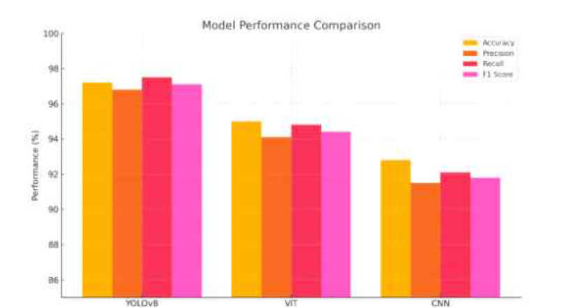
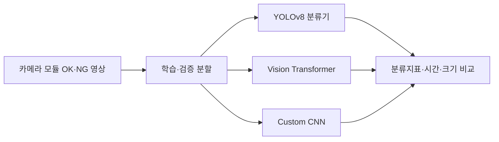

# Camera-Module-Anomaly-Project — LEVEL 3 - Practitioner

**읽기 수준 선택** · [LEVEL 1 - Beginner](%EB%A0%88%EB%B2%A81.md) · [LEVEL 2 - Explorer](%EB%A0%88%EB%B2%A82.md) · **LEVEL 3 - Practitioner** · [LEVEL 4 - Advanced](%EB%A0%88%EB%B2%A84.md) · [LEVEL 5 - Expert](%EB%A0%88%EB%B2%A85.md)

[같은 수준 프로필](https://github.com/PUVKID/PUVKID/blob/main/docs/읽기안내/레벨3.md) · [저장소 첫 화면](../../README.md)

<a id="guide-intro"></a>

## 프로젝트 소개

**원고의 설정과 결과표를 대조해 세 분류기의 차이를 검토하는 자료입니다.** 제조 원영상과 학습 가중치가 제공되는 실행 패키지는 아닙니다. 재실행보다 먼저 입력 크기·분할·학습 조건이 모델별로 어떻게 다른지 확인해야 합니다.

<a id="guide-problem"></a>

## 문제와 주요 기능

분류 지표를 비교할 때 OK/NG의 분모와 오류 방향을 먼저 확인합니다. 원고의 지표 표와 혼동행렬을 대응해 읽고 F1과 처리시간을 같은 지표처럼 합치지 않습니다. 다른 공정에서의 검증은 원고 내부 비교와 구분합니다.

<a id="guide-flow"></a>

## 입력·처리·출력

원고의 데이터 준비 부분에서 분할 비율을 확인하고 모델별 설정표를 따로 만듭니다. YOLO의 imgsz64·batch32·최대 3000epoch·patience100과 ViT/CNN 입력을 비교합니다. 같은 설정으로 실험했다고 새로 가정하지 않습니다.

<a id="guide-practice"></a>

## 실험과 사용 흐름

실행 재현에는 제조 영상·라벨·가중치·환경이 추가로 필요합니다. 공개 자료만 열람하는 것과 학습 호출을 실행하는 것은 다릅니다. 특히 원고의 파일 처리 예시는 별도 복사본에서 설정을 검토해야 하며, 이 안내 자체가 재학습 실행을 뜻하지 않습니다.

<a id="guide-results"></a>

## 관측 결과와 해석

결과표의 F1과 처리시간·크기를 모델별로 묶어 읽으세요. 5쪽 문단의 YOLOv8 F1 0.977과 표의 0.972가 다르므로 인용한 위치를 함께 적습니다. 정확한 하나의 값으로 임의 정정하거나 새로운 평균을 만들지 않습니다.

<a id="guide-architecture"></a>

## 구현과 핵심 파일

전체 원고와 같은 판의 편집 원본을 기준으로 설정을 검토합니다. YOLO 학습 호출과 ViT 모델 식별자, CNN 블록을 각각 찾아 대응시키세요. 실행 코드 저장소가 제공하는 함수·명령 체계와 동일하게 취급하지 않습니다.

<a id="guide-paper"></a>

## 실제 논문과 원고

해당 단일 최종 원고의 원문·그림을 인용 근거로 사용합니다. 표, 본문, 시간 그래프가 다른 부분은 원문의 위치를 명시하세요. 현재 자료 안내가 원고 숫자를 수정한 새 논문은 아닙니다.

<a id="guide-limits"></a>

## 조건·실패·미검증 한계

재실행 필수 자료가 없으므로 문헌의 보고값을 재측정값처럼 적지 않습니다. 모델 비교 시 각 전처리와 학습 조건을 옆에 두고, 외부 평가 부재와 시간 측정 범위의 한계를 함께 기록합니다.

## 전체 차수

차수는 아래의 실제 자료 구분을 따릅니다. 설명은 현재 선택한 수준으로 열리며, 자료 폴더와 당시 전체 비교도 함께 확인할 수 있습니다.

| 차수·단계 · 같은 수준 설명 · 자료 폴더 · 직전 비교·구성 |
| --- |
| **차수·단계**<br>최종 원고<br><br>**같은 수준 설명**<br>[LEVEL 3 - Practitioner](../versions/final-paper.md#reading-level-3)<br><br>**자료 폴더**<br>[자료](../../%EB%85%BC%EB%AC%B8)<br><br>**직전 비교·구성**<br>[전체 비교](../VERSIONS.md) |

## 첫 화면의 모든 설명과 공통 근거

아래는 기존 첫 화면의 실질 구성 전체입니다. 각 항목의 개념은 이 페이지의 풀이와 연결하고, 실제 표·코드·그림·상세 조건은 원문 공통 근거에서 확인합니다. 기존 전체 비교는 문장·주석·파일 단위의 작은 변화까지 보존하는 자료입니다.

| 첫 화면 구성 · 이 수준의 풀이 · 원문 공통 근거 |
| --- |
| **첫 화면 구성**<br>연구 요약<br><br>**이 수준의 풀이**<br>[프로젝트 소개](#guide-intro)<br><br>**원문 공통 근거**<br>[전체 설명·표·그림](../../README.md#-%EC%97%B0%EA%B5%AC-%ED%95%B5%EC%8B%AC) |
| **첫 화면 구성**<br>입력·처리·출력<br><br>**이 수준의 풀이**<br>[입력·처리·출력](#guide-flow)<br><br>**원문 공통 근거**<br>[전체 설명·표·그림](../../README.md#-%EC%9E%85%EB%A0%A5%EC%B2%98%EB%A6%AC%EC%B6%9C%EB%A0%A5) |
| **첫 화면 구성**<br>논문과 최신 자료<br><br>**이 수준의 풀이**<br>[실제 논문과 원고](#guide-paper)<br><br>**원문 공통 근거**<br>[전체 설명·표·그림](../../README.md#-%EB%85%BC%EB%AC%B8%EA%B3%BC-%EC%B5%9C%EC%8B%A0-%EC%9E%90%EB%A3%8C) |
| **첫 화면 구성**<br>전체 차수<br><br>**이 수준의 풀이**<br>[문제와 주요 기능](#guide-problem)<br><br>**원문 공통 근거**<br>[전체 설명·표·그림](../../README.md#%EF%B8%8F-%EC%B0%A8%EC%88%98%EB%B3%84-%ED%94%84%EB%A1%9C%EC%A0%9D%ED%8A%B8-%EC%95%88%EB%82%B4) |
| **첫 화면 구성**<br>연구 방법<br><br>**이 수준의 풀이**<br>[자료 분할과 세 분류기의 비교](#semantic-classification-level-3)<br><br>**원문 공통 근거**<br>[전체 설명·표·그림](../../README.md#-%ED%94%84%EB%A1%9C%EC%A0%9D%ED%8A%B8-%EC%86%8C%EA%B0%9C) |
| **첫 화면 구성**<br>저장소 구성<br><br>**이 수준의 풀이**<br>[구현과 핵심 파일](#guide-architecture)<br><br>**원문 공통 근거**<br>[전체 설명·표·그림](../../README.md#-%EC%A0%80%EC%9E%A5%EC%86%8C-%EA%B5%AC%EC%84%B1) |
| **첫 화면 구성**<br>원고의 모델 구성<br><br>**이 수준의 풀이**<br>[입력 크기와 학습 설정의 의미](#semantic-models-level-3)<br><br>**원문 공통 근거**<br>[전체 설명·표·그림](../../README.md#-%EC%9B%90%EA%B3%A0%EC%9D%98-%EB%AA%A8%EB%8D%B8-%EA%B5%AC%EC%84%B1) |
| **첫 화면 구성**<br>원고 읽기<br><br>**이 수준의 풀이**<br>[실제 논문과 원고](#guide-paper)<br><br>**원문 공통 근거**<br>[전체 설명·표·그림](../../README.md#-%EC%9B%90%EA%B3%A0-%EC%9D%BD%EA%B8%B0) |
| **첫 화면 구성**<br>자료 구성과 결과 해석<br><br>**이 수준의 풀이**<br>[F1·속도·용량을 함께 읽기](#semantic-cost-level-3)<br><br>**원문 공통 근거**<br>[전체 설명·표·그림](../../README.md#-%EC%9E%90%EB%A3%8C-%EA%B5%AC%EC%84%B1%EA%B3%BC-%EA%B2%B0%EA%B3%BC-%ED%95%B4%EC%84%9D) |
| **첫 화면 구성**<br>문제 해결<br><br>**이 수준의 풀이**<br>[원고 내부 차이와 재실행의 경계](#semantic-conflicts-level-3)<br><br>**원문 공통 근거**<br>[전체 설명·표·그림](../../README.md#-%EB%AC%B8%EC%A0%9C-%ED%95%B4%EA%B2%B0) |
| **첫 화면 구성**<br>자료 폴더와 차수별 변화<br><br>**이 수준의 풀이**<br>[문제와 주요 기능](#guide-problem)<br><br>**원문 공통 근거**<br>[전체 설명·표·그림](../../README.md#%EF%B8%8F-%EC%9E%90%EB%A3%8C-%ED%8F%B4%EB%8D%94%EC%99%80-%EC%B0%A8%EC%88%98%EB%B3%84-%EB%B3%80%ED%99%94) |
| **첫 화면 구성**<br>최신 문서와 변경 이력<br><br>**이 수준의 풀이**<br>[실제 논문과 원고](#guide-paper)<br><br>**원문 공통 근거**<br>[전체 설명·표·그림](../../README.md#-%ED%98%84%EC%9E%AC-%EC%B2%A8%EB%B6%80-%EB%AC%B8%EC%84%9C) |
| **첫 화면 구성**<br>차수별 방법과 조건<br><br>**이 수준의 풀이**<br>[입력 크기와 학습 설정의 의미](#semantic-models-level-3)<br><br>**원문 공통 근거**<br>[전체 설명·표·그림](../../README.md#-%EC%97%B0%EA%B5%AC%EA%B5%AC%ED%98%84%EC%9D%98-%EC%84%B8%EB%B6%80-%ED%9D%90%EB%A6%84) |

## 이어 읽기

같은 난이도로 다른 프로젝트를 찾으려면 [프로필의 LEVEL 3 - Practitioner](https://github.com/PUVKID/PUVKID/blob/main/docs/읽기안내/레벨3.md)를 엽니다. 이 저장소 안에서는 위 전체 차수 표의 같은 수준 설명으로 이동하세요. 단계별 선택표에서 깊이를 바꿀 수 있으며, LEVEL 5 아래에는 기존 상세 전체가 보존되어 있습니다.

<!-- semantic-explanation17:start -->

## LEVEL 3 · 조건과 절차를 상세히 읽기

<a id="semantic-classification-level-3"></a>

### LEVEL 3 · 자료 분할과 세 분류기의 비교

원고의 데이터 구성에서 약 2,000장과 80:20을 확인하고 모델별 전처리·학습 호출을 결과표에 대응시키세요. 정확도와 F1만 옮기지 말고 정밀도·재현율도 확인합니다. **원영상 전체가 없으므로 이 분할을 새로 재현한 결과로 보고하지 않습니다.**

<a id="layout18-table-3-row-1"></a>

**약 2,000장 OK/NG·80:20**

**조건·자료**

약 2,000장 OK/NG·80:20

**의미와 확인 방법**

OK는 정상, NG는 불량입니다. 사진의 약 80%는 모델이 규칙을 배우는 데, 나머지 약 20%는 그 규칙을 확인하는 데 씁니다. 별도 외부 공장 시험을 뜻하지 않습니다.

<a id="layout18-table-3-row-2"></a>

**YOLOv8·ViT·자체 CNN**

**조건·자료**

YOLOv8·ViT·자체 CNN

**의미와 확인 방법**

세 모델 모두 사진 전체를 정상/불량으로 분류합니다. 볼 위치를 찾는 탐지 결과와 구분합니다. 금속 표면 흠집·오염의 예시가 모든 결함 종류를 포괄하지는 않습니다.

<a id="layout18-table-3-row-3"></a>

**정확도·정밀도·재현율·F1**

**조건·자료**

정확도·정밀도·재현율·F1

**의미와 확인 방법**

정확도는 전체 판정, 정밀도는 불량으로 지목한 것의 적중, 재현율은 실제 불량을 찾은 정도를 봅니다. F1은 정밀도와 재현율을 함께 요약하지만 오류 종류를 없애지는 않습니다.


<a id="semantic-models-level-3"></a>

### LEVEL 3 · 입력 크기와 학습 설정의 의미

원고 학습 호출의 imgsz64·batch32·3000epoch·patience100을 기록하고 ViT/CNN의 224×224 설명과 구분하세요. ViT 사전학습 식별자와 CNN 3블록도 함께 남깁니다. 최대 한도를 실제 종료 epoch로 바꾸어 기록하지 않습니다.

<a id="layout18-table-4-row-1"></a>

**YOLOv8 입력 64·batch32**

**조건·자료**

YOLOv8 입력 64·batch32

**의미와 확인 방법**

입력 크기는 모델에 넣을 사진의 크기 설정, batch32는 한 번의 갱신에 묶는 사진 수입니다. 원고 호출의 설정이지 모든 모델의 공통 설정은 아닙니다.

<a id="layout18-table-4-row-2"></a>

**최대 3,000epoch·patience100**

**조건·자료**

최대 3,000epoch·patience100

**의미와 확인 방법**

epoch는 학습 자료를 반복해 보는 단위입니다. 3,000은 최대 반복 한도이고 patience100은 개선을 기다린 뒤 일찍 멈추는 설정입니다. 실제 3,000회를 모두 완료했다는 뜻은 아닙니다.

<a id="layout18-table-4-row-3"></a>

**ViT 224×224·google/vit-base-patch16-224-in21k**

**조건·자료**

ViT 224×224·google/vit-base-patch16-224-in21k

**의미와 확인 방법**

사전학습된 Vision Transformer를 분류에 이용합니다. YOLO 입력64와 같게 줄인 사진의 비교가 아닙니다.

<a id="layout18-table-4-row-4"></a>

**자체 CNN 224×224·합성곱/풀링 3블록·완전연결층**

**조건·자료**

자체 CNN 224×224·합성곱/풀링 3블록·완전연결층

**의미와 확인 방법**

합성곱이 무늬를 찾고 풀링이 공간 정보를 줄인 뒤 완전연결층이 분류합니다. 원고의 구성 설명이며 실행 패키지가 제공됐다는 뜻은 아닙니다.


<a id="semantic-cost-level-3"></a>

### LEVEL 3 · F1·속도·용량을 함께 읽기

인용할 때 모델·F1·ms·MB·원고 위치를 함께 기록하세요. 다운로드한 원고를 읽은 일과 모델을 실행한 일을 구분합니다. 원영상·가중치·로그가 없어 독립 재측정은 이 저장소만으로 완료할 수 없습니다.

<a id="layout18-table-5-row-1"></a>

**5쪽 표·6쪽 결론의 YOLOv8**

**조건·자료**

5쪽 표·6쪽 결론의 YOLOv8

**의미와 확인 방법**

F1 0.972·12ms·약 15MB입니다. F1은 분류 지표, ms는 처리시간, MB는 모델 크기라 서로 다른 성질을 뜻합니다.

<a id="layout18-table-5-row-2"></a>

**같은 보고의 ViT**

**조건·자료**

같은 보고의 ViT

**의미와 확인 방법**

F1 0.958·28ms·약 380MB입니다. 더 큰 모델이 이 표에서 더 높은 F1을 얻은 것은 아닙니다.

<a id="layout18-table-5-row-3"></a>

**같은 보고의 CNN**

**조건·자료**

같은 보고의 CNN

**의미와 확인 방법**

F1 0.943·22ms·약 4MB입니다. 작은 저장 크기와 분류 지표를 함께 비교하되 다른 장비에서도 이 시간이 유지된다고 보장하지 않습니다.

<a id="layout18-table-5-row-4"></a>

**자료 범위**

**조건·자료**

자료 범위

**의미와 확인 방법**

원고 PDF·같은 판 편집 원본·부품 예시·연구 도표를 제공합니다. 제조 원영상 전체·가중치·학습 로그·완성된 검사 실행 패키지는 제공하지 않습니다.


<a id="semantic-conflicts-level-3"></a>

### LEVEL 3 · 원고 내부 차이와 재실행의 경계

문제별로 확인점을 나눕니다. 수치 차이는 5쪽 문단/표와 시간 그림, 실행 요청은 코드의 삭제·재생성 경로와 원자료 부재, 독립 테스트 여부는 80:20 설명을 확인하세요. **실행 불가를 임의 설치 명령으로 채우지 않습니다.**

<a id="layout18-table-6-row-1"></a>

**F1 위치별 차이**

**조건·자료**

F1 위치별 차이

**의미와 확인 방법**

5쪽 문단은 YOLOv8 F1 0.977, 같은 쪽 표는 0.972입니다. 둘 중 하나를 새 정답으로 골라 원문을 고치지 않습니다.

<a id="layout18-table-6-row-2"></a>

**ViT 조기종료·시간**

**조건·자료**

ViT 조기종료·시간

**의미와 확인 방법**

조기종료를 적용했다는 문장과 제거했다는 구현 설명이 함께 있습니다. 시간 그래프와 표에도 차이가 있어 인용 위치를 함께 확인합니다.

<a id="layout18-table-6-row-3"></a>

**원고 코드 조각**

**조건·자료**

원고 코드 조각

**의미와 확인 방법**

데이터 폴더 삭제·재생성을 설명하는 부분이 있습니다. 원본 자료가 있는 경로에서 그대로 실행하지 말고 코드의 경로와 실제 제공 범위를 먼저 확인해야 합니다.

<a id="layout18-table-6-row-4"></a>

**후속 과제**

**조건·자료**

후속 과제

**의미와 확인 방법**

다른 공정·조명·배경, 다중 결함 분류, 생산라인 연동, 경량화·양자화는 추가 검증 대상입니다. 원고의 80:20 내부 검증으로 완료 처리하지 않습니다.


<!-- semantic-explanation17:end -->

<!-- complete-source-facts17:start -->

## 첫 화면의 세부 사실을 빠짐없이 읽기

위의 수준별 풀이에 대응하는 실제 세부 사실입니다. 입력·조건·수치·표·그림·문서 판본과 작은 변경까지 같은 페이지에서 확인하도록 기존 첫 화면의 내용을 함께 수록했습니다. 각 절은 해당 수준의 앞선 설명과 연결해 읽으며, 원래 실행 코드·전체 비교·원고는 원문 주소로 이어집니다.

<a id="facts-section-0"></a>

### LEVEL 3 · 첫 화면 기본 정보


YOLO·ViT·CNN으로 카메라 모듈의 정상·불량 분류 성능과 처리시간을 비교한 연구입니다.

분야: 컴퓨터 비전 › 딥러닝 영상 분류 › CNN·Vision Transformer 비교

`논문·연구 자료` `Document`

[원고 읽기](../../README.md#quick-start) · [저장소 구성](../../README.md#structure) · [자료·설정](../../README.md#data)

[핵심 구성](../../README.md#input-processing-output)

<details>
<summary>원고 제목</summary>

Performance Comparison of Image-Based Deep Learning Models for Anomaly Detection in Camera Modules of Smart Device

</details>


<a id="facts-section-1"></a>

### LEVEL 3 · 연구 요약


정상·불량 카메라 모듈 영상에 대한 YOLOv8·ViT·CNN 분류 비교 원고입니다.

원고의 표·본문·그래프에는 일부 수치 차이가 있습니다. 평가는 모델별 분류 실험을 대상으로 하며, 외부 테스트와 생산라인 검증은 후속 과제입니다.

- 모델별 제조 결함 이미지 분류 결과를 비교합니다.
- 표·본문·그래프 간 일부 수치 차이를 보존하고 원문 지표 정의를 함께 확인합니다. 실행 코드·외부 시험 자료는 제공하지 않습니다.

**자료별 안내:** [최종 원고](../../docs/versions/final-paper.md#reading-level-3) · [전체 기록](../../docs/VERSIONS.md)




**논문 그림** — 원고 5쪽의 모델 성능 비교 그림입니다. 그래프와 본문·표의 수치 차이는 아래에 정리했습니다.

[근거 파일 보기](../../%EB%85%BC%EB%AC%B8/%EC%B5%9C%EC%A2%85_%EB%85%BC%EB%AC%B8.pdf)


<a id="facts-section-2"></a>

### LEVEL 3 · 입력·처리·출력


**구분**

문제

**내용**

카메라 모듈의 정상·불량 분류에서 모델별 성능과 처리 비용을 비교합니다.


**구분**

입력

**내용**

정상·불량 카메라 모듈 영상


**구분**

처리

**내용**

원고에서 YOLO·ViT·CNN 분류 성능과 처리시간 비교


**구분**

출력

**내용**

F1·처리시간 비교표와 그래프


---


<a id="facts-section-3"></a>

### LEVEL 3 · 논문과 최신 자료


| 자료 · 원문 파일 |
| --- |
| **자료**<br>최종 논문 · 카메라 모듈 분류<br><br>**원문 파일**<br>[PDF 다운로드](../../%EB%85%BC%EB%AC%B8/%EC%B5%9C%EC%A2%85_%EB%85%BC%EB%AC%B8.pdf) |
| **자료**<br>최종 논문 · 카메라 모듈 분류<br><br>**원문 파일**<br>[HWP 다운로드](../../%EB%85%BC%EB%AC%B8/%EC%B5%9C%EC%A2%85_%EB%85%BC%EB%AC%B8.hwp) |

[자료별 설명](../../docs/PAPERS.md) · [코드 차수와 변경 이력](../../docs/REVISION_INDEX.md)


<a id="facts-section-4"></a>

### LEVEL 3 · 전체 차수


<a id="layout18-table-9-row-1"></a>

**[최종 원고](../../docs/versions/final-paper.md#reading-level-3)**

**차수·단계**

[최종 원고](../../docs/versions/final-paper.md#reading-level-3)

**주요 내용**

스마트 장치의 카메라 모듈 영상을 정상·불량으로 분류할 때 YOLOv8·Vision Transformer·자체 CNN의 성능과 처리 비용을 비교한 7쪽 연구 원고입니다.

**자료**

[폴더](../../%EB%85%BC%EB%AC%B8)

**직전 비교**

[전체 비교](../../docs/VERSIONS.md)


<a id="facts-section-5"></a>

### LEVEL 3 · 연구 방법


저자: **곽윤석**

원고에는 「곽윤석 개인논문」으로 표시되어 있습니다.

**항목**

이진 분류 비교

**원고에서 다루는 내용**

YOLOv8 분류기, 사전학습 ViT, 자체 CNN을 비교합니다.


**항목**

데이터 구성

**원고에서 다루는 내용**

약 2,000장의 OK/NG 영상과 80:20 학습·검증 분할을 서술합니다.


**항목**

정량 지표

**원고에서 다루는 내용**

정확도·정밀도·재현율·F1과 처리시간·모델크기를 비교합니다.


**항목**

오류 사례

**원고에서 다루는 내용**

금속 표면의 흠집과 오염 영상에 대한 예측 사례를 설명합니다.





<a id="facts-section-6"></a>

### LEVEL 3 · 저장소 구성


```text
.
├── README.md
├── CHANGELOG.md
└── 논문/
    └── 최종_논문.pdf
```

- [전체 최종 원고](../../논문/최종_논문.pdf)


<a id="facts-section-7"></a>

### LEVEL 3 · 원고의 모델 구성


YOLOv8은 입력 크기 64, 배치 32, 최대 3,000에폭을 설명합니다. ViT에는 `google/vit-base-patch16-224-in21k`를, 커스텀 CNN에는 세 개의 합성곱·풀링 블록과 완전연결층을 사용했다고 기술합니다.

ViT/CNN 입력 전처리 설명은 224×224입니다. 같은 입력 크기의 모델 비교라고 단정하지 않습니다.


<a id="facts-section-8"></a>

### LEVEL 3 · 원고 읽기


1. 위의 최종 원고 링크를 엽니다.
2. 서론의 연구 질문과 방법을 먼저 읽습니다.
3. 결과표와 함께 한계·후속 연구를 확인합니다.

카메라 모듈의 정상·불량 영상에 대한 YOLOv8·ViT·CNN 분류 성능과 처리시간을 비교한 연구 논문을 수록했습니다.


<a id="facts-section-9"></a>

### LEVEL 3 · 자료 구성과 결과 해석


원고 안의 부품 예시와 연구 도표를 보존합니다. 제조 영상 원데이터 전체, 모델 가중치와 학습 로그는 제공하지 않습니다.

데이터 폴더 삭제·재생성을 설명하는 문장이 있으므로 원고의 코드 조각을 원본 자료가 있는 경로에서 바로 실행하지 마세요.


#### LEVEL 3 · 원고가 보고한 결과와 한계

원고 5쪽 표와 6쪽 결론은 YOLOv8 F1 0.972·12ms, ViT 0.958·28ms, CNN 0.943·22ms를 보고합니다. 6쪽의 모델 크기는 각각 약 15MB·380MB·4MB입니다.

5쪽 문단의 YOLOv8 F1 0.977은 같은 쪽 표의 0.972와 다릅니다. ViT 조기종료도 적용했다는 문장과 제거했다는 구현 설명이 함께 있으며, 시간 그래프와 표의 수치도 일부 다릅니다.

결과를 인용할 때 해당 위치와 불일치를 함께 확인해야 합니다.

자료는 단일 공정 장비의 OK/NG 영상으로 한정됩니다. 다중 결함 분류, 다른 조명·배경, 실제 생산라인 연동과 경량화·양자화는 후속 연구 방향이며 완료된 검증으로 보지 않습니다.


<a id="facts-section-10"></a>

### LEVEL 3 · 문제 해결


<a id="layout18-table-11-row-1"></a>

**표와 본문 수치가 다릅니다.**

**상황**

표와 본문 수치가 다릅니다.

**확인할 내용**

F1·시간 값의 불일치는 원고에 존재합니다. 이 저장소에서 임의로 원고 수치를 고치지 않습니다.

<a id="layout18-table-11-row-2"></a>

**분류 코드를 실행하고 싶습니다.**

**상황**

분류 코드를 실행하고 싶습니다.

**확인할 내용**

원고의 구현 설명과 실행 가능한 코드 패키지는 구분합니다. 설치·실행 명령을 보장하지 않습니다.

<a id="layout18-table-11-row-3"></a>

**독립 테스트 결과인가요?**

**상황**

독립 테스트 결과인가요?

**확인할 내용**

원고는 80:20 학습·검증 분할을 설명합니다. 별도 외부 테스트나 생산라인 검증 완료로 확대하지 않습니다.


<a id="facts-section-11"></a>

### LEVEL 3 · 자료 폴더와 차수별 변화


| 자료 · 자료 폴더 · 설명 · 비교·구성 |
| --- |
| **자료**<br>최종 원고<br><br>**자료 폴더**<br>[자료 폴더](../../%EB%85%BC%EB%AC%B8)<br><br>**설명**<br>[내용](../../docs/versions/final-paper.md#reading-level-3)<br><br>**비교·구성**<br>[비교·구성](../../docs/VERSIONS.md) |


<a id="facts-section-12"></a>

### LEVEL 3 · 최신 문서와 변경 이력


현재 제공하는 원문과 직전 공개본의 비교입니다. 이전 원고·발표와 코드는 전체 차수 표에서 확인할 수 있습니다.

| 문서 · 자료 폴더 · 상세 · 직전 공개본 전체 비교 |
| --- |
| **문서**<br>최종 논문 · 카메라 모듈 분류<br><br>**자료 폴더**<br>[폴더](../../%EB%85%BC%EB%AC%B8)<br><br>**상세**<br>[설명](../../docs/latest/camera-module-binary-classification.md)<br><br>**직전 공개본 전체 비교**<br>[전체 비교](../../docs/changes/2026-11-02-%EC%B5%9C%EC%8B%A0%EB%AC%B8%EC%84%9C-%EC%A0%84%EC%B2%B4%EB%B9%84%EA%B5%90.md) |

[최신 문서 구성 변경](../../docs/changes/2026-11-02-%EC%B5%9C%EC%8B%A0%EB%AC%B8%EC%84%9C.md)


<a id="facts-section-13"></a>

### LEVEL 3 · 차수별 방법과 조건


차수별 입력, 처리 방법, 실행 조건과 결과를 정리했습니다.


<details>
<summary>최종 원고 · 카메라 모듈 정상·불량 분류</summary>

#### LEVEL 3 · 최종 원고 · 카메라 모듈 정상·불량 분류

스마트 장치의 카메라 모듈 영상을 정상·불량으로 분류할 때 YOLOv8·Vision Transformer·자체 CNN의 성능과 처리 비용을 비교한 7쪽 연구 원고입니다.

<a id="layout18-table-14-row-1"></a>

**정상·불량 데이터 구성**

**구성**

정상·불량 데이터 구성

**처리 내용**

OK/NG 영상을 학습 80%·검증 20%로 분할하는 실험을 설명합니다.

<a id="layout18-table-14-row-2"></a>

**YOLOv8 분류**

**구성**

YOLOv8 분류

**처리 내용**

원고의 학습 호출은 imgsz64·batch32·최대 3000epoch·patience100을 사용합니다.

<a id="layout18-table-14-row-3"></a>

**ViT와 CNN 비교**

**구성**

ViT와 CNN 비교

**처리 내용**

사전학습 ViT와 합성곱·풀링·완전연결층 CNN을 분류 지표로 비교합니다.

<a id="layout18-table-14-row-4"></a>

**성능과 비용 해석**

**구성**

성능과 비용 해석

**처리 내용**

정확도·정밀도·재현율·F1과 처리시간·모델 크기를 함께 제시합니다.


**입력·실행 조건**

분할

**내용**

학습 80%·검증 20%


**입력·실행 조건**

YOLOv8 입력

**내용**

64·batch32


**입력·실행 조건**

ViT/CNN 전처리

**내용**

224×224 설명


**입력·실행 조건**

최대 학습

**내용**

3000epoch로 서술


**입력·실행 조건**

자료

**내용**

원고 PDF와 같은 판의 HWP


원고 5쪽 표와 6쪽 결론의 보고값입니다.

**모델**

YOLOv8

**F1**

0.972

**처리시간**

12ms

**모델 크기**

약 15MB


**모델**

ViT

**F1**

0.958

**처리시간**

28ms

**모델 크기**

약 380MB


**모델**

CNN

**F1**

0.943

**처리시간**

22ms

**모델 크기**

약 4MB


5쪽 문단의 YOLOv8 F1 0.977은 표의 0.972와 다릅니다. ViT 조기종료를 적용했다는 설명과 제거했다는 구현 설명도 함께 있어 해당 위치를 확인해야 합니다. 이 안내에서는 원고의 숫자나 문장을 임의로 고치지 않았습니다.

**제약**

지표 불일치

**확인할 내용**

본문·표·시간 그래프에 차이가 있습니다. 인용 위치를 함께 적습니다.


**제약**

모델 비교 조건

**확인할 내용**

YOLO64와 ViT/CNN224 전처리를 같은 입력 크기로 설명하지 않습니다.


**제약**

현장 일반화

**확인할 내용**

다른 공정·조명·배경의 외부 테스트와 생산라인 연동은 후속 평가입니다.


**제약**

재실행

**확인할 내용**

공개 자료는 원고이며 학습 가중치·제조 원영상·실행 패키지는 별도로 필요합니다.


[파일 구성·핵심 정의·사용 순서](../../docs/versions/final-paper.md#reading-level-3) · [이 단계 전체 비교](../../docs/VERSIONS.md)

[차수별 안내 변경](../../docs/changes/2026-11-03-%EC%B0%A8%EC%88%98%EB%B3%84%ED%94%84%EB%A1%9C%EC%A0%9D%ED%8A%B8%EC%95%88%EB%82%B4.md)

</details>


<!-- complete-source-facts17:end -->
