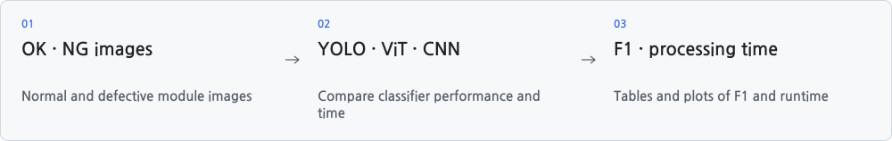
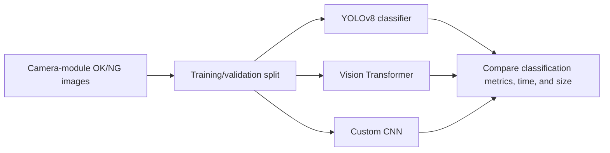

<a name="카메라-모듈-정상불량-영상-분류"></a>
<a name="카메라-모듈-정상불량-영상-분류-비교"></a>
<a name="performance-comparison-of-image-based-deep-learning-models-for-anomaly-detection-in-camera-modules-of-smart-device"></a>

<a id="-camera-module-anomaly-project"></a>

<!-- readme-header32:start -->
<a name="camera-module-anomaly-project"></a>
<p align="center"></p>
<h1 align="center" id="project-title">Camera Module Anomaly Project</h1>
<p align="center">Comparing camera-module image classifiers</p>
<p align="center">
  <a href="../README.md"></a>
  <a href="README.md"></a>
</p>
<p align="center">
  <a href="../docs/%EC%9D%BD%EA%B8%B0%EC%95%88%EB%82%B4/%EB%A0%88%EB%B2%A81.md"></a>
  <a href="../docs/%EC%9D%BD%EA%B8%B0%EC%95%88%EB%82%B4/%EB%A0%88%EB%B2%A82.md"></a>
  <a href="../docs/%EC%9D%BD%EA%B8%B0%EC%95%88%EB%82%B4/%EB%A0%88%EB%B2%A83.md"></a>
  <a href="../docs/%EC%9D%BD%EA%B8%B0%EC%95%88%EB%82%B4/%EB%A0%88%EB%B2%A84.md"></a>
  <a href="../docs/%EC%9D%BD%EA%B8%B0%EC%95%88%EB%82%B4/%EB%A0%88%EB%B2%A85.md"></a>
</p>
<p align="center"><small>LEVEL links open the Korean source at the same reading level.</small></p>
<picture>
  <source media="(max-width: 600px) and (prefers-color-scheme: dark)" srcset="../assets/readme/flow-en-dark-mobile.svg" />
  <source media="(max-width: 600px)" srcset="../assets/readme/flow-en-light-mobile.svg" />
  <source media="(prefers-color-scheme: dark)" srcset="../assets/readme/flow-en-dark.svg" />
  <source media="(prefers-color-scheme: light)" srcset="../assets/readme/flow-en-light.svg" />
  
</picture>
<!-- readme-header32:end -->


This study compares normal/defective camera-module image classification and processing time using YOLO, ViT, and CNN.

<!-- reading-levels17:start -->
| Reading level | What the guide covers |
| --- | --- |
| [LEVEL 1 - Beginner (Korean source)](../docs/%EC%9D%BD%EA%B8%B0%EC%95%88%EB%82%B4/%EB%A0%88%EB%B2%A81.md) | Unfamiliar terms and concrete examples from input to result |
| [LEVEL 2 - Explorer (Korean source)](../docs/%EC%9D%BD%EA%B8%B0%EC%95%88%EB%82%B4/%EB%A0%88%EB%B2%A82.md) | The relationships between key concepts and processing steps |
| [LEVEL 3 - Practitioner (Korean source)](../docs/%EC%9D%BD%EA%B8%B0%EC%95%88%EB%82%B4/%EB%A0%88%EB%B2%A83.md) | Experiment and usage procedures, and how to interpret results |
| [LEVEL 4 - Advanced (Korean source)](../docs/%EC%9D%BD%EA%B8%B0%EC%95%88%EB%82%B4/%EB%A0%88%EB%B2%A84.md) | Code structure, settings, design choices, and constraints |
| [LEVEL 5 - Expert (Korean source)](../docs/%EC%9D%BD%EA%B8%B0%EC%95%88%EB%82%B4/%EB%A0%88%EB%B2%A85.md) | Papers, protocols, denominators, leakage, and unverified scope |
<!-- reading-levels17:end -->

Field: Computer vision › Deep-learning image classification › CNN and Vision Transformer comparison

`Paper and research materials` `Document`

[Read the research description](#quick-start) · [Repository structure](#structure) · [Materials and settings](#data)

[Core components](#input-processing-output)

<details>
<summary>Paper title</summary>

Performance Comparison of Image-Based Deep Learning Models for Anomaly Detection in Camera Modules of Smart Device

</details>

<a id="-연구-핵심"></a>

## Research overview

The manuscript compares YOLOv8, ViT, and CNN classification of normal and defective camera-module images.

Some values differ between its tables, text, and graphs. The evaluation concerns the individual model-classification experiments; external testing and production-line validation remain future work.

- It compares manufacturing-defect image classification results for each model.
- Differences among tables, text, and graphs are retained, with the original metric definitions. Executable code and external test materials are not provided.

**Materials:** [Final manuscript description (Korean source)](../docs/versions/final-paper.md) · [Complete history (Korean source)](../docs/VERSIONS.md)

<a name="preview"></a>


[Writing and publication status (Korean source)](../docs/%EB%85%BC%EB%AC%B8%EC%83%81%ED%83%9C.md)

<a name="input-processing-output"></a>

<a id="-입력처리출력"></a>

## Input, processing, and output

| Component | Description |
| --- | --- |
| Problem | Compare model performance and processing cost for normal/defective camera-module classification. |
| Input | Normal and defective camera-module images |
| Processing | The manuscript compares YOLO, ViT, and CNN classification performance and processing time. |
| Output | F1 and processing-time comparison tables and graphs |

---

<a id="-논문과-최신-자료"></a>

## Paper and current materials

| Material | Original source |
| --- | --- |
| Final manuscript · Camera-module classification | [Writing and publication status (Korean source)](../docs/%EB%85%BC%EB%AC%B8%EC%83%81%ED%83%9C.md) |

[Material descriptions (Korean source)](../docs/PAPERS.md) · [Code revisions and change history (Korean source)](../docs/REVISION_INDEX.md)

<a id="️-차수별-프로젝트-안내"></a>

## All revisions

| Revision or stage | Main content | Materials and comparison with the previous version |
| --- | --- | --- |
| <a id="layout18-table-4-row-1"></a> [Final manuscript (Korean source)](../docs/versions/final-paper.md) | A 7-page research manuscript comparing the performance and processing cost of YOLOv8, Vision Transformer, and a custom CNN when classifying smart-device camera-module images as normal or defective. | [Folder](../%EB%85%BC%EB%AC%B8)<br>[Full comparison (Korean source)](../docs/VERSIONS.md) |


<a id="-프로젝트-소개"></a>

## Research method

Author: **곽윤석** (Kwak Yunsuk)

The manuscript is marked “곽윤석 개인논문” (Kwak Yunsuk's individual paper).

| Component | What the manuscript covers |
| --- | --- |
| Binary classification comparison | A YOLOv8 classifier, pretrained ViT, and custom CNN are compared. |
| Data | Approximately 2,000 OK/NG images and an 80:20 training/validation split are described. |
| Quantitative metrics | Accuracy, precision, recall, F1, processing time, and model size are compared. |
| Error cases | Prediction examples include scratches and contamination on metal surfaces. |



<a name="structure"></a>
<a id="-저장소-구성"></a>

## Repository structure

```text
.
├── README.md
├── CHANGELOG.md
└── 논문/
    └── README.md
```

- [Writing and publication status (Korean source)](../docs/%EB%85%BC%EB%AC%B8%EC%83%81%ED%83%9C.md)

<a id="-원고의-모델-구성"></a>

## Model configurations in the manuscript

The YOLOv8 description uses input size 64, batch 32, and up to 3,000 epochs. ViT uses `google/vit-base-patch16-224-in21k`; the custom CNN is described as three convolution/pooling blocks followed by fully connected layers.

The preprocessing description for ViT/CNN is 224×224. These should not be presented as a comparison using the same input size.

<a name="quick-start"></a>
<a id="-원고-읽기"></a>

## Reading the research description

1. Check the writing/publication status and public research description above.
2. Read the research question and method in the public description.
3. Review the reported values alongside limitations and future work. The unpublished manuscript body and editable originals are not public.

The public description covers the study comparing YOLOv8, ViT, and CNN classification performance and processing time for normal/defective camera-module images. The unpublished manuscript body and editable originals are retained locally and are not published.

<a name="data"></a>
<a id="-자료-구성과-결과-해석"></a>

## Materials and interpretation

The component examples and research figures in the manuscript are preserved. The complete manufacturing-image dataset, model weights, and training logs are not provided.

The manuscript includes instructions that delete and recreate data folders. Do not run its code snippets directly in a path containing original materials.

<a name="원고가-보고한-결과와-한계"></a>

<a id="-원고가-보고한-결과와-한계"></a>

### Reported results and limitations

The table on page 5 and the conclusion on page 6 report YOLOv8 F1 0.972·12ms, ViT 0.958·28ms, and CNN 0.943·22ms. Page 6 gives approximate model sizes of 15MB, 380MB, and 4MB, respectively.

The YOLOv8 F1 of 0.977 in a page 5 paragraph differs from 0.972 in the table on the same page. A statement that ViT early stopping was used coexists with an implementation description saying it was removed. Some values in the timing graph also differ from the table.

When citing results, check the location and the discrepancies together.

The data are limited to OK/NG images from a single process machine. Multiclass defect classification, other lighting/backgrounds, production-line integration, model compression, and quantization are future research directions, not completed validation.

<a id="-문제-해결"></a>

## Questions and checks

| Situation | What to check |
| --- | --- |
| <a id="layout18-table-6-row-1"></a> Table and text values differ. | The F1 and timing discrepancies are present in the manuscript.<br>This repository does not alter the manuscript's values arbitrarily. |
| <a id="layout18-table-6-row-2"></a> You want to run the classifier. | A manuscript's implementation description and an executable code package are different materials.<br>Installation or execution commands are not guaranteed. |
| <a id="layout18-table-6-row-3"></a> Are these independent test results? | The manuscript describes an 80:20 training/validation split.<br>It does not establish separate external testing or production-line validation. |


<a id="️-자료-폴더와-차수별-변화"></a>

## Material folders and revision changes

| Material | Folder | Description and comparison or structure |
| --- | --- | --- |
| Final manuscript | [Material folder](../%EB%85%BC%EB%AC%B8) | [Content (Korean source)](../docs/versions/final-paper.md)<br>[Comparison and structure (Korean source)](../docs/VERSIONS.md) |

<a id="-현재-첨부-문서"></a>

## Current documents and change history

This compares the current public guide with the previous public version. The all-revisions table covers changes between manuscript stages; the unpublished manuscript body and editable originals remain local.

| Document | Material folder | Details and full comparison with the previous public version |
| --- | --- | --- |
| Final manuscript · Camera-module classification | [Folder](../%EB%85%BC%EB%AC%B8) | [Description (Korean source)](../docs/latest/camera-module-binary-classification.md)<br>[Full comparison (Korean source)](../docs/changes/2026-11-02-%EC%B5%9C%EC%8B%A0%EB%AC%B8%EC%84%9C-%EC%A0%84%EC%B2%B4%EB%B9%84%EA%B5%90.md) |

[Changes to the current document structure (Korean source)](../docs/changes/2026-11-02-%EC%B5%9C%EC%8B%A0%EB%AC%B8%EC%84%9C.md)

<a name="research-details"></a>

<a id="-연구구현의-세부-흐름"></a>

## Methods and conditions by revision

Inputs, processing methods, execution conditions, and results are organized by revision.

<a id="-최종-원고--카메라-모듈-정상불량-분류"></a>

<details>
<summary>Final manuscript · Normal/defective camera-module classification</summary>

<a id="최종-원고--카메라-모듈-정상불량-분류"></a>

A 7-page research manuscript comparing the performance and processing cost of YOLOv8, Vision Transformer, and a custom CNN when classifying smart-device camera-module images as normal or defective.

| Component | Processing |
| --- | --- |
| <a id="layout18-table-9-row-1"></a> Normal/defective data | The experiment splits OK/NG images into 80% training and 20% validation. |
| <a id="layout18-table-9-row-2"></a> YOLOv8 classification | The manuscript's training call uses imgsz64·batch32·up to 3000epoch·patience100. |
| <a id="layout18-table-9-row-3"></a> ViT and CNN comparison | A pretrained ViT and a CNN with convolution, pooling, and fully connected layers are compared using classification metrics. |
| <a id="layout18-table-9-row-4"></a> Performance and cost | Accuracy, precision, recall, F1, processing time, and model size are presented together. |


| Input or condition | Description |
| --- | --- |
| Split | 80% training·20% validation |
| YOLOv8 input | 64·batch32 |
| ViT/CNN preprocessing | Described as 224×224 |
| Maximum training | Described as 3000epoch |
| Material | Research description and writing/publication status of the final manuscript. PDF/HWP bodies are retained locally and are not public. |

These are the values reported in the page 5 table and page 6 conclusion.

| Model | F1 | Processing time | Model size |
| --- | --- | --- | --- |
| YOLOv8 | 0.972 | 12ms | Approximately 15MB |
| ViT | 0.958 | 28ms | Approximately 380MB |
| CNN | 0.943 | 22ms | Approximately 4MB |

The page 5 paragraph reports YOLOv8 F1 0.977, whereas the table gives 0.972. The descriptions of using and removing ViT early stopping also coexist, so the cited location needs to be checked. This guide does not arbitrarily correct the manuscript's numbers or statements.

| Constraint | What to check |
| --- | --- |
| Metric discrepancies | Text, tables, and timing graphs differ.<br>State the cited location as well. |
| Model comparison conditions | Do not describe YOLO64 and ViT/CNN224 preprocessing as the same input size. |
| Generalization to production | External testing on other processes, lighting, and backgrounds, and production-line integration require further evaluation. |
| Rerunning | Public materials are research descriptions; the manuscript body and editable originals are private.<br>Training weights, original manufacturing images, and an executable package are also needed separately. |

[Files, key definitions, and reading order (Korean source)](../docs/versions/final-paper.md) · [Full comparison for this stage (Korean source)](../docs/VERSIONS.md)

[Changes to the revision guides (Korean source)](../docs/changes/2026-11-03-%EC%B0%A8%EC%88%98%EB%B3%84%ED%94%84%EB%A1%9C%EC%A0%9D%ED%8A%B8%EC%95%88%EB%82%B4.md)

</details>
